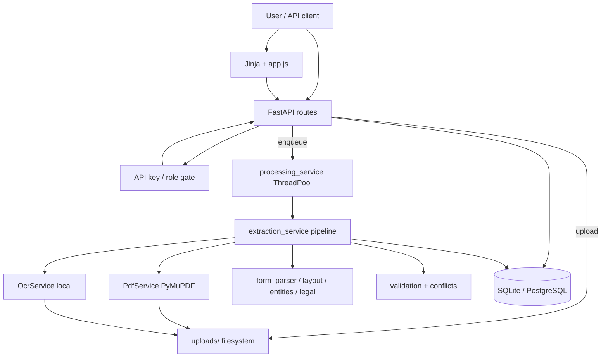
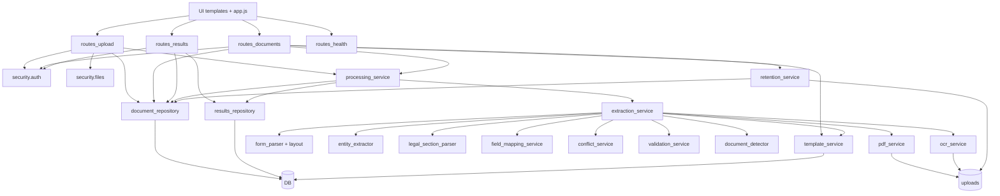

# CHARGE_SHEET_OCR — Application Analysis Report

**Document type:** Evidence-based application audit (read-only)  
**Application root:** `CHARGE_SHEET_OCR`  
**Analysis date:** 2026-10-10  
**Code version observed:** `app.__version__` = `1.0.0`  
**Scope:** Implementation verification from source; no application code was modified.

---

## Executive Summary

**What it is.** A local-only FastAPI web service that accepts police **charge-sheet PDFs**, extracts structured case data with a multi-stage OCR/NLP-free (rules/layout) pipeline, stores results in SQLite (or optional PostgreSQL), and exposes a small HTML UI plus REST API for review, correction, and verification.

**Who uses it.** Operators who upload and correct extractions; reviewers who mark results verified (requires auth); admins who delete documents; optional API consumers with role-scoped keys. Default deployment is loopback-only with auth disabled (upload/correct/reprocess allowed; verification blocked).

**Problem solved.** Manual transcription of multi-page digital and scanned charge sheets into structured fields (FIR identifiers, accused, witnesses, legal sections, narratives) while keeping confidential documents on-host and never inventing missing values.

**Major capabilities.** PDF upload; async processing; native PDF text + local OCR; layout-aware form parsing; synonym-based field mapping; entity/legal extraction; source conflict detection; validation; human corrections with audit trail; reprocess with safe correction re-apply; retention purge; API-key RBAC.

**Major workflows.** Upload → queue → extract → review/correct → (optional) verify; history/reprocess; admin delete / retention purge.

**Key integrations.** PyMuPDF (in-process); optional local PaddleOCR or Tesseract; SQLite/PostgreSQL; filesystem upload store. **No cloud AI/OCR.** `LLM_*` settings exist but no LLM client is implemented.

**Maturity.** Core upload→extract→review→verify path is **Implemented** and covered by API tests. OCR for scans depends on optional local engines (without them, scanned PDFs correctly **fail**). Several API features (delete, templates list, list filters) lack UI. Template `mapping_json` / verified-template reuse is largely **unused / incomplete**. Dependencies `httpx`, `alembic`, `aiosqlite`, `pdfplumber` appear unused by runtime app code.

**Major gaps / risks.** Verification unavailable when `ENABLE_AUTH=false`; OCR optional and slow; accuracy not proven on held-out unseen layouts; empty `app/workers` directory; template mapping reuse not driving extraction; delete/templates not in UI; offline network guard is best-effort only.

---

## 1. Application Overview

### Overall purpose

Convert **charge sheet / final report PDFs** (Indian police / court-oriented documents) into a **versioned structured schema** (`ChargeSheetData`, schema `1.2.0`) with per-field provenance (page, source text, confidence, validation/review status), suitable for human review before any downstream use.

### Main problem solved

| Without the app | With the app |
| --- | --- |
| Manual reading and typing of FIR numbers, accused, witnesses, sections | Automated extraction into editable fields |
| Scanned PDFs hard to search/structure | Local OCR per page when text layer missing |
| Risk of sending confidential data to cloud AI | Offline-first; network guard; no LLM/OCR cloud calls |
| Silent empty extractions | Honest `complete` / `partial` / `failed` statuses |

### Likely target users

| User type | Evidence |
| --- | --- |
| Police / legal operations staff digitizing charge sheets | Domain schema (`fir_number`, accused, CrPC-oriented legal roles); `docs/SECURITY.md` states confidential police data |
| Technical operators deploying on a secure workstation | Loopback bind, API keys, offline mode |
| QA / developers | `tests/`, `scripts/evaluate*.py`, ground-truth fixtures |

### Major workflows and capabilities

1. **Upload & process** a PDF (UI or API).  
2. **Poll status** until completed/failed/verified.  
3. **Inspect** structured results and open source PDF.  
4. **Correct** fields; view correction history.  
5. **Verify** (authenticated reviewer + notes).  
6. **Reprocess**; history list.  
7. **Delete** / **retention purge** (API / startup; delete not in UI).  
8. **Health / offline verification** scripts.

---

## 2. Architecture / Technology Overview

### Stack (verified)

| Layer | Technology | Location |
| --- | --- | --- |
| Web framework | FastAPI + Uvicorn | `app/main.py`, `run.ps1` |
| UI | Jinja2 templates + vanilla JS + CSS | `app/templates/*`, `app/static/js/app.js`, `app/static/css/styles.css` |
| Config | pydantic-settings / `.env` | `app/config.py`, `.env.example` |
| ORM / DB | SQLAlchemy 2.x; SQLite default; PostgreSQL optional | `app/db.py`, `app/models.py` |
| PDF text/tables | PyMuPDF (`fitz`) | `app/services/pdf_service.py` |
| OCR | Optional PaddleOCR / Tesseract | `app/services/ocr_service.py` |
| Async jobs | In-process `ThreadPoolExecutor` (max 2) | `app/services/processing_service.py` |
| Auth | API key + roles | `app/security/auth.py` |
| Offline | Socket connect patch | `app/security/network_guard.py` |

### High-level architecture



### Startup behavior (`create_app` in `app/main.py`)

1. Logging setup; network guard install.  
2. `init_db()` — `create_all` + additive column migration.  
3. `purge_expired()` — retention delete.  
4. `recover_interrupted()` — QUEUED/PROCESSING left by crash → FAILED.  
5. Mount routers, static files, HTML pages `/`, `/results/{id}`, `/history`.  
6. Security headers + CSP middleware.

---

## 3. Module Inventory

| Module / area | Path | Purpose |
| --- | --- | --- |
| App entry | `app/main.py` | FastAPI app, HTML pages, middleware |
| Config | `app/config.py` | Env-driven settings |
| DB | `app/db.py` | Engine, sessions, schema init |
| Models | `app/models.py` | `documents`, `results`, `corrections`, `templates` |
| API — health | `app/api/routes_health.py` | `GET /health` |
| API — upload | `app/api/routes_upload.py` | `POST .../upload` |
| API — documents | `app/api/routes_documents.py` | list, get, source, reprocess, delete, templates |
| API — results | `app/api/routes_results.py` | results, corrections, patch fields, verify |
| Processing | `app/services/processing_service.py` | Queue, progress, orchestrate extraction |
| Extraction | `app/services/extraction_service.py` | Full pipeline orchestration |
| PDF | `app/services/pdf_service.py` | Text layer, tables, page render |
| OCR | `app/services/ocr_service.py` | Paddle / Tesseract |
| Layout | `app/services/layout_service.py` | Boxes → rows / header pairs |
| Form parse | `app/services/form_parser.py` | Candidates, narrative split |
| Field mapping | `app/services/field_mapping_service.py`, `field_synonyms.py` | Label → canonical |
| Entities | `app/services/entity_extractor.py` | Accused, witnesses, officers |
| Legal | `app/services/legal_section_parser.py` | Acts/sections + roles |
| Conflicts | `app/services/conflict_service.py` | Unresolved source disagreements |
| Validation | `app/services/validation_service.py` | Field validation statuses |
| Detector / templates | `document_detector.py`, `template_service.py` | Type + fingerprint store |
| Retention | `app/services/retention_service.py` | Purge / delete content |
| Repositories | `app/repositories/*` | Persistence |
| Schemas | `app/schemas/*` | API + charge sheet models |
| Security | `app/security/*` | Auth, files, network |
| UI pages | `templates/index|results|history.html` | Upload, results, history |
| Evaluation (not runtime) | `evaluation/`, `scripts/` | Accuracy / variants / offline check |
| Tests | `tests/` | Unit + API contracts |
| Workers package | `app/workers/` | **Empty directory — no worker modules found** |

### Module interaction (extraction)

```text
Upload route
   ↓
DocumentRepository + filesystem
   ↓
processing_service.enqueue_processing
   ↓
ExtractionService.process
   ↓
PdfService → OcrService → layout → form_parser
   ↓
field mapping → entities → legal → narrative
   ↓
DocumentDetector + TemplateService.remember
   ↓
conflicts → ValidationService
   ↓
ResultsRepository.save + Document status COMPLETED/FAILED
```

---

## 4. Feature Inventory

| Feature | What it is | Who | Why | How (summary) | Status |
| --- | --- | --- | --- | --- | --- |
| PDF upload | Accept charge sheet PDF | Operator | Start digitization | Validate magic/size → store → queue | **Implemented** |
| Async processing | Background extraction | System | OCR can take minutes | ThreadPoolExecutor | **Implemented** |
| Progress polling | Step + elapsed time | Operator | Visibility during OCR | In-memory `_progress` on GET document | **Implemented** |
| Native PDF extraction | Text/tables from text layer | System | Digital PDFs | PyMuPDF | **Implemented** |
| Local OCR | Scanned pages | System | Scans lack text | Paddle preferred, Tesseract fallback | **Implemented** (engine optional) |
| Structured mapping | Case, people, legal, narrative | System | Structured output | Synonyms + layout parsers | **Implemented** |
| Conflict detection | Flag disagreeing source values | Reviewer | Avoid silent wrong pick | Never auto-resolve | **Implemented** |
| Validation statuses | valid/invalid/missing/etc. | Reviewer | Quality signals | `ValidationService` | **Implemented** |
| Results UI | Editable field tables | Operator/Reviewer | Human check | `initResultsPage` | **Implemented** |
| Field corrections | Save changed values | Operator | Fix extraction | PATCH `/fields` | **Implemented** |
| Correction history | Audit trail | Reviewer | Accountability | GET `/corrections` | **Implemented** |
| Verification | Mark human-checked | Reviewer | Sign-off | POST `/verify` + notes | **Implemented** (auth required) |
| Reprocess | Re-run pipeline | Operator | After OCR fix / retry | POST `/reprocess` | **Implemented** |
| Open source PDF | Side-by-side check | Operator | Compare to original | GET `/source` | **Implemented** |
| Document history | List recent uploads | Operator | Navigate past jobs | GET `/documents` UI | **Implemented** (no filters) |
| Delete document | Purge PDF + results | Admin | Privacy / cleanup | DELETE API | **Implemented** (API only; **no UI**) |
| Retention purge | Auto-delete old docs | System | Data minimization | Startup `purge_expired` | **Implemented** |
| Template fingerprints | Remember layout hashes | System | “Seen before” flag | `TemplateService.remember` | **Partially Implemented** |
| Template mapping reuse | Apply stored mappings | System | Faster/better parse | `mapping_json` column | **Unused / Placeholder** |
| List templates API | Inventory fingerprints | Viewer | Ops insight | GET `/templates` | **Implemented** (API; **no UI**) |
| Role-based API keys | viewer→admin | Deployer | Least privilege | `auth.py` | **Implemented** |
| Offline network guard | Block outbound | Deployer | Confidentiality | `network_guard.py` | **Implemented** (best-effort) |
| LLM assist | External/local LLM | N/A | Config placeholders | Settings + health flag only | **Placeholder** |
| API docs | Swagger/ReDoc | Developer | Explore API | FastAPI docs | **Implemented** (CDN in browser) |
| Health check | OCR/auth/offline status | Ops | Readiness | `GET /health` | **Implemented** |

---

## 5. Important Button & Action Audit

| Module | User Action | What User Expects | What Actually Happens | Technical Flow | Outcome | Status |
| --- | --- | --- | --- | --- | --- | --- |
| Global | Nav **Upload** | Go to upload page | `GET /` → `index.html` | Server template | Upload UI | **Implemented** |
| Global | Nav **History** | See past documents | `GET /history` → JS loads list | `GET /api/v1/documents?limit=100` | Table of docs | **Implemented** |
| Global | Nav **API Docs** | Open Swagger | `/docs` if enabled | FastAPI OpenAPI | Docs UI | **Implemented** |
| Global | **Use key** | Persist API key | `sessionStorage` only | No server call | Key sent on later API calls | **Implemented** |
| Upload | Dropzone click / drag | Select PDF | Local file selection | File input / DnD | Enables Upload button | **Implemented** |
| Upload | **Upload & process** | Upload and process | XHR POST multipart | `routes_upload` → FS + DB + `enqueue_processing` → redirect `/results/{id}` | 202 → results page polling | **Implemented** |
| Results | Auto poll while processing | Wait for finish | `load()` every 2.5s | GET document (+ progress) | Shows step / elapsed | **Implemented** |
| Results | **Open PDF** | View original | Fetch blob, `window.open` | GET `.../source` | PDF in new tab | **Implemented** |
| Results | Edit field inputs | Change extracted value | Local DOM only until Save | No API until Save | Dirty values in inputs | **Implemented** |
| Results | **Save changed fields** | Persist corrections | PATCH only changed fields | `routes_results.patch_fields` → corrections + results JSON | Originals preserved; if verified → reopened | **Implemented** |
| Results | **Mark verified** | Sign off results | Requires notes; POST verify | `require_role("reviewer")` | Status VERIFIED or 403 if unauthenticated | **Implemented** |
| Results | **Reprocess** | Re-run extraction | POST reprocess | Queue + reset verified | New extraction | **Implemented** |
| Results | Expand **Correction history** | See audit trail | Lazy GET corrections | `correction_history` | Table of past edits | **Implemented** |
| Results | Expand person cards / source details | Inspect provenance | Client-side `<details>` | No API | UI only | **Implemented** |
| Results (failed) | **Reprocess** | Retry failed job | Same as reprocess | Same | Retry | **Implemented** |
| History | Click filename | Open results | Link `/results/{id}` | Navigation | Results page | **Implemented** |
| History | **Reprocess** row button | Re-queue | POST reprocess | Same as above | Refresh list | **Implemented** |
| — | Delete document | Remove confidential data | **No UI control** | DELETE API exists | API-only | **Unused** (from UI) |
| — | List templates | See fingerprints | **No UI** | GET `/templates` | API-only | **Unused** (from UI) |
| — | Filter history by status/verified | Narrow list | **No UI filters**; API supports query params | `DocumentRepository.list` | API-only filters | **Partially Implemented** |
| — | Un-verify (`verified: false`) | Clear verification | UI only sends `verified: true` | API accepts `VerifyRequest.verified` | API-capable; UI does not expose | **Partially Implemented** |
| — | Pagination beyond 100 | Browse older | History hardcodes `limit=100` | API supports offset/limit | Truncation risk | **Partially Implemented** |

### Action status legend (used above)

- **Implemented** — Frontend handler + backend path verified in code/tests.  
- **Partially Implemented** — Backend or UI incomplete for full product expectation.  
- **Unused** — Backend exists; no UI caller found.  
- **Placeholder** — Config/UI stub without runtime feature code.

---

## 6. Major Application Workflows

### Workflow A — Upload and extract (happy path)

#### Business terms

User submits a charge sheet PDF and expects structured case data for review.

#### Technical terms

```text
User Action: Upload & process
    ↓
Frontend: app.js XHR POST /api/v1/documents/upload (+ optional X-API-Key)
    ↓
Backend: validate_pdf_upload → write uploads/<uuid>_name.pdf
    ↓
DocumentRepository.create + status QUEUED
    ↓
enqueue_processing → ThreadPoolExecutor
    ↓
process_document: status PROCESSING → ExtractionService.process(path)
    ↓
PdfService.extract → optional OcrService per page → form/layout/entities/legal/validate
    ↓
ResultsRepository.save (JSON payload) + Document COMPLETED
    ↓
UI: redirect /results/{id}; poll GET document until terminal; GET results → render
```

**Evidence:** `app/api/routes_upload.py`, `processing_service.py`, `extraction_service.py`, `tests/test_api.py::test_correct_verify_reprocess_workflow`.

---

### Workflow B — Human correction and verification

#### Business terms

Operator fixes wrong fields; reviewer confirms against the PDF that data is acceptable.

#### Technical terms

```text
Edit inputs → Save changed fields
    ↓
PATCH /api/v1/documents/{id}/fields  (operator+)
    ↓
Validate canonical names against field_map()
    ↓
CorrectionRecord rows + apply_corrections on ResultRecord.payload_json
    ↓
(optional) POST /verify with notes (reviewer+)
    ↓
Document status VERIFIED; correction row canonical_name=_verification
```

**Auth note:** With `ENABLE_AUTH=false`, principal is unauthenticated `operator` — verify returns **403** (`tests/test_api.py::test_auth_disabled_serves_loopback_only_and_forbids_verify`).

---

### Workflow C — Failed OCR / reprocess

#### Business terms

Scanned PDF fails without OCR engine; user installs OCR or fixes scan and retries.

#### Technical terms

Extraction yields `extraction_status=failed` → document FAILED → GET results returns **422** diagnostics only (no invented fields) → UI failure card → Reprocess → QUEUED again.

**Evidence:** `test_failed_extraction_is_not_presented_as_results` (sample_04 scanned without OCR in default tests).

---

### Workflow D — Retention / delete

#### Business terms

Remove personal data after retention period or on admin request.

#### Technical terms

Startup `purge_expired` or `DELETE /api/v1/documents/{id}` → unlink PDF → purge results/corrections → tombstone `status=deleted`, filename `[purged]`.

---

## 7. Backend / API / Service Mapping

### REST API map

| Method | Route | Auth role | Backend | Storage | Used by UI? |
| --- | --- | --- | --- | --- | --- |
| GET | `/health` | none | `routes_health` | — | Yes (status line) |
| POST | `/api/v1/documents/upload` | operator | `routes_upload` | FS + DB | Yes |
| GET | `/api/v1/documents` | viewer | `routes_documents.list` | DB | Yes (history) |
| GET | `/api/v1/documents/{id}` | viewer | get + progress | DB + memory | Yes |
| GET | `/api/v1/documents/{id}/source` | viewer | FileResponse | FS | Yes |
| POST | `/api/v1/documents/{id}/reprocess` | operator | enqueue | DB | Yes |
| DELETE | `/api/v1/documents/{id}` | admin | retention delete | FS + DB | **No** |
| GET | `/api/v1/templates` | viewer | TemplateService | DB | **No** |
| GET | `/api/v1/documents/{id}/results` | viewer | ResultsRepository | DB | Yes |
| GET | `/api/v1/documents/{id}/corrections` | viewer | DocumentRepository | DB | Yes |
| PATCH | `/api/v1/documents/{id}/fields` | operator | corrections apply | DB | Yes |
| POST | `/api/v1/documents/{id}/verify` | reviewer | status update | DB | Yes |

### HTML pages

| Path | Template | JS init |
| --- | --- | --- |
| `/` | `index.html` | `initUploadPage` |
| `/results/{uuid}` | `results.html` | `initResultsPage` |
| `/history` | `history.html` | `initHistoryPage` |

### Databases / storage

| Store | Contents | Path / config |
| --- | --- | --- |
| SQLite (default) | documents, results JSON, corrections, templates | `data/charge_sheets.db` via `DATABASE_URL` |
| PostgreSQL (optional) | Same models | `psycopg2-binary` in requirements |
| Filesystem | Original PDFs | `UPLOAD_DIR` / `uploads/` |
| In-memory | Inflight set + progress steps | `processing_service` |

### External / third-party

| Component | Role | Called at runtime? |
| --- | --- | --- |
| PyMuPDF | PDF parse/render | Yes |
| PaddleOCR / Tesseract | OCR | Yes if installed & enabled |
| jsDelivr CDN | Swagger assets | Browser only when `/docs` open |
| Cloud LLM / cloud OCR | — | **No** — not implemented |

### Background processing

| Mechanism | Evidence |
| --- | --- |
| `ThreadPoolExecutor(max_workers=2)` | `processing_service.py` |
| Not Celery/RQ/Redis | No queue broker in code |
| `app/workers/` | Empty — **no modules** |

### Components configured but unused / weakly used

| Item | Evidence | Classification |
| --- | --- | --- |
| `LLM_*` settings | Config + health flag; `docs/SECURITY.md` says no LLM code | **Placeholder** |
| `TemplateRecord.mapping_json` | Column + upsert param; extraction never passes mapping | **Unused** |
| Template `verified=True` path | Upsert supports it; no caller sets verified templates | **Unused** |
| Fuzzy template match | `match(..., min_similarity=1.0)` default exact only | **Unused** (fuzzy path) |
| `httpx` package | In `requirements.txt`; no `import httpx` in repo | **Unused** |
| `alembic` package | In requirements; no Alembic migration tree; `create_all` + ALTER used | **Unused** |
| `aiosqlite` | Sync SQLAlchemy engine | **Unused** (runtime) |
| `pdfplumber` | In requirements; PDF path uses PyMuPDF | **Unused** (app runtime) |
| List `status`/`verified` filters | API yes; UI no | **Unused** (UI) |
| DELETE endpoint | Tests cover; UI absent | **Unused** (UI) |
| GET `/templates` | Implemented; UI absent | **Unused** (UI) |

---

## 8. User Roles

Defined in `app/security/auth.py` (`ROLE_ORDER`):

| Role | Access | Can do | Restrictions |
| --- | --- | --- | --- |
| **viewer** | Read documents, results, source, corrections, templates | View / poll | Cannot upload, correct, verify, delete |
| **operator** | Includes viewer | Upload, reprocess, PATCH fields | Cannot verify or delete |
| **reviewer** | Includes operator | POST verify | Cannot delete |
| **admin** | Includes reviewer | DELETE documents | Full API |
| **local-unauthenticated** (auth off, loopback only) | Treated as operator | Upload/correct/reprocess | **Cannot verify**; non-loopback → 403 |

Keys: `API_KEY` → user `default` / admin; `API_KEYS=name:secret:role;...`. Placeholder/short keys refused.

UI has no login roles UI — only optional API key box when auth enabled.

---

## 9. Functional Use Cases

### UC-1 Digitize a digital charge sheet

```text
Use Case: Extract structured data from a text-layer charge sheet PDF
↓
Actor: Operator
↓
Trigger: Upload PDF on /
↓
User Actions: Select PDF → Upload & process → wait on results page
↓
Application Processing: Native PDF text → form/entity/legal mapping → COMPLETED
↓
Systems: FastAPI, PdfService, ExtractionService, SQLite, uploads/
↓
Final Outcome: Editable structured fields with provenance
```

### UC-2 Digitize a scanned charge sheet

```text
Use Case: OCR + extract from image-based PDF
↓
Actor: Operator
↓
Trigger: Upload scanned PDF
↓
User Actions: Same as UC-1
↓
Application Processing: Render pages → local OCR → layout rebuild → extract
↓
Systems: OcrService (Paddle/Tesseract), PdfService.render_page_image
↓
Final Outcome: COMPLETED/PARTIAL if OCR works; FAILED with OCR_REQUIRED if not
```

### UC-3 Human quality review

```text
Use Case: Correct and verify extraction before trusting data
↓
Actor: Operator then Reviewer
↓
Trigger: Results page after COMPLETED
↓
User Actions: Edit fields → Save → enter notes → Mark verified
↓
Application Processing: Corrections stored separately; verify requires notes + reviewer role
↓
Systems: routes_results, CorrectionRecord, ResultRecord
↓
Final Outcome: Document VERIFIED with attributable reviewer
```

### UC-4 Retry after failure or engine install

```text
Use Case: Re-run extraction after OCR install or fix
↓
Actor: Operator
↓
Trigger: Reprocess on results or history
↓
User Actions: Click Reprocess
↓
Application Processing: Reset verified; queue; reapply corrections only if source value unchanged
↓
Systems: processing_service, DocumentRepository.reapply_corrections
↓
Final Outcome: Fresh extraction; prior verification cleared
```

### UC-5 Data minimization

```text
Use Case: Remove stored personal data
↓
Actor: Admin (API) or system retention
↓
Trigger: DELETE or retention_days elapsed
↓
User Actions: API delete (no UI) / automatic on startup
↓
Application Processing: Unlink PDF; delete results/corrections; tombstone row
↓
Systems: retention_service
↓
Final Outcome: Content gone; audit tombstone remains
```

---

## 10. Module Dependencies



**Shared services:** Auth dependency on nearly all `/api/v1/*`; ExtractionService composes most parsing services; DocumentRepository shared across upload/results/processing/retention.

**Cross-module workflow:** Upload → Processing → Extraction → Results UI → Corrections → Verify.

---

## 11. Feature-to-Implementation Mapping

| Feature | UI Location | API/Route | Backend Service | Data/Storage | External Integration | Status |
| --- | --- | --- | --- | --- | --- | --- |
| Upload PDF | `/` dropzone + button | POST `/api/v1/documents/upload` | `validate_pdf_upload`, `enqueue_processing` | `uploads/`, `documents` | — | **Implemented** |
| Processing progress | Results poll note | GET `/api/v1/documents/{id}` | `get_progress` | In-memory | — | **Implemented** |
| View results | `/results/{id}` | GET `.../results` | `ResultsRepository`, `ExtractionService` | `results.payload_json` | — | **Implemented** |
| OCR scanned pages | (transparent) | (via processing) | `OcrService` | Memory PNGs | Local Paddle/Tesseract | **Implemented** / engine **Unverified** on host without install |
| Edit & save corrections | Results Review card | PATCH `.../fields` | `DocumentRepository.add_corrections` | `corrections`, results JSON | — | **Implemented** |
| Verify | Mark verified | POST `.../verify` | status update | `documents.verified*` | — | **Implemented** |
| Reprocess | Results + History | POST `.../reprocess` | `enqueue_processing` | DB | — | **Implemented** |
| Open source PDF | Source link | GET `.../source` | `FileResponse` | `uploads/` | — | **Implemented** |
| History list | `/history` | GET `/api/v1/documents` | `DocumentRepository.list` | `documents` | — | **Implemented** |
| Delete | — | DELETE `.../{id}` | `delete_document_content` | FS + DB | — | **Implemented** (API); UI **Unused** |
| Templates list | — | GET `/api/v1/templates` | `TemplateService.list_profiles` | `templates` | — | **Implemented** (API); UI **Unused** |
| Template fingerprint store | Results “previously seen” via payload | (internal) | `_remember_template` | `templates` | — | **Partially Implemented** |
| Template mapping reuse | — | — | `mapping_json` unused by extract | `templates.mapping_json` | — | **Unused** |
| Retention | — | Startup | `purge_expired` | FS + DB | — | **Implemented** |
| Health / OCR status | Header `#service-status` | GET `/health` | `OcrService.status` | — | — | **Implemented** |
| Auth | API key box | All `/api/v1` | `get_principal` / `require_role` | Env keys | — | **Implemented** |
| Offline guard | — | Startup | `install_network_guard` | — | Blocks outbound sockets | **Implemented** |
| LLM | — | Health `llm_enabled` | Settings only | — | — | **Placeholder** |
| Evaluation / accuracy | Scripts/docs | N/A | `evaluation/*` | fixtures | — | **Implemented** (dev tooling, not user app) |

---

## 12. Implementation Status

| Area | Status | Evidence |
| --- | --- | --- |
| Core extract + review API | **Implemented** | `tests/test_api.py` end-to-end |
| UI upload/results/history | **Implemented** | `app.js` wired to real endpoints |
| RBAC | **Implemented** | Role tests; auth module |
| OCR path | **Implemented** code; runtime depends on install | `ocr_service.py`; scanned test expects FAILED without OCR |
| Delete in product UI | **Unused** | No delete button in templates/JS |
| Templates UI / mapping reuse | **Partially Implemented** / **Unused** | Fingerprints stored; mappings not applied |
| LLM | **Placeholder** | Config + SECURITY.md |
| Workers package | **Unused** | Empty `app/workers` |
| Some requirements packages | **Unused** | `httpx`, `alembic`, `aiosqlite`, `pdfplumber` |

Overall product maturity for the stated local digitization purpose: **high for core path**, **moderate** for ops/admin UX and template learning, **dependent** on local OCR for scans.

---

## 13. Gaps / Issues / Unused Functionality

| Finding | Status | Evidence |
| --- | --- | --- |
| No UI for document delete | **Unused** (UI) | DELETE in `routes_documents.py`; absent from `app.js` |
| No UI for templates | **Unused** (UI) | GET `/templates`; no page |
| History ignores status/verified filters & pagination | **Partially Implemented** | API query params; UI `?limit=100` only |
| Verify only “mark verified” in UI | **Partially Implemented** | API `verified: bool`; UI hardcodes `true` |
| Auth off ⇒ cannot verify | By design / product gap | `auth.py`, tests |
| Template `mapping_json` never written/read in extraction | **Unused** | `_remember_template` calls `remember(fingerprint, label=label)` only |
| Template verified / fuzzy reuse never activated | **Unused** | Default `min_similarity=1.0`; no `verified=True` callers |
| `LLM_*` settings | **Placeholder** | No client code; SECURITY.md |
| Empty `app/workers` | Dead structure | Directory with no Python modules |
| Unused deps: httpx, alembic, aiosqlite, pdfplumber | **Unused** | requirements vs imports |
| Accuracy on unseen templates | **Unverified** / risk | `docs/ACCURACY_REPORT.md`, README caveats |
| Offline guard incompleteness | Documented risk | `network_guard.py` docstring; SECURITY.md |
| Interrupt recovery marks FAILED (not auto-retry) | Implemented behavior | `recover_interrupted` |
| Processing timeout → partial OCR skip | Implemented | `extraction_service._run_ocr` budget |
| Debug files `tmp_debug_*.txt` in project root | Ops hygiene risk | Present on disk; SECURITY.md warns |

No significant TODO/FIXME stubs found in application Python/JS beyond intentional `pass` in exception sinks.

---

## 14. Evidence & Code References

### Frontend

```text
app/templates/base.html       — nav, API key box, CSP-friendly script include
app/templates/index.html      — upload dropzone
app/templates/results.html    — results shell + document_id
app/templates/history.html    — history table
app/static/js/app.js          — all interactive handlers (upload, poll, patch, verify, reprocess, history)
app/static/css/styles.css     — presentation only
```

### Backend controllers / routes

```text
app/main.py                   — app factory, pages, middleware
app/api/routes_upload.py      — POST upload
app/api/routes_documents.py   — list/get/source/reprocess/delete/templates
app/api/routes_results.py     — results/corrections/fields/verify
app/api/routes_health.py      — health
```

### Services / pipeline

```text
app/services/processing_service.py
app/services/extraction_service.py
app/services/pdf_service.py
app/services/ocr_service.py
app/services/layout_service.py
app/services/form_parser.py
app/services/field_mapping_service.py
app/services/entity_extractor.py
app/services/legal_section_parser.py
app/services/conflict_service.py
app/services/validation_service.py
app/services/template_service.py
app/services/document_detector.py
app/services/retention_service.py
```

### Data

```text
app/models.py                 — DocumentRecord, ResultRecord, CorrectionRecord, TemplateRecord
app/repositories/*.py
app/db.py                     — create_all + additive ALTER
data/charge_sheets.db         — default SQLite file (runtime)
uploads/                      — stored PDFs
```

### Security / config

```text
app/security/auth.py
app/security/files.py
app/security/network_guard.py
app/config.py
.env.example
docs/SECURITY.md
```

### Tests confirming behavior

```text
tests/test_api.py             — upload, roles, correct/verify/reprocess, failed OCR, delete, auth-off
tests/test_security.py        — purge tombstone behavior
tests/test_extraction.py, test_entities.py, test_legal_sections.py, test_layout.py, ...
```

---

## Overall Application Summary

### What the Application Does

It is a **local charge-sheet PDF extraction and human-review service**: upload PDFs, extract structured FIR/case/person/legal/narrative fields using local PDF+OCR and rules-based parsers, store results privately, and support corrections and reviewer verification via UI and REST API.

### Primary Users

Operators (upload/correct/reprocess), reviewers (verify with notes), admins (delete via API), and developers/QA using evaluation scripts. Default local mode serves a single loopback operator without verification.

### Major Capabilities

- Digital and scanned multi-page PDF ingestion  
- Staged extraction with honest complete/partial/failed reporting  
- Provenance-rich structured schema  
- Conflict detection without auto-resolution  
- Corrections audit trail and safe re-apply on reprocess  
- Role-based API keys and offline-oriented deployment controls  

### Major Business Use Cases

1. Digitize charge sheets into structured records  
2. Human QA of automated extraction  
3. Attributable verification for downstream trust  
4. Retry after OCR/engine issues  
5. Retention / purge of confidential content  

### Key Technical Components

FastAPI + Jinja/JS UI; SQLAlchemy SQLite/Postgres; PyMuPDF; optional PaddleOCR/Tesseract; in-process thread-pool processing; filesystem uploads; API-key RBAC; socket network guard.

### Implementation Status

**Core digitization and review loop: Implemented** (backed by automated API tests).  
**Admin/ops UI and template-learning features: Partial / unused.**  
**LLM: Placeholder.**  
**Scan OCR success: Depends on local engine installation (Unverified per host).**

### Major Gaps / Risks

- Verification unavailable without auth configuration  
- Delete and templates not exposed in UI  
- Template mapping reuse not actually driving extraction  
- Accuracy claims limited to development/known templates  
- Optional OCR and long CPU runtimes  
- Offline guard not a substitute for host firewall  
- Unused third-party packages inflate supply chain surface  

### Overall Assessment

CHARGE_SHEET_OCR is a **focused, privacy-oriented charge-sheet extraction product** with a real, test-backed end-to-end workflow from upload through structured review. It is **not** a generic document AI platform and does **not** call cloud models. Stakeholders can treat **upload → extract → correct → verify → reprocess** as production-intent capabilities (subject to OCR availability and accuracy validation on their own documents), while treating **template mapping reuse, LLM settings, delete/templates UI, and some listed dependencies** as incomplete or unused relative to the shipping UI.
