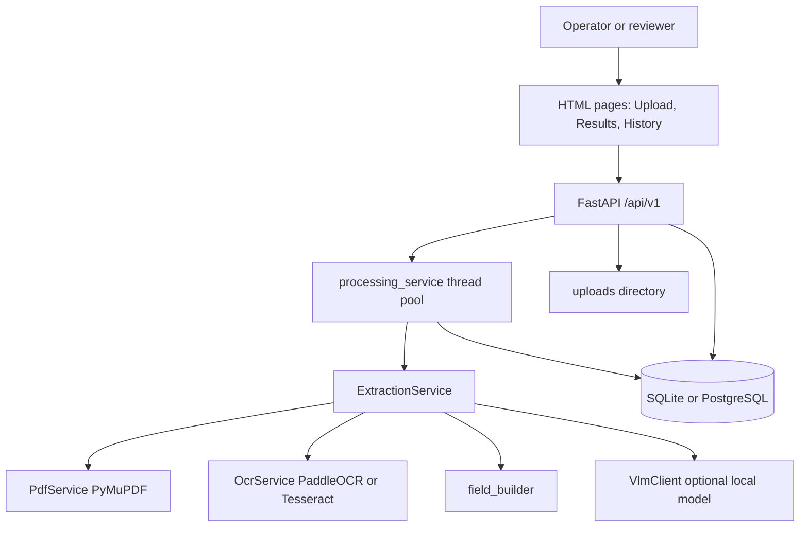
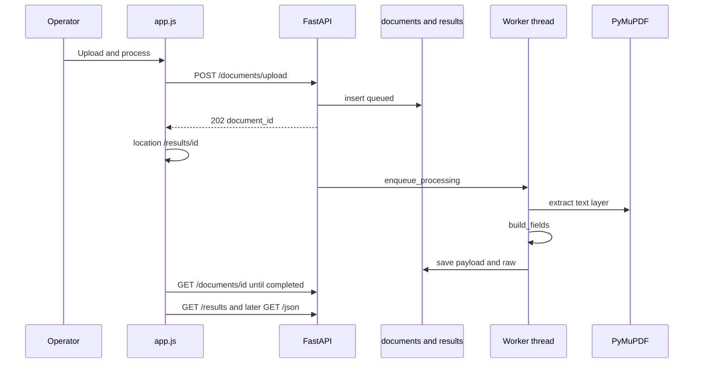
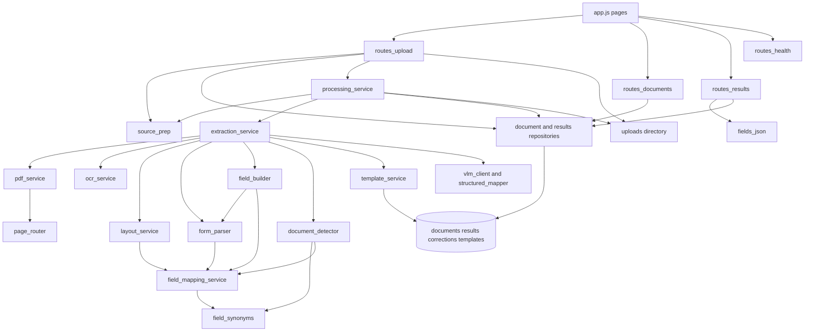

# CHARGE_SHEET_OCR — Application Analysis

**Audit type:** static source inspection of the working tree  
**Application root:** `CHARGE_SHEET_OCR`  
**Application version (code):** `1.0.0` (`app/__init__.py`)  
**Result schema written by processing:** `2.0.0` (`app/schemas/charge_sheet.py`, constant `SCHEMA_VERSION`)  
**Scope:** what the running application can do, traced from routes, services, models, and the HTML/JS UI. Documentation was used only as a cross-check.  
**Runtime:** this audit did not start the server, upload a document, or execute OCR/VLM. A status of **Implemented** means the source contains a complete, connected code path. Whether an optional local engine succeeds on a given machine was **not executed here**.

### Status legend

| Status | Meaning |
| --- | --- |
| **Implemented** | The workflow is wired from the caller through to storage or a response. Repository tests assert many of these paths. |
| **Partially Implemented** | Some of the path exists, but the outcome the surrounding code suggests is not fully produced. |
| **Unverified** | Code suggests the behavior, but this audit did not execute it, or success depends on an optional engine that was not run. |
| **Unused** | The code or endpoint exists, and no active caller in the application UI or processing path was found. |
| **Broken** | A connected path contains an identifiable failure. None of the primary user flows were classified Broken from source alone. |
| **Placeholder** | Stub, mock, or future hook with no real effect. |

---

## Executive Summary

**What it is.** Charge Sheet Extraction Service is a local FastAPI application with a small HTML UI. A user uploads a police charge sheet or final report (PDF, PNG, JPEG, TIFF, or DOCX). The service reads the file on this host, detects the labels and values printed in that document, and shows them for human review. It can also emit a JSON object whose keys are those printed labels.

**Who uses it.** There is no user directory. Access is an API key with a role, or, when authentication is off, anyone on the same machine (`127.0.0.1`), treated as an unauthenticated operator. The document model (FIR number, police station, accused, witnesses, acts and sections) is built for people who digitize or review Indian police charge sheets: scanning operators, reviewers, and administrators who delete records.

**Problem it solves.** Charge sheets arrive as digital PDFs, scans, photos, or Word files, with different layouts. The application turns one uploaded file into a reviewable list of fields as printed, plus a downloadable JSON file, without sending the document to a cloud AI API by default.

**Major capabilities.**

- Upload and store the original file unchanged.
- Read a PDF text layer, or OCR a scan locally (PaddleOCR, then Tesseract if Paddle is missing or fails).
- Build a per-document field list (schema 2.0.0): label, value, page, review state.
- Show Fields and JSON on the results page; copy or download that JSON.
- Save human corrections without overwriting the extracted value; re-apply them after reprocess only when the extracted text is unchanged.
- Mark a document verified, but only with an authenticated reviewer key and a note.
- List recent documents and reprocess them.
- Optionally, when `VLM_ENABLED=true`, call a local vision-language model to transcribe hard pages and map text into a fixed charge-sheet schema. That structured result is stored and served by the API. The current results page does not display it.

**Major workflows.** Upload → background processing → results review → correct → (reviewer) verify. A second path, off by default, adds local VLM transcription and canonical structured JSON.

**Key integrations.** SQLite (PostgreSQL is supported by the driver and `DATABASE_URL`, unused unless configured). Files under `uploads/`. Local PaddleOCR / Tesseract. Optional Docling, PP-Structure, PaddleOCR-VL, and an OpenAI-compatible local VLM (`httpx`). No cloud LLM is called by the extraction code. `LLM_ENABLED` is reported on `/health` and is not used to call a model.

**Implementation maturity.** The operator path — upload, extract as-printed fields, review, correct, download JSON, reprocess, history — is implemented in source and covered by API/UI tests in `tests/`. Optional layout engines (Docling, PP-Structure, PaddleOCR-VL) run, but their extracted text or tables are not fed back into the field list. The canonical structured schema is a complete backend feature with no results-page tab. Delete, raw lines, page images, and template listing are API-only.

**Major gaps and risks.**

- Default authentication is off. Verification cannot succeed in that mode. The **Mark verified** button is still shown and returns 403.
- History loads at most 100 documents and does not page, filter, or refresh until the user reloads.
- There is no durable job queue. A restart marks in-progress documents failed.
- Retention runs only when the process starts, not on a schedule.
- HTML pages and `/health` are not authenticated. Document APIs are.
- Several installed packages (`pdfplumber`, `alembic`, `aiosqlite`) and the `schema_version` setting are never used by application code.

---

## 1. Application Overview

### Purpose

The service accepts one charge-sheet file, keeps the original bytes, derives a PDF when the upload is an image or DOCX, extracts text, and stores a structured-enough result for a person to check.

Two result shapes exist in code:

| Shape | Schema | When it is produced | What the user sees |
| --- | --- | --- | --- |
| As-printed fields | `2.0.0` (`ChargeSheetData.fields`) | Every successful extraction | Fields tab and JSON tab |
| Canonical charge-sheet | `1.0` (`ChargeSheetData.structured`) | Only when `VLM_ENABLED=true` | Not shown in the UI. Available at `GET /api/v1/documents/{id}/structured` |

Evidence: `app/schemas/charge_sheet.py` (`SCHEMA_VERSION = "2.0.0"`), `app/schemas/structured.py` (`STRUCTURED_SCHEMA_VERSION = "1.0"`), `app/services/extraction_service.py` (`process`, `_structured_stage`), `app/static/js/app.js` (tabs `fields` and `json` only).

### Problem

Police charge sheets and final reports are not one fixed form. Labels, tables, and scans differ. The field builder does not rename labels to a canonical dictionary. It uses a synonym list only to decide that a phrase *is* a label. The printed wording is what is stored and shown.

Evidence: `app/services/field_builder.py` (module docstring), `app/services/field_synonyms.py`, `app/services/fields_json.py`.

### Likely users

Derived from the data model and roles, not from a user table:

| Actor in the software | How they appear | What the domain model implies |
| --- | --- | --- |
| Local operator | `ENABLE_AUTH=false`, loopback client, role `operator`, name `local-unauthenticated` | Person at the workstation who uploads and corrects |
| Named operator | API key role `operator` | Same, attributable |
| Reviewer | API key role `reviewer` or `admin` | Person allowed to mark results verified |
| Viewer | API key role `viewer` | Read-only API client |
| Admin | `API_KEY` user `default`, or role `admin` | Can delete a document |

There is no login screen, session user, or organization model. The API key box on every page (`app/templates/base.html`, `bindApiKeyForm` in `app/static/js/app.js`) is the only identity control in the UI.

### Major workflows

1. Upload a file and wait for extraction.
2. Read fields as printed and the label-keyed JSON.
3. Correct values and inspect correction history.
4. A reviewer marks the document verified (authenticated reviewer only).
5. Reprocess from results or history.
6. Open the stored original.
7. Optional API-only: raw lines, canonical structured JSON, page PNG, template fingerprints, permanent delete.
8. On process start: purge files older than `RETENTION_DAYS` and fail jobs interrupted by the previous process.

---

## 2. Architecture / Technology Overview

| Layer | Technology | Evidence |
| --- | --- | --- |
| HTTP API and HTML | FastAPI, Jinja2 templates, static JS/CSS | `app/main.py` |
| Server | Uvicorn, default bind `127.0.0.1:8000` | `app/config.py`, `run.ps1` |
| Validation / settings | Pydantic v2, pydantic-settings, `.env` | `app/config.py`, `.env.example` |
| Database | SQLAlchemy 2. `create_all` plus additive `ALTER TABLE` for new nullable columns. Default SQLite file `data/charge_sheets.db`. `psycopg2` is listed so a PostgreSQL URL can be used. | `app/db.py`, `app/models.py`, `requirements.txt` |
| File storage | `uploads/` with a server-generated name. Images and DOCX also get a derived `<stored>.pages.pdf`. | `app/security/files.py`, `app/services/source_prep.py` |
| PDF | PyMuPDF (`fitz`) for text, tables, render-to-PNG | `app/services/pdf_service.py` |
| Images / DOCX | Pillow; `python-docx` | `app/services/source_prep.py` |
| OCR | PaddleOCR if importable, else Tesseract (`pytesseract` + binary). Both are optional installs. | `app/services/ocr_service.py`, `requirements.txt` |
| Optional layout | PP-Structure, Docling, PaddleOCR-VL | `structure_service.py`, `docling_service.py`, `vl_service.py` |
| Optional VLM | `httpx` to an OpenAI-compatible local server | `app/services/vlm_client.py` |
| UI | Three Jinja pages, one script `app/static/js/app.js` | `app/templates/`, `app/main.py` |
| Background work | In-process `ThreadPoolExecutor(max_workers=2)`. Not a queue, not Celery, not a scheduler. | `app/services/processing_service.py` |
| Tests | pytest | `tests/`, `pytest.ini` |



### Pages

| URL | Template | Script entry | Auth on the HTML itself |
| --- | --- | --- | --- |
| `GET /` | `app/templates/index.html` | `initUploadPage` | None. The page is public. Data calls are protected. |
| `GET /results/{uuid}` | `app/templates/results.html` | `initResultsPage` | None. Non-UUID returns HTTP 404 text. |
| `GET /history` | `app/templates/history.html` | `initHistoryPage` | None. |
| `GET /docs`, `GET /redoc` | FastAPI built-in | — | Served when `API_DOCS_ENABLED=true` (default). The browser loads Swagger assets from `cdn.jsdelivr.net`. |
| `GET /health` | JSON | — | No API key and no loopback check. |
| `GET /static/...` | StaticFiles | — | No API key. |

Evidence: `app/main.py` route functions `index`, `results_page`, `history_page`; `app/api/routes_health.py` has no `require_role`.

### Security controls that do run

- Security headers and a Content-Security-Policy that allows only same-origin scripts (`app/main.py`).
- Upload type is taken from file bytes, not the client content-type (`app/security/files.py`, `detect_kind` in `source_prep.py`).
- Stored names are UUID-prefixed; paths must stay inside `uploads/` (`resolve_under`).
- Offline mode patches `socket.connect` and refuses non-local, non-allowlisted hosts (`app/security/network_guard.py`). The module itself says this does not see native code that bypasses Python sockets.
- Logs redact phone-shaped, Aadhaar-shaped, and email-shaped strings unless `LOG_PII=true` (`app/logging_utils.py`).
- API keys are compared with `secrets.compare_digest`. Placeholder and short keys are refused (`app/security/auth.py`).

---

## 3. Module Inventory

### 3.1 Web shell — `app/main.py`, `app/templates/`, `app/static/`

**Purpose.** Serve the three pages, static assets, CORS, security headers, and mount the API routers. On startup: create tables, purge expired documents, mark interrupted jobs failed, install the network guard.

**Features.** Navigation (Upload, History, API Docs), API-key box, cache-busting query on `app.js` and `styles.css`.

**Depends on.** Settings, database init, retention, processing recovery, the four API routers.

### 3.2 Upload API — `app/api/routes_upload.py`

**Purpose.** Accept one file, store it, create a document row, queue processing.

**Route.** `POST /api/v1/documents/upload` → HTTP 202. Role: `operator`.

### 3.3 Document API — `app/api/routes_documents.py`

**Purpose.** List and fetch document metadata, stream the original, render a page PNG, reprocess, delete, list template fingerprints.

| Method | Path | Role |
| --- | --- | --- |
| GET | `/api/v1/documents` | viewer |
| GET | `/api/v1/documents/{id}` | viewer |
| GET | `/api/v1/documents/{id}/source` | viewer |
| GET | `/api/v1/documents/{id}/pages/{page}/image` | viewer |
| POST | `/api/v1/documents/{id}/reprocess` | operator |
| DELETE | `/api/v1/documents/{id}` | admin |
| GET | `/api/v1/templates` | viewer |

### 3.4 Results API — `app/api/routes_results.py`

**Purpose.** Return extraction JSON, as-printed field JSON, canonical structured JSON, raw lines, correction history; apply corrections; verify.

| Method | Path | Role |
| --- | --- | --- |
| GET | `/api/v1/documents/{id}/results` | viewer |
| GET | `/api/v1/documents/{id}/json` | viewer |
| GET | `/api/v1/documents/{id}/structured` | viewer |
| GET | `/api/v1/documents/{id}/raw` | viewer |
| GET | `/api/v1/documents/{id}/corrections` | viewer |
| PATCH | `/api/v1/documents/{id}/fields` | operator |
| POST | `/api/v1/documents/{id}/verify` | reviewer |

### 3.5 Health — `app/api/routes_health.py`

**Purpose.** Report process health and which optional engines import successfully. Does not authenticate.

### 3.6 Processing — `app/services/processing_service.py`

**Purpose.** Run extraction off the request thread (when `ASYNC_PROCESSING=true`, the default), track an in-memory step string, persist results, re-apply prior corrections, set document status.

**Depends on.** `ExtractionService`, `source_prep.prepare_source`, `DocumentRepository`, `ResultsRepository`.

### 3.7 Extraction — `app/services/extraction_service.py`

**Purpose.** Orchestrate page routing, OCR/VLM acquisition, field detection, optional structured mapping, document-type fingerprint, unresolved-page report.

**Depends on.** Pdf, OCR, structure, Docling, VL, VLM, field builder, structured mapper, template service, document detector.

### 3.8 PDF and page routing

| Module | Purpose |
| --- | --- |
| `app/services/pdf_service.py` | Open PDF, reject encrypted and over-long files, extract lines and tables, render PNG |
| `app/services/page_router.py` | Decide `native`, `ocr`, or `both` from character counts, image coverage, label hits, spacing |
| `app/services/source_prep.py` | Detect upload kind; convert images and DOCX to a working PDF |

### 3.9 Field understanding

| Module | Purpose |
| --- | --- |
| `app/services/field_builder.py` | Turn reading-order items into `PdfField` records |
| `app/services/form_parser.py` | Colon labels, headings, table-row bodies, narrative start |
| `app/services/layout_service.py` | Rebuild rows and header pairs from OCR boxes |
| `app/services/field_mapping_service.py` | Score a label against the synonym dictionary |
| `app/services/field_synonyms.py` | Charge-sheet label synonyms and document-type keywords |
| `app/services/text_normalize.py` | Restore missing spaces in glued PDF text; join narrative lines |
| `app/services/fields_json.py` | Map the field list to the JSON tab object |
| `app/services/value_parsers.py` | Dates, mobile shape, Aadhaar shape — used by structured validation and evaluation, not by the Fields tab |

### 3.10 Optional engines

| Module | Purpose | Effect on the field list |
| --- | --- | --- |
| `ocr_service.py` | Read scan images | Text is used. **Implemented** when an engine is installed. |
| `structure_service.py` | PP-Structure tables on OCR pages | Tables are saved on `ExtractionService._structure_tables` and never read again. **Partially Implemented.** |
| `docling_service.py` | Docling markdown on selected digital pages | Sets `docling_used` and a note. Markdown is not substituted for page text. **Partially Implemented.** |
| `vl_service.py` | PaddleOCR-VL on up to 5 hard pages | Appends an unresolved note with character count. Comment in code: text is not re-parsed into fields. **Partially Implemented.** |
| `vlm_client.py`, `vlm_text.py`, `structured_mapper.py`, `structured_validation.py`, `structured_export.py` | Local VLM transcription and canonical schema | Fields stay as-printed. A second object `results.structured` is stored when `VLM_ENABLED`. **Implemented** in the backend; **Unused** by the UI. Off unless configured. |

### 3.11 Persistence

| Module | Tables |
| --- | --- |
| `app/models.py` | `documents`, `results`, `corrections`, `templates` |
| `app/repositories/document_repository.py` | Create, status, list, corrections, re-apply, purge |
| `app/repositories/results_repository.py` | `payload_json` (full result) and `raw_json` (lines) |
| `app/repositories/template_repository.py` | Fingerprint rows |
| `app/services/template_service.py` | Remember fingerprint; exact match only in the live call |
| `app/services/retention_service.py` | Delete file, derived PDF, result, corrections; keep a tombstone |
| `app/services/document_detector.py` | Keyword score: `charge_sheet` if score ≥ 0.35, else `unknown` |

### 3.12 Schemas

| Module | Role |
| --- | --- |
| `app/schemas/document.py` | Status enum and document metadata |
| `app/schemas/charge_sheet.py` | As-printed result, including a loader that drops schema 1.x field payloads and adds `REPROCESS_REQUIRED` |
| `app/schemas/structured.py` | Fixed sections: case, complainant, informant, acts and sections, investigating officers, accused, witnesses, property |
| `app/schemas/raw.py` | Page/line dump |
| `app/schemas/api_responses.py` | Health, list, corrections, verify, template list |

### 3.13 Security

| Module | Role |
| --- | --- |
| `app/security/auth.py` | Roles `viewer < operator < reviewer < admin` |
| `app/security/files.py` | Size, emptiness, magic-byte type, path jail |
| `app/security/network_guard.py` | Block non-local sockets in offline mode |

### 3.14 Developer tools (not part of the served UI)

| Path | Role |
| --- | --- |
| `scripts/evaluate.py`, `evaluation/` | Score extractions against ground-truth JSON; write `docs/ACCURACY_REPORT.md` |
| `scripts/evaluate_structured.py` | Score the VLM structured schema |
| `scripts/evaluate_variants.py` | Generate layout variants |
| `scripts/verify_ui.py`, `scripts/verify_offline.py` | Manual verification helpers |
| `scripts/generate_sample_pdfs.py` | Fixture PDFs |
| `tests/` | API, security, field builder, VLM pipeline (fake client), OCR, layout |

These scripts do not register routes.

### How modules interact

```text
Upload page
   ↓
POST /api/v1/documents/upload
   ↓
files.validate_upload → uploads/{uuid}_{name}
   ↓
documents row (status queued)
   ↓
processing_service.enqueue_processing
   ↓
source_prep.prepare_source (PDF as-is, or derived PDF)
   ↓
ExtractionService.process
   ├─ PdfService.extract + page_router
   ├─ OcrService and/or VlmClient for non-native pages
   ├─ field_builder.build_fields          → results.fields
   ├─ StructuredMapper (only if VLM on)   → results.structured
   ├─ DocumentDetector + TemplateService  → documents.template_id, templates row
   └─ optional VlService                  → unresolved note only
   ↓
results.payload_json + results.raw_json
   ↓
Results page polls GET /documents/{id} then GET /results and GET /json
```

Shared state: one SQLite (or Postgres) database, the `uploads/` directory, and process-local sets `_inflight` and `_progress`. Those sets are not shared across OS processes. Running more than one Uvicorn worker would not coordinate in-flight jobs. **Evidence insufficient to verify** multi-worker behavior; the code is written for one process (`ThreadPoolExecutor` in `processing_service.py`).

---

## 4. Feature Inventory

For each feature: **What is it? → Who uses it? → Why is it needed? → How does it work? → What does the user do? → What happens technically? → What is the final outcome?**

### 4.1 Upload and process

**What.** Accept a PDF, PNG, JPEG, TIFF, or DOCX and extract it.  
**Who.** Operator (or local unauthenticated operator).  
**Why.** Get a digital field list from a charge sheet without retyping it.  
**How.** Browser posts the file; the server stores bytes, inserts a row, and processes on a worker thread.  
**User.** Drop or choose a file, click **Upload & process**.  
**Technical.** `initUploadPage` → `XMLHttpRequest POST /api/v1/documents/upload` → `validate_upload` → `DocumentRepository.create` → `enqueue_processing` → `process_document`.  
**Outcome.** Browser goes to `/results/{id}` and polls until status is `completed`, `failed`, or `verified`.  
**Status.** **Implemented.**

Limits enforced in code: `MAX_UPLOAD_SIZE_MB` (default 25) during read; `MAX_PAGES` (default 200) when the PDF is opened or when an image/DOCX is converted. Encrypted PDFs fail with “PDF is password-protected”. Empty files and unknown types are HTTP 400. A macOS `._` AppleDouble file gets a specific error (`app/security/files.py`).

### 4.2 As-printed field extraction

**What.** A list of label/value pairs in reading order, using the document’s own wording.  
**Who.** Operator reviewing the Fields tab; any API client reading `/results`.  
**Why.** Layouts differ; a fixed column set would drop or rename fields.  
**How.** Page items (table rows, header pairs, free lines) are walked. A recognised label starts a field. Following text belongs to it until the next label. List headings keep their rows. Narrative (“Brief facts…”, “Honoured Sir,”) becomes one text block. Text before the first label is kept with no label.  
**User.** Open the results page after processing; stay on the Fields tab.  
**Technical.** `ExtractionService._page_items` → `build_fields` → `PdfField` (`id` like `p1-03`).  
**Outcome.** Tables grouped by starting page, with label, editable value, page span, OCR confidence when the page was OCR’d, and review badge.  
**Status.** **Implemented.**

Label recognition uses `best_canonical_match` only as a yes/no signal (`form_parser.recognise`, `field_builder._row_label_like`). The stored `label` string is the printed text.

### 4.3 JSON of printed fields

**What.** One JSON object: keys are printed labels, values are the text the Fields tab shows, including saved corrections.  
**Who.** Operator exporting data; downstream systems calling the API.  
**Why.** A file that matches what the reviewer sees, without a fixed schema.  
**How.** `fields_to_json`. Duplicate labels become `"Label (2)"`. Unlabelled text uses the key `(text before any label)`. Empty values are `""`.  
**User.** Open the JSON tab; **Copy** or **Download JSON**.  
**Technical.** Tab click → `GET /api/v1/documents/{id}/json`. Copy uses `navigator.clipboard`. Download builds a Blob in the browser from that response. The same route with `?download=true` returns `Content-Disposition: attachment`. The UI does not call `download=true`; it saves the already loaded text.  
**Outcome.** A `.json` file named from the original filename.  
**Status.** **Implemented** (UI download and API download are both implemented; only the UI path is used by the page).

### 4.4 Human correction

**What.** Replace the displayed value of a field while keeping the extracted value.  
**Who.** Operator.  
**Why.** OCR and layout detection are wrong often enough that a person must fix them before the JSON is trusted.  
**How.** Changed inputs are sent as `{field_id, corrected_value, review_status: "corrected"}`. The server checks the id exists, appends `corrections` rows, and sets `corrected_value` on the field. If the document was `verified`, status returns to `completed` and `verified` becomes false.  
**User.** Edit one or more values, click **Save changed fields**.  
**Technical.** `PATCH /api/v1/documents/{id}/fields` → `DocumentRepository.add_corrections` → `ResultsRepository.apply_corrections`.  
**Outcome.** Fields show the new text, a “corrected” badge, and a disclosure of the extracted value. JSON tab, when opened again, includes the correction. Unchanged fields are not written.  
**Status.** **Implemented.**

Reprocess reapplies a correction only when the new extraction’s value equals `original_value` (`reapply_corrections`). Otherwise a warning is added and the correction is left in history only.

### 4.5 Verification

**What.** Record that a named reviewer accepts the result.  
**Who.** Role `reviewer` or `admin` only. The default local operator cannot do this.  
**Why.** Corrections and machine output must stay distinct from a human sign-off.  
**How.** `POST /verify` with `verified: true` requires non-empty `notes`. A correction row with `canonical_name` `_verification` stores the note. Status becomes `verified`.  
**User.** Type notes, click **Mark verified**.  
**Technical.** `require_role("reviewer")`. With `ENABLE_AUTH=false`, the principal is `operator` and not authenticated, so the handler returns HTTP 403.  
**Outcome.** When it succeeds, document `verified` is true and `verified_by` is the key’s user name. When auth is off, the user sees the error text from the API.  
**Status.** **Implemented** on the API. The button is always rendered (`renderResults` in `app.js`) and is rejected for operators. That is the designed rule (`auth.py` docstring), not a missing route.

`verified: false` on the same route clears verification. The UI never sends `verified: false`. Clearing happens when a verified document is edited or reprocessed.

### 4.6 History

**What.** A table of non-deleted documents, newest first.  
**Who.** Any caller who can read the API (viewer and above; local operator).  
**Why.** Return to an earlier upload or run it again.  
**How.** `GET /api/v1/documents?limit=100`. Deleted tombstones are excluded in `DocumentRepository.list`.  
**User.** Open History; click a filename; or click **Reprocess**.  
**Outcome.** Up to 100 rows: file, status, pages, uploaded time, verified flag, reprocess button.  
**Status.** **Partially Implemented** as a product feature: the API supports `status`, `verified`, `limit` (max 200), and `offset`. The page uses none of those except a hard-coded limit of 100, and it does not poll after reprocess. Documents beyond the first 100 are not reachable from the UI.

### 4.7 Reprocess

**What.** Run extraction again on the stored file.  
**Who.** Operator.  
**Why.** An older result (schema 1.x), a failed OCR install, or a changed engine should be rerun without uploading again.  
**How.** Status set to `queued`, `verified` cleared, `requires_review` true, then `enqueue_processing`. HTTP 409 if this process is already working on that id.  
**User.** **Reprocess** on the results review card, on the failure card, or on a history row.  
**Outcome.** Results page starts polling. History reloads once and shows `queued` until the user refreshes.  
**Status.** **Implemented.**

### 4.8 Open original

**What.** Show the stored upload in a new browser tab.  
**Who.** Operator comparing the extraction to the file.  
**Why.** Review without a separate file share.  
**How.** `GET /source` with the API key header, then `window.open` on a blob URL. PDF and images are `Content-Disposition: inline`. DOCX is `attachment` because browsers do not render DOCX inline (`routes_documents.get_source_pdf`).  
**Outcome.** A new tab with the original bytes. For DOCX, the browser typically downloads.  
**Status.** **Implemented.** Exact DOCX browser download behavior was not executed in this audit (**Unverified** for that one client detail).

### 4.9 Failure diagnostics

**What.** When extraction status is `failed`, `/results` returns HTTP 422 with warnings, stage list, and page summaries, and no field values.  
**Who.** Operator.  
**Why.** A blank “success” would hide an unread scan.  
**How.** `get_results` raises 422 for `failed`. The page catches that body and renders pipeline and page tables plus **Reprocess**.  
**Status.** **Implemented.**

### 4.10 Progress while processing

**What.** A one-line step such as `OCR page 2 of 4` and elapsed seconds.  
**Who.** Operator waiting on the results page.  
**Why.** OCR and VLM are slow (comments in config: on the order of a minute per OCR page, minutes per VLM page).  
**How.** In-memory `_progress`. `GET /documents/{id}` attaches it only while this process is working. The page polls every 2.5 seconds while status is `uploaded`, `queued`, or `processing`.  
**Status.** **Implemented** for a single process. Progress is lost on restart; the document is then marked failed by `recover_interrupted`.

### 4.11 Service status banner

**What.** One line under the header: auth mode, OCR engine, PP-Structure, Docling, VL, vision model, offline mode.  
**Who.** Anyone who loads a page.  
**Why.** A missing OCR engine must be visible before a scan is uploaded.  
**How.** `fetch("/health")` with no API key (`bindApiKeyForm`). The API-key box is hidden when `auth_enabled` is false.  
**Status.** **Implemented.** `/health` does not check the database with a query; `database` is `"sqlite"` or `"postgresql"` from the URL prefix only (`routes_health.py`). Liveness of the database is **Unverified** by this endpoint.

### 4.12 API key for the browser tab

**What.** Store a key in `sessionStorage` under `cs_api_key` and send it as `X-API-Key` (or `API_KEY_HEADER`).  
**Who.** Users when `ENABLE_AUTH=true`.  
**Why.** The HTML page cannot know the key from the server.  
**How.** **Use key** writes session storage. The key is not sent to the server by that button. The next API call sends it. Closing the tab drops it.  
**Status.** **Implemented.**

### 4.13 Canonical structured extraction (VLM)

**What.** A second result with fixed sections and field names, each value carrying status, source page, and source text.  
**Who.** An API client, when an administrator has set `VLM_ENABLED=true` and a local model server.  
**Why.** Downstream systems that need `fir_number` and `accused[].name` regardless of the printed label.  
**How.** After as-printed fields are built, `_structured_stage` sends each readable page’s text to `StructuredMapper.map_page`. The model returns values only. `observe_page` checks them against the page text. `merge_observations` combines pages. Conflicts stay as `conflicting` with candidates. `validate_structured` adds warnings (missing police station, FIR or crime number, accused, act/section).  
**User.** Nothing in the current UI. A client calls `GET /api/v1/documents/{id}/structured` or `?download=true`.  
**Outcome.** JSON file `{name}_structured.json`, or HTTP 404 if VLM was off or the document predates the feature.  
**Status.** **Implemented** in the backend and in `tests/test_vlm_pipeline.py` (fake VLM). **Unused** by `app.js`. Default configuration leaves it off (`vlm_enabled: bool = False`). Live model quality was **not executed** in this audit.

The structured schema has no “brief facts / narrative” section (`SECTIONS` in `app/schemas/structured.py`). Narrative remains an as-printed field. Unmatched model findings can be kept as `other_details` (`structured_mapper.py` docstring).

Corrections may target structured ids `s.<section>.<field>` (`PATH_PREFIX`). The UI only sends as-printed ids such as `p1-03`, because it never renders structured fields.

### 4.14 Raw line capture

**What.** Every text line read from each page, in reading order, with source `native`, `ocr`, or `vlm`.  
**Who.** API client debugging an extraction.  
**Why.** Audit what the engine actually read, separate from field grouping.  
**How.** `ExtractionService._raw_document` stored in `results.raw_json`. `GET /raw` and `?download=true`.  
**User.** No button.  
**Status.** **Implemented** backend. **Unused** by the UI. `tests/test_api.py` calls the route.

### 4.15 Page image preview API

**What.** PNG of one page, rendered from the working PDF (derived PDF for image/DOCX).  
**Who.** API client.  
**Why.** The route docstring says it is for a side-by-side preview.  
**How.** `GET /pages/{page}/image?width=`.  
**User.** No image element in `app.js` or the templates requests this URL.  
**Status.** **Implemented** backend (`tests/test_vlm_pipeline.py` requests it). **Unused** by the UI.

### 4.16 Template fingerprints

**What.** A SHA-256 prefix of normalized labels, stored so a repeat of the same label set can be recognised.  
**Who.** API client of `GET /api/v1/templates`.  
**Why.** The service comment describes reuse of verified mappings.  
**How.** `DocumentDetector.fingerprint` → `TemplateService.remember(fingerprint, label=document_type)`. `match()` is called with the default exact match. `previously_seen` is set on `document_info` inside the result JSON. `mapping_json` is never passed by `ExtractionService._remember_template`. Fuzzy match (`min_similarity < 1.0`) is never called from production code.  
**User.** The UI does not list templates or show `template_id`.  
**Outcome.** A row in `templates` and a `template_id` on the document. Extraction does not change because a template was seen before.  
**Status.** **Partially Implemented.** Storage and listing work. Mapping reuse does not.

### 4.17 Delete and retention

**What.** Remove the upload, the derived PDF, the result JSON, and corrections. A tombstone row remains: status `deleted`, filename `[purged]`.  
**Who.** Admin key for on-demand delete. Retention runs as the process itself, with no user.  
**Why.** Charge sheets contain personal data and should not live forever.  
**How.** `DELETE /api/v1/documents/{id}` (409 if in flight). `purge_expired` on startup deletes rows older than `RETENTION_DAYS` (default 90). `0` disables purge.  
**User.** No delete button.  
**Status.** **Implemented** backend and startup job. **Unused** in the UI. There is no cron; a process that stays up for months does not purge until the next start.

### 4.18 Document classification

**What.** Label the file `charge_sheet` or `unknown` from keywords (FIR, accused, section headers).  
**Who.** Shown as “Document type” on the results summary.  
**Why.** A coarse check that the upload looks like a charge sheet.  
**How.** `DocumentDetector.detect`. Score ≥ 0.35 → `charge_sheet`. Uncertain if score < 0.55, which adds a warning. This does not choose a parser.  
**Status.** **Implemented** as a heuristic. It is not a trained classifier.

### 4.19 Hybrid page routing

**What.** Per page: use the PDF text layer, OCR, or both.  
**Who.** Indirectly every user; the page table shows the route.  
**Why.** Digital PDFs should not be OCR’d; scans have no text layer; glued text needs both.  
**How.** `decide_route` in `page_router.py`. OCR route when there is no text, a large image with little text, or too few characters without charge-sheet label hits. `both` when spacing, word length, or alpha ratio looks wrong.  
**Status.** **Implemented.**

Language hint `en` / `hi` / `te` is computed from script (`RouteDecision.ocr_lang_hint`). `OcrService` is constructed with `settings.ocr_lang` (default `en`), not with the per-page hint. **Evidence:** `ocr_service._get_paddle` uses `self.settings.ocr_lang`. The hint is stored on the page object in `pdf_service.py` and is not passed into `recognize_png`. Hindi or Telugu routing therefore does not switch the OCR language. **Partially Implemented** for multilingual OCR.

### 4.20 Evaluation harness

**What.** Offline scripts that compare extractions to JSON ground truth.  
**Who.** A developer running Python, not a user of the website.  
**Status.** **Implemented** as scripts. **Unused** by the web application.

---

## 5. Important Button and Action Audit

| Module | User action | What the user expects | What actually happens | Technical flow | Outcome | Status |
| --- | --- | --- | --- | --- | --- | --- |
| All pages | **Use key** | The server accepts this key | The key is stored in `sessionStorage` only. No request is made. Later `fetch` calls add the header. | `bindApiKeyForm` → `setApiKey` | Message “Key saved for this browser tab.” | **Implemented** |
| All pages | Upload / History nav | Open that page | Normal browser navigation to `/` or `/history`. | `base.html` links | Page loads and calls its API | **Implemented** |
| All pages | **API Docs** | Open API reference | New tab `/docs` if `docs_enabled`. Browser then loads jsDelivr. Hidden when `API_DOCS_ENABLED=false`. | `base.html` | Swagger UI | **Implemented** |
| Upload | Click / Enter / Space on drop zone | File chooser | `fileInput.click()`. | `initUploadPage` | Native file dialog | **Implemented** |
| Upload | Drag and drop | File selected | First dropped file kept in memory; name and size shown; **Upload & process** enabled. | `drop` listener | No upload yet | **Implemented** |
| Upload | Choose file | Same | `change` listener calls `showFile`. | — | Button enabled | **Implemented** |
| Upload | **Upload & process** | File is extracted | Client checks the extension. XHR posts `multipart` field `file`. Progress bar follows upload bytes, not OCR. HTTP 202 redirects to `/results/{id}`. Other statuses show the error and re-enable the button. | `POST /api/v1/documents/upload` → `validate_upload` → disk → `documents` → `enqueue_processing` | Processing continues after navigation | **Implemented** |
| Upload | Wrong extension | Rejection | Alert before any request if the name does not end in pdf, png, jpg, jpeg, tif, tiff, docx. The server still checks magic bytes, so a renamed file can fail later with HTTP 400. | Client regex, then `detect_kind` | Clear error | **Implemented** |
| Results | Automatic refresh | See progress, then results | Every 2.5s while status is queued, processing, or uploaded. Stops on completed, verified, or failed. | `GET /api/v1/documents/{id}` then `GET .../results` | Fields or failure card | **Implemented** |
| Results | **Open original** | See the file | Authenticated GET of `/source`, blob URL, new tab. | `get_source_pdf` | PDF/image inline; DOCX download-oriented | **Implemented** |
| Results | Fields / JSON tabs | Switch view | Toggles panels. JSON tab always refetches `/json`. | `bindTabs` | Current JSON, including corrections | **Implemented** |
| Results | Field filter | Narrow the table | Client-side substring on label + value. No server call. | `input` on `#field-filter` | Rows hidden | **Implemented** |
| Results | Edit a value | Change what will be saved | DOM only until save. JSON tab does not include unsaved edits (the page says so). | — | Dirty input | **Implemented** |
| Results | **Save changed fields** | Corrections stored | If no input differs from `data-initial`, an info alert. Otherwise PATCH. Then full reload. | `PATCH /fields` → `corrections` table + `payload_json` | Corrected values; verified flag cleared if it was set | **Implemented** |
| Results | **Mark verified** | Document signed off | Requires notes in the browser. Then POST. With auth off or a non-reviewer key, API returns 403 and the message is shown. | `POST /verify` → status `verified`, note row `_verification` | Verified only for reviewer/admin | **Implemented** (role-gated) |
| Results | **Reprocess** | Run extraction again | POST reprocess, then `load()` polls. | `POST /reprocess` → queue | New result; verification cleared | **Implemented** |
| Results | Correction history disclosure | See past edits | First open fetches history. | `GET /corrections` | Table of when, field id, extracted, corrected, reviewer | **Implemented** |
| Results | Pipeline details disclosure | See stages and pages | Renders data already in `/results`. No extra request. | — | Stage and page tables | **Implemented** |
| Results (failed) | **Reprocess** | Retry | Same POST as above. | Failure card `retry-btn` | Polling resumes | **Implemented** |
| Results | **Copy** (JSON) | Clipboard | `navigator.clipboard.writeText`. If the browser blocks it, the message says to download. | — | Clipboard or error | **Implemented** |
| Results | **Download JSON** | A file | Blob download of the text already shown. Does not call `?download=true`. | Client-side | `{filename}.json` | **Implemented** |
| History | Filename link | Open results | `href=/results/{id}` | Results page `load()` | That document | **Implemented** |
| History | **Reprocess** | Queue again | POST reprocess, then reload the table once. | Same reprocess route | Row shows queued; no live progress | **Implemented** |
| History | Scroll for older files | Next page | No control. Request is `limit=100` with no `offset`. | `initHistoryPage` | At most 100 newest non-deleted rows | **Partially Implemented** |
| — | Delete a document | Remove it | No button, no `fetch` DELETE in `app.js`. | `DELETE` exists for admin | API only | **Unused** in the UI; **Implemented** on the API |
| — | View raw lines | See engine text | No control. | `GET /raw` | API only | **Unused** in the UI |
| — | View structured JSON | Canonical fields | No tab. `structured.js` is not on disk. Test `test_page_scripts_have_no_structured_tab_and_a_json_tab` asserts the script 404s and that the page has no Structured tab. | `GET /structured` | API only | **Unused** in the UI |
| — | Page image beside fields | Visual compare | No `` calls `/pages/{n}/image`. | Route exists | API only | **Unused** in the UI |
| — | Template list | See known forms | No page calls `/templates`. | Route exists | API only | **Unused** in the UI |
| — | Unverify without editing | Clear sign-off | No button sends `verified: false`. | API accepts it | API only | **Unused** in the UI |
| — | Filter history by status or verified | Shorter list | Query params exist; the page does not send them. | `list_documents` | API only | **Unused** in the UI |

There are no menus beyond the header links, no modals, no pagination controls, no icon-only actions, and no toggles other than the correction-history and pipeline `<details>` elements.

---

## 6. Major Application Workflows

### 6.1 Upload a digital PDF and review fields

**Business terms.** An operator has a charge sheet that already contains a text layer. They want every printed label and its value, in order, so they can check it and download JSON.

**Technical terms.**

1. `POST /api/v1/documents/upload` reads the body in 1 MB chunks, rejects oversize, detects `%PDF`.
2. Bytes are written to `uploads/{uuid}_{sanitized name}.pdf`.
3. `documents` row: status `uploaded`, then immediately `queued`.
4. Worker calls `prepare_source` (returns the same path for PDF).
5. `PdfService.extract` reads text and tables with PyMuPDF. `decide_route` marks pages `native` when text looks usable.
6. Native pages skip OCR. `build_fields` creates `PdfField` rows.
7. If `VLM_ENABLED` is false, `_structured_stage` is not called.
8. `DocumentDetector` sets type and fingerprint; `TemplateService.remember` upserts `templates`.
9. `ResultsRepository.save` writes `payload_json` and `raw_json`.
10. Document status `completed` unless no usable text (`failed`) or some pages/stages are bad (`extraction_status=partial` still stored as document status `completed`).
11. The browser, already on `/results/{id}`, loads `/results` and renders Fields.



**Systems.** Browser, FastAPI, SQLite, `uploads/`, PyMuPDF. OCR is not required for a clean text layer.

### 6.2 Upload a scan

**Business terms.** The charge sheet is a photograph or a PDF of images. The operator expects the machine to read it locally and to say clearly if it cannot.

**Technical terms.** Router returns `ocr` (no text, or sparse text on a large image). If `VLM_ENABLED` and `VLM_TRANSCRIBE_ENGINE=nanonets` (the default when VLM is on), the page image is sent to the local model and the transcription becomes the page text (`_vlm_acquire_page`). Otherwise `OcrService.recognize_png` tries PaddleOCR, then Tesseract. Layout boxes become rows. Field detection runs on that text. If no engine is available, the page is `failed`, warnings start with `OCR_REQUIRED`, and if the whole document has too little text the document status is `failed` and `/results` returns 422 with diagnostics and no values.

Time budget: `PROCESSING_TIMEOUT_SECONDS` (default 900) skips remaining OCR pages. VLM has its own `VLM_DOCUMENT_BUDGET_SECONDS` (default 7200) and aborts after consecutive connection failures (`VLM_ABORT_AFTER_FAILURES`).

**Systems.** Same as 6.1, plus PaddleOCR or Tesseract, and optionally the local VLM. No cloud OCR call exists in `ocr_service.py`.

**Status of the OCR engines in this audit.** The fallback order is **Implemented** in source. Whether Paddle or Tesseract is installed on this machine was **not executed**.

### 6.3 Upload an image or a Word file

**Business terms.** The charge sheet is a photo or a DOCX, not a PDF. The operator still wants fields and wants the original file kept.

**Technical terms.** `detect_kind` accepts PNG, JPEG, TIFF (including TIFF magic `II*` / `MM*`), and a zip that contains `word/document.xml` when the filename ends in `.docx`. The original is stored as-is. `prepare_source` writes `uploads/<stored name>.pages.pdf`. Images: one PDF page per frame, EXIF orientation applied, long side capped at 5000 px, page size at 200 dpi (`source_prep.py`). DOCX: paragraphs, tables, and inline pictures via PyMuPDF. Headers, footers, text boxes, and floating shapes are not copied. Page numbers are the rendition’s pages, not Word’s. A warning `DOCX_RENDITION` or `IMAGE_SOURCE` is stored in `extraction_warnings`. Downstream OCR and field detection see only the derived PDF. Delete removes both files (`retention_service.delete_document_content`).

### 6.4 Correct and verify

**Business terms.** A person fixes wrong values. A reviewer, not the scanning PC’s default identity, records that the result was checked, with a note.

**Technical terms.** See sections 4.4 and 4.5. Original machine text stays on `PdfField.value`. The displayed and exported value prefers `corrected_value` when it is non-empty (`shownValue` in `app.js`, `final_value` in `fields_json.py`). Verification notes are a correction row, not a separate table.

### 6.5 Reprocess after an engine or schema change

**Business terms.** The file is already stored. The operator wants a new read, for example after installing OCR, or because the result says `REPROCESS_REQUIRED` (schema 1.x payload).

**Technical terms.** `ChargeSheetData._load_legacy` drops old fixed fields and prepends `LEGACY_RESULT_WARNING`. The UI shows a banner when any warning starts with `REPROCESS_REQUIRED` (`renderResults`). Reprocess clears verification and runs `process_document` again. Corrections reapply only on an exact extracted-value match.

### 6.6 Optional canonical mapping

**Business terms.** A system wants the same JSON shape for every charge sheet: FIR number, accused list, acts, and so on, with a status that says whether the value was actually on the page.

**Technical terms.** Requires `VLM_ENABLED` and a reachable model (`VlmClient.health` checks the base URL and that the model id is served). Each page is mapped with a JSON schema built from sections that the page text appears to mention (`select_sections`). Values not found in the page text are kept as `unverified` rather than dropped (mapper docstring). Placeholders such as “Not Mentioned” are ignored. The as-printed field list is still produced. The UI does not render `results.structured` even though `GET /results` includes it inside `results` when present.

### 6.7 Startup housekeeping

**Business terms.** After a crash or a long period, half-finished jobs should not look “processing” forever, and old charge sheets should expire.

**Technical terms.** `create_app` calls `purge_expired()` then `recover_interrupted()`. Interrupted `queued` or `processing` rows that are not in this process’s `_inflight` set become `failed` with the message to use Reprocess. Failures of either step are logged and do not stop the app (`app/main.py`).

---

## 7. Backend / API / Service Mapping

| Component | Used by | Notes |
| --- | --- | --- |
| `POST /api/v1/documents/upload` | Upload button | Operator |
| `GET /api/v1/documents` | History page | UI sends only `limit=100` |
| `GET /api/v1/documents/{id}` | Results polling | Adds in-memory progress |
| `GET /api/v1/documents/{id}/results` | Results page | 422 on failed, with diagnostics |
| `GET /api/v1/documents/{id}/json` | JSON tab | Also `?download=true`, unused by UI |
| `PATCH /api/v1/documents/{id}/fields` | Save corrections | Operator |
| `POST /api/v1/documents/{id}/verify` | Mark verified | Reviewer |
| `GET /api/v1/documents/{id}/corrections` | History disclosure | Viewer |
| `POST /api/v1/documents/{id}/reprocess` | Reprocess buttons | Operator |
| `GET /api/v1/documents/{id}/source` | Open original | Viewer |
| `GET /health` | Header status | No auth |
| `GET /api/v1/documents/{id}/raw` | No UI caller | Tests and API clients |
| `GET /api/v1/documents/{id}/structured` | No UI caller | Requires a structured payload |
| `GET /api/v1/documents/{id}/pages/{page}/image` | No UI caller | Tests |
| `DELETE /api/v1/documents/{id}` | No UI caller | Admin |
| `GET /api/v1/templates` | No UI caller | Fingerprints only; `mapping_json` not in the response model `TemplateProfile` |
| SQLite `data/charge_sheets.db` | All persistence | Default |
| PostgreSQL | Same repositories if `DATABASE_URL` is postgres | Driver in `requirements.txt`. **Unverified** in this audit (no live database). |
| `uploads/` | Upload, source, page render, delete | Derived `*.pages.pdf` for non-PDF |
| PaddleOCR | OCR path | Optional install, commented in `requirements.txt` |
| Tesseract | OCR fallback | Optional binary |
| PP-Structure | OCR pages when enabled | Output not consumed |
| Docling | Selected native pages when enabled | Markdown not consumed |
| PaddleOCR-VL | Hard pages when `VL_ENABLED` and GPU (default `VL_REQUIRE_GPU=true`) | Text not merged into fields |
| Local OpenAI-compatible VLM | Transcription and/or structured mapping when `VLM_ENABLED` | `httpx`; host must pass the offline guard (loopback, private, or allowlist) |
| jsDelivr | Browser only, for `/docs` | Not used by extraction |
| Thread pool (2 workers) | All processing | In-process |
| Startup purge and recovery | `create_app` | Not a scheduler |

### Authentication map

| Role | Can | Cannot |
| --- | --- | --- |
| viewer | List, get, results, json, structured, raw, corrections, source, page image, templates | Upload, correct, reprocess, verify, delete |
| operator | Viewer rights plus upload, correct, reprocess | Verify, delete |
| reviewer | Operator rights plus verify | Delete |
| admin | All of the above plus delete | — |
| local-unauthenticated (`ENABLE_AUTH=false`, loopback) | Operator rights | Verify, delete. Non-loopback API calls get HTTP 403 |

`require_api_key` is an alias of `require_role("viewer")` (`auth.py`). HTML routes do not use it.

### Components with no effect on extraction

| Item | Evidence |
| --- | --- |
| `Settings.llm_enabled`, `llm_base_url`, `llm_model`, `llm_allow_external` | Read only by `llm_is_local_only` and `/health`. No client calls `llm_base_url`. |
| `Settings.schema_version` default `"1.0.0"` | Defined in `config.py`. No `settings.schema_version` read. Processing stores `SCHEMA_VERSION` `"2.0.0"`. |
| `pdfplumber`, `alembic`, `aiosqlite` | Listed in `requirements.txt`. No import in the repository Python. Schema changes are `create_all` plus nullable `ALTER TABLE` in `db.py`. There is no `alembic/` directory. |
| `TemplateRecord.mapping_json` | Column exists. `remember()` can set it. The only production caller does not pass it. |
| `TemplateService.match` fuzzy branch | Live call uses default `min_similarity=1.0`, so the fuzzy loop never runs. |
| `DocumentDetector.similarity` | Only used by that fuzzy branch. |
| `accused_numbering_gaps` | Defined in `page_router.py`. Called from `tests/test_page_router.py` only, not from extraction. |
| `ExtractionService._structure_tables` | Assigned during OCR. No later read. |
| Docling `markdown` | Used only to set a boolean and a note (`extraction_service.py` around the Docling call). |
| VL `vr.text` | Length is reported on an unresolved item. Field builder is not run again (`_maybe_vl_escalate` comment). |

---

## 8. User Roles

The application has API-key roles, not business accounts.

### Viewer

- **Access.** All read APIs, including source PDF and page PNG.
- **Cannot.** Upload, edit, reprocess, verify, delete.
- **UI.** Can load pages. If they use a viewer key, **Upload & process**, **Save**, and **Reprocess** return 403. The buttons are still shown. **Evidence insufficient to verify** a live viewer session; the 403 text is built in `require_role`.

### Operator

- **Access.** Viewer rights, upload, corrections, reprocess.
- **Cannot.** Verify or delete.
- **Workflows.** Upload, review, correct, download JSON, reprocess.
- **Default local user** is this role and is not authenticated, so verify stays forbidden.

### Reviewer

- **Access.** Operator rights plus `POST /verify`.
- **Workflow.** After corrections, enter notes and mark verified. A later edit by anyone with operator rights clears that flag.

### Admin

- **Access.** Reviewer rights plus `DELETE`.
- **Workflow.** Permanent deletion is API-only. The `API_KEY` environment value maps to user name `default` and role `admin` when the key is at least 16 characters and not a known placeholder.

There is no per-document ownership. Any viewer key can read any document id. Any operator key can correct any document.

---

## 9. Functional Use Cases

### Use case A — Digitize a text-layer charge sheet

```text
Use case: Produce a reviewable field list and label-keyed JSON from a digital PDF
Actor: Operator
Trigger: File chosen on the Upload page
User actions: Upload & process → wait → read Fields → open JSON → Download
Application processing: Store original → PyMuPDF text → field builder → save JSON payloads
Systems: Browser, FastAPI, SQLite, uploads/, PyMuPDF
Final outcome: Document status completed; Fields and JSON available; requires_review remains true until a reviewer verifies
```

### Use case B — Digitize a scan or photo

```text
Use case: Read a scanned charge sheet on the local machine
Actor: Operator
Trigger: PDF or image upload whose pages fail the native-text route
User actions: Upload & process → watch the step line → read fields or the failure card
Application processing: Derived PDF if needed → render PNG → PaddleOCR or Tesseract or VLM transcription → layout → field builder
Systems: Browser, FastAPI, SQLite, uploads/, PyMuPDF, local OCR and optionally local VLM
Final outcome: completed with partial warnings if some pages fail; or failed with no field values and a reprocess button
```

### Use case C — Correct machine output

```text
Use case: Fix wrong labels' values without losing the machine text
Actor: Operator
Trigger: A value on the Fields tab is wrong
User actions: Edit the input → Save changed fields → open correction history
Application processing: PATCH fields → append corrections → set corrected_value → reload
Systems: Browser, results API, corrections and results tables
Final outcome: JSON export shows the corrected text; extracted value remains visible under the field
```

### Use case D — Formal verification

```text
Use case: Record that a named person accepts the extraction
Actor: Reviewer or admin (authenticated)
Trigger: Review is finished
User actions: Enter verification notes → Mark verified
Application processing: POST /verify → status verified, verified_by = key name, note stored as _verification
Systems: Auth, documents, corrections
Final outcome: History shows verified. A later correction or reprocess clears it.
```

With authentication disabled, the same clicks end in HTTP 403. That is the implemented outcome for the local operator.

### Use case E — Run the file again

```text
Use case: Re-extract a stored file after a failure or an engine change
Actor: Operator
Trigger: Reprocess on results or history
User actions: Click Reprocess
Application processing: status queued, verified false → full pipeline → reapply corrections only if the extracted string is unchanged
Systems: Stored upload, worker, results table
Final outcome: New payload; old raw lines replaced; skipped corrections listed in a warning
```

### Use case F — Hand canonical JSON to another system

```text
Use case: Export fixed-schema charge-sheet JSON
Actor: API client with a viewer key or higher; VLM must be enabled at process time
Trigger: GET /api/v1/documents/{id}/structured?download=true
User actions: None in the UI
Application processing: final_structured_json over results.structured
Systems: VLM server (at processing time), results.payload_json
Final outcome: JSON with case, accused, witnesses, and the other fixed sections, plus validation
```

If the document was processed with VLM off, the outcome is HTTP 404. The Fields JSON from use case A is the export the UI actually offers.

### Use case G — Remove personal data

```text
Use case: Delete a charge sheet
Actor: Admin via API, or the process itself on startup for rows older than RETENTION_DAYS
Trigger: DELETE, or application start
User actions: None in the UI
Application processing: Unlink upload and derived PDF; delete result and corrections; tombstone the document row
Systems: uploads/, SQLite
Final outcome: List APIs omit the row. The id still exists with status deleted and filename [purged].
```

### Use case H — See what the engine read

```text
Use case: Audit raw lines
Actor: API client
Trigger: GET /raw
User actions: None in the UI
Application processing: Return results.raw_json
Systems: results table
Final outcome: Per-page lines with source and OCR confidence. 404 if the row has no raw_json (older processing).
```

---

## 10. Module Dependencies



**Direct.** UI calls four API areas. Upload calls processing. Processing calls extraction. Extraction calls PDF, OCR, field builder, and optionally VLM.

**Indirect.** Field labels are recognised through `field_mapping_service` → `field_synonyms`, but the JSON keys are still the printed labels (`fields_json.py`).

**Shared.** All document features share the four tables and the upload directory. Progress and the in-flight set are process memory, shared by the API and the worker threads in that process only.

**Cross-module.** Corrections written by the results API are read back by processing on the next reprocess. Template rows written during extraction are readable from the documents API and are not read by the UI. Structured values inside `payload_json` are readable from `/results` and `/structured` and are not rendered.

---

## 11. Implementation Status

| Feature | UI location | API / route | Backend | Data / storage | External integration | Status |
| --- | --- | --- | --- | --- | --- | --- |
| Upload PDF, PNG, JPEG, TIFF, DOCX | `/` drop zone, **Upload & process** | `POST /api/v1/documents/upload` | `routes_upload`, `files.validate_upload`, `source_prep` | `documents`, `uploads/` | — | **Implemented** |
| Background extraction | Results poll text | `GET /api/v1/documents/{id}` | `processing_service`, `ExtractionService.process` | `documents.status`, `results` | — | **Implemented** |
| Native PDF text and tables | Page table “text from” | inside `/results` | `PdfService`, `page_router` | `page_summaries` in payload | PyMuPDF | **Implemented** |
| Local OCR | Header “OCR: …” | `/health`; used during process | `OcrService.recognize_png` | page summaries, field confidence | PaddleOCR, else Tesseract | **Implemented** code path. Engine presence **Unverified** in this audit. |
| As-printed fields | Results **Fields** tab | `GET .../results` | `field_builder`, `form_parser`, `layout_service` | `results.payload_json` | — | **Implemented** |
| Label-keyed JSON | **JSON** tab, Copy, Download | `GET .../json` | `fields_json.fields_to_json` | derived from fields | — | **Implemented** |
| Save corrections | **Save changed fields** | `PATCH .../fields` | `ResultsRepository.apply_corrections` | `corrections`, payload | — | **Implemented** |
| Correction history | `<details>` on results | `GET .../corrections` | `DocumentRepository.correction_history` | `corrections` | — | **Implemented** |
| Verify | **Mark verified** | `POST .../verify` | `verify_document` | `documents.verified`, note row | — | **Implemented**, reviewer only |
| Reprocess | Results and History | `POST .../reprocess` | `enqueue_processing` | same document id | — | **Implemented** |
| Open original | **Open original** | `GET .../source` | `FileResponse` | `uploads/` | — | **Implemented** |
| History list | `/history` | `GET /api/v1/documents` | `DocumentRepository.list` | `documents` | — | **Partially Implemented** (no paging or filters in the UI) |
| Failure diagnostics | Failure card | `GET .../results` → 422 | `get_results` | page summaries even on failure | — | **Implemented** |
| Health banner | Header | `GET /health` | `routes_health` | none | probes optional imports; VLM HTTP if enabled | **Implemented** |
| API key | **Use key** | header on later calls | `auth.get_principal` | `sessionStorage` only | — | **Implemented** |
| Canonical structured JSON | none | `GET .../structured` | `_structured_stage`, `structured_export` | `payload_json.structured` | Local VLM when enabled | **Implemented** backend, **Unused** UI, off by default |
| Raw lines | none | `GET .../raw` | `_raw_document` | `results.raw_json` | — | **Implemented** backend, **Unused** UI |
| Page PNG | none | `GET .../pages/{n}/image` | `PdfService.render_page_image` | derived or original PDF | — | **Implemented** backend, **Unused** UI |
| Template list | none | `GET /api/v1/templates` | `TemplateService.list_profiles` | `templates` | — | **Partially Implemented** (list works; mappings are not applied) |
| Delete | none | `DELETE /api/v1/documents/{id}` | `retention_service.delete_document_content` | tombstone + unlink | — | **Implemented** backend, **Unused** UI |
| Retention | none | startup | `purge_expired` | same as delete | — | **Implemented** at startup only |
| Recover interrupted jobs | results error text | startup | `recover_interrupted` | status `failed` | — | **Implemented** |
| PP-Structure tables | page note only | — | `StructureService.analyze_png` | in-memory dict, discarded | Paddle PP-Structure if installed | **Partially Implemented** |
| Docling assist | page note only | — | `DoclingService.analyze_pdf_page` | not stored | Docling if enabled and installed | **Partially Implemented** |
| PaddleOCR-VL assist | unresolved list | — | `VlService.analyze_png` | note only | local GPU VL if enabled | **Partially Implemented** |
| Generic LLM settings | `/health` flag `llm_enabled` | — | `llm_is_local_only` | — | none called | **Unused** |
| Multilingual OCR hint | not shown as a control | — | `ocr_lang_hint` on the page; OCR uses `OCR_LANG` | — | — | **Partially Implemented** |
| List filters and offset | none | query on `GET /documents` | `DocumentRepository.list` | — | — | **Implemented** API, **Unused** UI |
| Unverify without an edit | none | `POST /verify` with `verified: false` | `verify_document` | status `completed` | — | **Implemented** API, **Unused** UI |
| Accuracy evaluation | none | none | `scripts/evaluate.py` | ground-truth JSON files | — | **Implemented** as a developer script |

---

## 12. Gaps / Issues / Unused Functionality

### Incomplete or partial

| Item | Evidence | Status |
| --- | --- | --- |
| Docling output is not used as document text | After `analyze_pdf_page`, only `summary.docling_used` and the note “Docling structured assist applied” are set. `dl.markdown` is not written onto the page. | **Partially Implemented** |
| PP-Structure tables are not used | `_structure_tables[page] = ...` in `extraction_service.py`. No other read of `_structure_tables`. | **Partially Implemented** |
| PaddleOCR-VL text is not turned into fields | `_maybe_vl_escalate` records “VL extracted N chars” and returns. The comment states re-parse is not done. | **Partially Implemented** |
| Template mapping reuse | `mapping_json` never set by extraction. `match()` result is used only for `previously_seen`. | **Partially Implemented** |
| History paging and filters | API `limit`/`offset`/`status`/`verified`. UI: `limit=100` once. | **Partially Implemented** |
| OCR language follows the page script | Hint computed in `decide_route`. `recognize_png` uses `settings.ocr_lang`. | **Partially Implemented** |
| Structured narrative | `SECTIONS` has no brief-facts field. Narrative exists only on the as-printed field list. | **Partially Implemented** for the canonical schema |
| Verify button for operators | Always rendered. API rejects non-reviewers. | **Implemented** restriction; the control is easy to mistake for a broken button |
| Retention while the process stays up | `purge_expired` is called from `create_app` only. | **Partially Implemented** as an ongoing policy |
| Job durability | `recover_interrupted` fails queued/processing rows on restart. There is no persisted queue. | **Implemented** recovery; work in flight is lost |

### Unused by the UI, present on the API

- `GET /raw`, `GET /structured`, `GET /pages/{page}/image`, `GET /templates`, `DELETE /documents/{id}`.
- `GET /json?download=true` (the button downloads a client-side blob instead).
- `POST /verify` with `verified: false`.
- Query filters on the document list.
- `results.structured` and `structured_layout` inside `GET /results` (`ResultsResponse.structured_layout` defaults to `layout_definition()`). `app.js` never reads `payload.results.structured` or `field_corrections`. Corrections are already applied onto each field before the response is built.
- `field_corrections` on `ResultsResponse` is used by `tests/test_api.py`, not by the page.

### Unused configuration and dependencies

| Item | Status |
| --- | --- |
| `LLM_ENABLED`, `LLM_BASE_URL`, `LLM_MODEL`, `LLM_ALLOW_EXTERNAL` | **Unused** for inference. Health reports `llm_enabled and llm_is_local_only()`. |
| `Settings.schema_version` (`"1.0.0"`) | **Unused.** Live schema constant is `"2.0.0"`. |
| `pdfplumber`, `alembic`, `aiosqlite` | **Unused** by application code. |
| `accused_numbering_gaps` | **Unused** outside its unit test. |
| Fuzzy template similarity | **Unused** in production calls. |

### Dead UI asset

`app/static/js/structured.js` is not on disk. `tests/test_fields_json.py` asserts `GET /static/js/structured.js` is 404 and that `app.js` has no Structured tab. The canonical view is API-only by current code, not a broken script tag.

### Frontend / backend mismatches

| UI | Backend | Effect |
| --- | --- | --- |
| **Mark verified** always visible | Reviewer role required | 403 for the default local operator |
| History has no delete | Admin delete exists | Users cannot delete from the product UI |
| No structured or raw tab | Both payloads are stored | Operators do not see canonical fields or raw lines |
| No page image | PNG route exists | No side-by-side review in the UI |
| Subtitle on the upload page says “template-independent mapping” | Template rows are stored and do not change mapping | The field list is template-independent. The template table does not drive it. |
| Document meta shows filename, status, pages, scanned, verified, id | `template_id` and classification confidence are on `DocumentMeta` | Those two are not rendered |

### Inconsistent or easy-to-misread behavior

- Document status `completed` can still have `extraction_status` `partial`. The banner explains partial pages. Both values are real and different (`charge_sheet.ExtractionStatus` vs `document.DocumentStatus`).
- `overall_confidence` is the mean OCR confidence of scanned pages, not an accuracy score. The UI label says “OCR confidence (not accuracy)”.
- `is_scanned` on the document is true when any page’s `text_source` is not `native` (`processing_service.process_document`), which includes a single mixed page. `PdfService` uses a different rule (at least half the pages routed `ocr`) only for a warning string.
- HTML and `/health` are reachable without a key. Document bodies are not, except that with auth disabled any loopback client is an operator.
- Offline guard does not cover non-Python sockets. The module docstring states that limit.
- Swagger’s CDN request is a browser request, outside the Python socket guard.
- DOCX page numbers are not Word’s page numbers (`source_prep.py` docstring). The warning is in `extraction_warnings`, which the results page lists.
- Two workers can process two documents at once. VLM calls take an additional process-wide lock so only one VLM HTTP request is in flight (`vlm_client.py`). OCR has its own lock inside `OcrService`.

### Not classified Broken

No primary button posts to a missing route. Save, upload, reprocess, verify, JSON, and history each call a handler that exists. Verify’s 403 for operators is an authorization result, not a missing implementation.

### TODOs and FIXMEs

A search of `app/`, `tests/`, and `scripts/` for `TODO` and `FIXME` did not find maintenance markers of that form. “Placeholder” in code refers to model answer text that must not be stored as a value (`structured_mapper.py`) and to rejected example API keys (`auth.py`), not to stub screens.

---

## 13. Evidence and Code References

Audit method: read routes, services, models, templates, and `app/static/js/app.js`; searched callers of optional engines, LLM settings, and UI endpoints. Confirmed `app/static/js/structured.js` is absent from the working tree.

| Topic | Location |
| --- | --- |
| App factory, pages, CSP, startup purge and recovery | `app/main.py` |
| Settings, including unused LLM and schema_version fields | `app/config.py` |
| Tables `documents`, `results`, `corrections`, `templates` | `app/models.py` |
| SQLite/Postgres engine, `create_all`, nullable column add | `app/db.py` |
| Roles and loopback operator | `app/security/auth.py` |
| Upload validation | `app/security/files.py` |
| Offline socket guard | `app/security/network_guard.py` |
| Upload route | `app/api/routes_upload.py` |
| List, source, page image, reprocess, delete, templates | `app/api/routes_documents.py` |
| Results, json, structured, raw, corrections, patch, verify | `app/api/routes_results.py` |
| Health | `app/api/routes_health.py` |
| Worker, progress, reapply on save | `app/services/processing_service.py` |
| Pipeline orchestration | `app/services/extraction_service.py` (`process`, `_run_page_pipeline`, `_structured_stage`, `_maybe_vl_escalate`, `_remember_template`) |
| Route rules | `app/services/page_router.py` |
| PDF extract and render | `app/services/pdf_service.py` |
| Image and DOCX conversion | `app/services/source_prep.py` |
| OCR fallback | `app/services/ocr_service.py` (`recognize_png`) |
| Field list | `app/services/field_builder.py` |
| JSON keys | `app/services/fields_json.py` |
| Synonym dictionary | `app/services/field_synonyms.py`, `app/services/field_mapping_service.py` |
| Fixed schema | `app/schemas/structured.py` (`SECTIONS`) |
| Result schema 2.0.0 and legacy loader | `app/schemas/charge_sheet.py` |
| VLM HTTP client | `app/services/vlm_client.py` |
| Grounding and merge | `app/services/structured_mapper.py` |
| Structured download shape | `app/services/structured_export.py` |
| Delete and retention | `app/services/retention_service.py` |
| Corrections reapply rules | `app/repositories/document_repository.py` (`reapply_corrections`) |
| UI actions | `app/static/js/app.js` |
| Pages | `app/templates/base.html`, `index.html`, `results.html`, `history.html` |
| UI contract test (no structured tab) | `tests/test_fields_json.py` (`test_page_scripts_have_no_structured_tab_and_a_json_tab`) |
| Upload and raw API tests | `tests/test_api.py` |
| Structured API tests with a fake VLM | `tests/test_vlm_pipeline.py` |
| Dependencies not imported | `requirements.txt` (`pdfplumber`, `alembic`, `aiosqlite`) |

`GET /results` response model includes `structured_layout` even when no structured extraction ran, because the default factory is `layout_definition` (`app/schemas/api_responses.py`). The page ignores that field.

---

## 14. Overall Application Summary

### What the Application Does

It stores a charge-sheet file on the local machine, reads it with PyMuPDF and, when needed, local OCR or a local vision model, and saves the labels and values printed in that file. A person can correct those values and download JSON whose keys are the printed labels. A reviewer with an API key can mark the result verified. Optionally, the same run can also ask a local model to fill a fixed charge-sheet schema; that output is stored and available on an API route the current screens do not show.

### Primary Users

People at a workstation who upload and correct charge sheets (operator), reviewers who sign off (reviewer key), and administrators who delete records (admin key). With the default configuration there is no key: only programs on the same computer are accepted, as an operator who cannot verify or delete.

### Major Capabilities

Upload of PDF, image, and DOCX; local text and OCR extraction; as-printed field review; label-keyed JSON; corrections with history; verification; reprocess; document history; optional canonical structured JSON; optional raw line dump; startup retention and crash recovery.

### Major Business Use Cases

Digitize a digital or scanned charge sheet; correct the reading; export JSON; have a named reviewer accept it; re-run extraction on the stored file; remove the file and the extracted personal data.

### Key Technical Components

FastAPI and a three-page UI; SQLAlchemy on SQLite; files in `uploads/`; PyMuPDF; PaddleOCR with Tesseract fallback; an in-process thread pool; optional Docling, PP-Structure, PaddleOCR-VL, and an OpenAI-compatible local VLM.

### Implementation Status

The path from upload through as-printed fields, JSON, correction, and reprocess is implemented in source and has automated tests in the repository. This audit did not execute that path live. Optional layout engines are only partly wired: they may run, and their text or tables do not become fields. The canonical schema, raw lines, page images, template list, and delete are implemented as APIs without screens.

### Major Gaps / Risks

Operators see **Mark verified** and cannot complete it until authentication and a reviewer key exist. History stops at 100 documents. In-flight work is discarded on restart. Retention does not run on a clock. Docling, PP-Structure, and PaddleOCR-VL do not change the extracted fields. There is no per-document access control. HTML and health are unauthenticated. The generic LLM settings and three declared Python packages are unused.

### Overall Assessment

CHARGE_SHEET_OCR is a local charge-sheet digitization and review tool. What a user can actually do in the browser is: upload a file, wait, read and edit the fields the pipeline detected, download JSON of those fields, reprocess, and browse a short history. What the server can additionally do, for an API client and only when configured, is call a local vision model, keep a fixed-schema JSON document, serve raw lines and page images, list template fingerprints, and delete records. The product is mature on the as-printed review loop and incomplete on visual review, canonical structured review, template learning, and the optional layout engines’ influence on the result.

---

*End of audit. No application source was modified to produce this document.*
