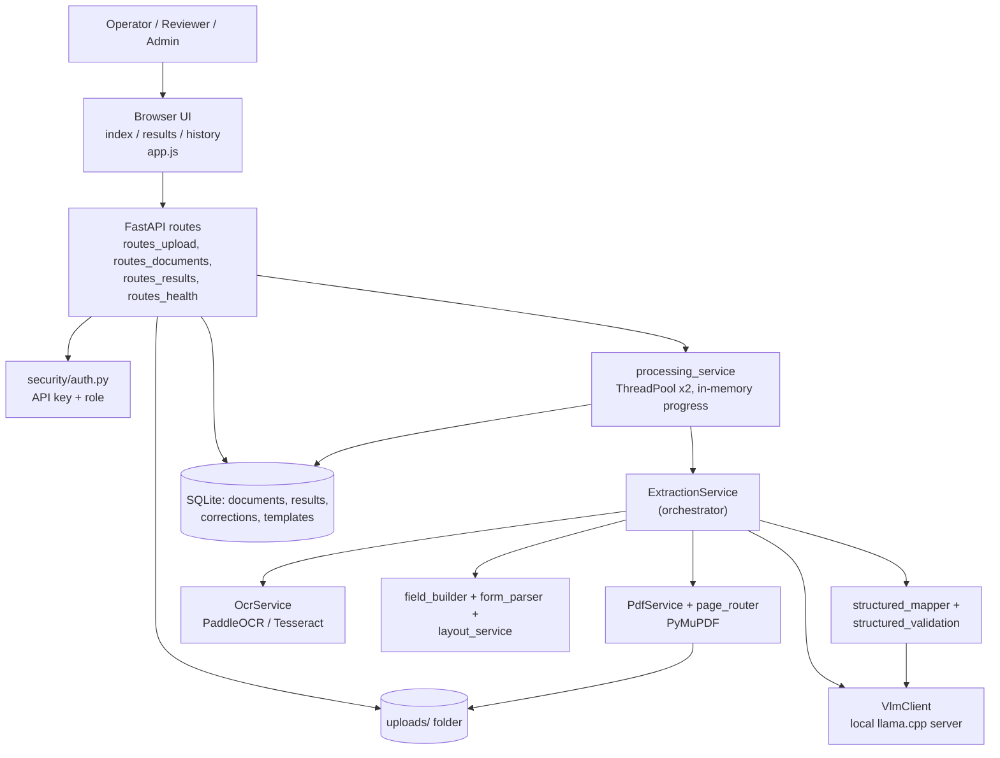
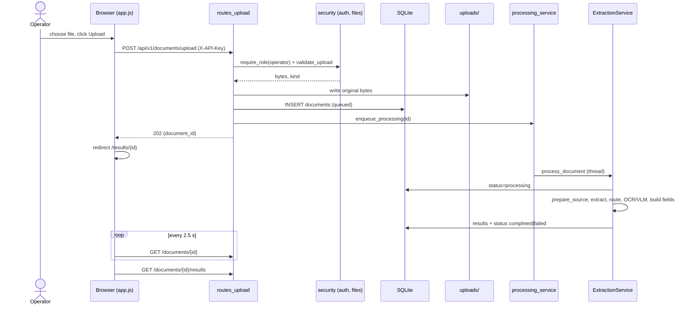
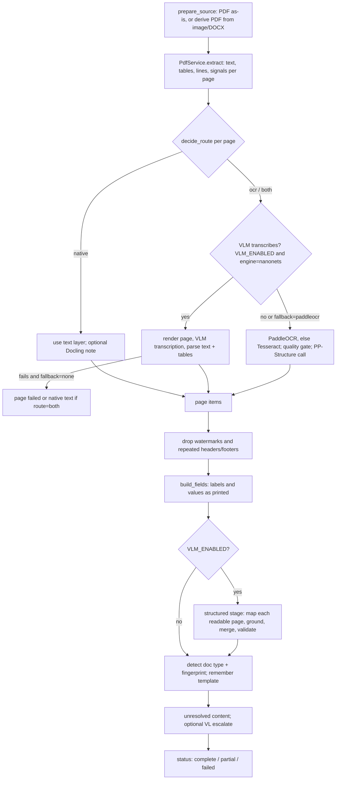
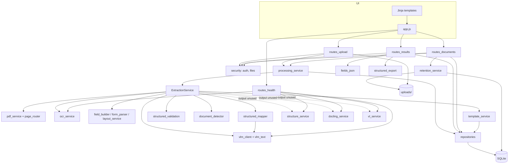

# CHARGE_SHEET_OCR — Application Analysis

| | |
|---|---|
| **Audit type** | Static source audit of the working tree, plus two kinds of runtime evidence (see "Evidence boundaries") |
| **Application root folder** | `CHARGE_SHEET_OCR` |
| **Code version** | `1.0.0` (`app/__init__.py`); result schema written by processing: `2.0.0` (`app/schemas/charge_sheet.py:22`); structured sub-schema `1.0` (`app/schemas/structured.py:31`) |
| **Audit date** | 2026-10-15 |
| **Git state audited** | branch `main`, HEAD `1b3fd5e` ("Enhance field parsing for witness tables and inline labels"), working tree clean at start |
| **Source modified?** | No. Only this report was written. |

### Evidence boundaries (read this first)

What was and was not done, so that status labels can be trusted:

| Evidence type | Done? | Notes |
|---|---|---|
| Read every file under `app/` (routes, services, repositories, schemas, security, templates, JS, CSS) | Yes | Large parsing modules (`layout_service.py`, `form_parser.py`, `field_synonyms.py`, `text_normalize.py`) were read for role, signatures and call sites rather than line by line. |
| Automated test suite | Yes — **267 passed, 6 skipped, 0 failed** (35 s) | Run on 2026-10-15 with `.venv\Scripts\python.exe -m pytest`. Tests use temp SQLite DBs and temp upload dirs (`tests/conftest.py`), OCR off, VLM replaced by a fake. The 6 skips are the opt-in OCR/live-VLM tests. |
| Read-only aggregate query of the live SQLite DB (`data/charge_sheets.db`) | Yes — counts only | No document text, names or values were read. Used to see which paths real runs actually exercised. |
| Started the web server, uploaded a document, ran real OCR, or called the vision model | **No** | "Implemented" therefore means *a complete, connected code path exists*, and where tests or stored results exercise it, that is stated. Behaviour of PaddleOCR / the vision-model server on a specific machine is **Unverified** unless the stored data shows it ran. |
| Accuracy | Not measured | Accuracy figures in `docs/ACCURACY_REPORT.md` and `docs/STRUCTURED_EVALUATION.md` are quoted as the project's own claims on small development sets; they were not reproduced. |

### Status legend (as requested)

| Status | Meaning |
|---|---|
| **Implemented** | Complete, connected code path; tests and/or stored data corroborate it |
| **Partially Implemented** | Some of the path exists; the outcome the surrounding code suggests is not fully produced |
| **Unverified** | Code suggests it works, but evidence is insufficient to confirm end-to-end behaviour |
| **Unused** | Exists, but no active caller was found in the UI or processing path |
| **Broken** | Connected path contains an identifiable defect |
| **Placeholder** | Stub/hook with no effective outcome |

---

# Executive Summary

**What the application is.** A *local-only* web application and REST API (FastAPI + SQLite + a small server-rendered HTML/vanilla-JS UI) that ingests Indian police **charge sheets / final reports** — PDF, PNG, JPEG, TIFF or DOCX — reads them on the same machine, and returns the **labels and values exactly as printed in that document**, for human review, correction, and JSON export.

**Who uses it.** Operators who digitise charge sheets, reviewers who confirm results, and administrators who delete records. There is no user directory: identity is an **API key with a role** (`viewer < operator < reviewer < admin`), or — when authentication is off — any process on the same machine, treated as an unauthenticated *operator*.

**Problem it solves.** Charge sheets arrive as digital PDFs, scans, photos or Word files with varying layouts. The application turns one file into a reviewable, correctable list of fields and a downloadable JSON, without sending the document to a cloud service (an in-process network guard blocks non-private outbound connections).

**Major capabilities (all verified in code):**
1. Upload → store original unchanged → background processing → status polling.
2. Per-page routing: PDF text layer ("native"), OCR, or both (`page_router.py`).
3. Local OCR (PaddleOCR, Tesseract fallback) *or* a local vision-language model (VLM) that transcribes scanned pages.
4. A deterministic **field builder** that produces `{label, value, page, serial, confidence}` entries in reading order; no fixed field list.
5. Human review: edit values (stored beside, never over, the extracted value), correction history, verification with notes (reviewer role).
6. Optional **structured** canonical schema (case, complainant, informant, acts, officers, accused, witnesses, property) built by the VLM with deterministic grounding/validation — **served by API only; the UI does not display it.**
7. Retention purge, admin delete, audit logging, security headers, role checks.

**Key integrations.** PyMuPDF (PDF), PaddleOCR 3.7 / PaddlePaddle 3.3.1 (installed here), Tesseract (optional; **binary not present** on this machine), a local OpenAI-compatible llama.cpp server hosting `nanonets-ocr2-3b` (enabled in this machine's `.env`), python-docx (DOCX), Pillow (images), SQLAlchemy. Docling and PaddleOCR-VL are optional hooks (Docling not installed).

**Overall maturity.** The *core* path (upload → OCR/native → field list → review → JSON) is **well built and well tested** (267 tests pass; 12 stored schema-2.0.0 results show it running for both native and scanned pages). The *edges* are immature: three advertised "hybrid stack" components (Docling, PP-Structure tables, PaddleOCR-VL escalation) compute output that is **never used**; the structured result has **no UI**; template "learning" stores fingerprints only; the LLM settings are **never consumed**.

**Major gaps/risks (details in §12):**
- In this machine's configuration (`ENABLE_AUTH=false`), **verification and deletion are impossible** (both need an authenticated role) — the live DB has **0 verified documents** of 26, yet the UI still shows a "Mark verified" button.
- Clearing a field to blank cannot be saved as a correction (display falls back to the extracted value).
- Retention purge runs **only at server start**; there is no scheduler.
- Accuracy on unseen real documents is **not established**: the project's own structured evaluation on real documents was poor before a fix and was **not re-run** afterwards.
- Single-process, in-memory job tracking; no persistent queue; no per-user isolation; no encryption at rest or TLS (acknowledged in `docs/SECURITY.md`).

---

# 1. Application Overview

### 1.1 Purpose and problem
`app/main.py:67-76` describes it as a "Local-only charge-sheet PDF extraction and data mapping service". The implemented behaviour matches: it does **not** classify charge-sheet content into a fixed template; the primary output (`ChargeSheetData.fields`, `app/schemas/charge_sheet.py:105-125`) is a list of `PdfField` objects whose labels come from the document itself. A second, optional output (`ChargeSheetData.structured`) maps content onto a fixed set of sections.

### 1.2 Target users
Derived from the data model and role system, not from marketing text:
- **Scanning / data-entry operators** — upload and correct (`require_role("operator")`).
- **Reviewers / supervising officers** — mark results verified (`require_role("reviewer")`).
- **Administrators** — delete documents (`require_role("admin")`).
- **Integrators / developers** — consume REST endpoints (`/json`, `/structured`, `/raw`).
- **Developers/QA** — `scripts/` and `evaluation/` for accuracy measurement (never imported by `app/`, per README).

### 1.3 Major workflows
1. Ingest and process a document (§6.1).
2. Review, correct and verify (§6.2).
3. Reprocess (§6.3).
4. Export JSON (§6.4).
5. Structured VLM mapping (§6.5, API-only result).
6. Retention and deletion (§6.6).

---

# 2. Architecture / Technology Overview

### 2.1 Stack (from `requirements.txt` and import analysis)

| Layer | Technology | Evidence |
|---|---|---|
| Web framework | FastAPI 0.115.6, Uvicorn 0.34 | `app/main.py` |
| UI | Jinja2 templates + one static JS file (`app/static/js/app.js`, 601 lines) + CSS; **no JS framework, no build step** | `app/templates/*.html`, `app/static/` |
| Persistence | SQLAlchemy 2.0.36; SQLite by default (`data/charge_sheets.db`); PostgreSQL URL accepted | `app/config.py:29`, `app/db.py` |
| File storage | Local folder `uploads/` (original bytes, plus a derived `*.pages.pdf` for image/DOCX) | `routes_upload.py:38-41`, `source_prep.py:80-81` |
| PDF engine | PyMuPDF 1.25.1 | `pdf_service.py` |
| OCR | PaddleOCR 3.7.0 + PaddlePaddle 3.3.1 (installed in `.venv`); Tesseract via `pytesseract` (wrapper installed, **binary absent**) | `ocr_service.py`; `pip list` |
| Layout assist | PP-Structure (via paddleocr), Docling (**not installed**), PaddleOCR-VL (needs GPU) | `structure_service.py`, `docling_service.py`, `vl_service.py` |
| Vision-language model | OpenAI-compatible HTTP server (llama.cpp), model `nanonets-ocr2-3b`; client = `httpx` | `vlm_client.py`; `.env` has `VLM_ENABLED=true` |
| DOCX/Image input | python-docx → HTML → PyMuPDF Story → PDF; Pillow → PDF | `source_prep.py` |
| Background work | In-process `ThreadPoolExecutor(max_workers=2)` — **no external queue/worker** | `processing_service.py:22` |
| Auth | API-key table from env; role hierarchy; constant-time compare | `app/security/auth.py` |
| Offline enforcement | Monkey-patches `socket.connect/connect_ex` to refuse non-private hosts | `app/security/network_guard.py` |
| Observability | Logging with PII redaction; `audit()` events to stdout | `logging_utils.py` |

### 2.2 Runtime configuration observed on this machine
(`.env`, values of secrets not read)

| Setting | Value | Consequence |
|---|---|---|
| `ENABLE_AUTH` | `false` | Loopback-only; callers are an unauthenticated operator → **cannot verify or delete** |
| `APP_PORT` | `8080` | (code default is 8000) |
| `OCR_ENABLED` | `true` | PaddleOCR used for scanned pages when VLM is not |
| `VLM_ENABLED` | `true`, model `nanonets-ocr2-3b`, `VLM_TRANSCRIBE_ENGINE=nanonets`, `VLM_FALLBACK_ENGINE=none` | Scanned pages are read by the VLM; every readable page is sent for structured mapping |
| `LLM_ENABLED` | `false` | (no code path consumes it anyway — see §12) |
| `RETENTION_DAYS` | `90` | Purge on server start only |

### 2.3 System diagram

---

# 3. Module Inventory

### 3.1 Backend (`app/`)

| Module | Purpose | Key features | Status |
|---|---|---|---|
| `main.py` | App factory; security headers/CSP; mounts routers and static files; serves 3 HTML pages; startup hooks | Startup runs: network guard install, DB init, **retention purge**, **interrupted-job recovery** (`main.py:51-60`) | Implemented |
| `config.py` | Environment-driven settings (≈90 keys) | See §12.3 for keys that are never consumed | Implemented (partly unconsumed) |
| `db.py` | Engine/session; `create_all`; additive column migration `_add_missing_columns` | No Alembic migrations despite `alembic` in requirements | Implemented |
| `models.py` | Tables `documents`, `results`, `corrections`, `templates` | `results.payload_json` holds the whole `ChargeSheetData`; `raw_json` separate | Implemented |
| `api/routes_upload.py` | `POST /api/v1/documents/upload` | Streaming size check, content sniffing, store original | Implemented |
| `api/routes_documents.py` | List/get/source/page-image/reprocess/delete/templates | See §7 | Implemented (2 endpoints have no UI caller) |
| `api/routes_results.py` | results, json, structured, raw, corrections history, PATCH fields, verify | See §7 | Implemented |
| `api/routes_health.py` | `GET /health` — unauthenticated status | Reports OCR engine, VLM reachability, auth state | Implemented |
| `security/auth.py` | Principal, role hierarchy, key table | Placeholder/short keys rejected (`auth.py:29-45`) | Implemented |
| `security/files.py` | Upload validation, safe filenames, path-traversal guard | Type decided by magic bytes, not name (`source_prep.detect_kind`) | Implemented |
| `security/network_guard.py` | Best-effort outbound-connection block | Only affects Python sockets | Implemented (scope-limited, documented) |
| `repositories/*` | Persistence for documents, results, templates | Correction re-application logic lives in `document_repository.reapply_corrections` | Implemented |
| `services/processing_service.py` | Queue (thread pool), progress, interrupted-job recovery | In-memory only | Implemented |
| `services/extraction_service.py` | **Pipeline orchestrator** (772 lines) | Page acquisition, field build, structured stage, status computation | Implemented; 3 sub-paths discard output (§12) |
| `services/pdf_service.py`, `page_router.py` | PDF opening, text/table/line extraction, route decision (native / ocr / both), page rendering | Rules in `decide_route` (`page_router.py:133-175`) | Implemented |
| `services/ocr_service.py` | PaddleOCR with Tesseract fallback; result normalisation | Singleton engine behind a lock | Implemented (Tesseract binary absent here) |
| `services/layout_service.py`, `form_parser.py`, `field_builder.py`, `text_normalize.py`, `field_mapping_service.py`, `field_synonyms.py` | Turn boxes/rows/lines into labelled fields | Vocabulary used **only to recognise** labels; labels never renamed | Implemented (tests: `test_layout`, `test_field_builder`, …) |
| `services/document_detector.py` | `charge_sheet` vs `unknown` by keyword score; structural fingerprint | Two classes only | Implemented |
| `services/template_service.py` + `repositories/template_repository.py` | Remember fingerprints | No mapping stored, no verification, fuzzy match off | **Placeholder** (§12) |
| `services/source_prep.py` | Accepted types; image/DOCX → derived PDF | DOCX page numbers refer to the rendition | Implemented |
| `services/vlm_client.py`, `vlm_text.py` | VLM transport (single-request lock, retries, typed errors), transcription parsing | Never logs content/keys | Implemented; **Unverified** live (no call made in this audit) |
| `services/structured_mapper.py`, `structured_validation.py`, `structured_export.py`, `schemas/structured.py` | Per-page VLM mapping → grounding → merge → validation → final JSON | 8 fixed sections | Implemented in backend; **no UI** |
| `services/docling_service.py` | Docling markdown for digital form pages | Result discarded | **Partially Implemented / Unused output** |
| `services/structure_service.py` | PP-Structure tables | Result discarded | **Partially Implemented / Unused output** |
| `services/vl_service.py` | PaddleOCR-VL on "hard pages" (GPU) | Result discarded | **Partially Implemented / Placeholder** |
| `services/retention_service.py` | Delete content, tombstone, purge expired | Called at start-up and from DELETE | Implemented |
| `services/value_parsers.py` | Date/phone/Aadhaar-shape helpers | `parse_date`, `find_numeric_date`, `has_date_shape` used; phone/Aadhaar helpers unused | Implemented (partly unused) |
| `schemas/*` | Pydantic models | `DocumentCreate`, `DocumentFilter`, `ErrorResponse` have no users | Implemented (partly unused) |

### 3.2 Frontend

| Page / asset | Purpose | Status |
|---|---|---|
| `templates/base.html` | Layout, nav (Upload, History, API Docs), API-key box, status line | Implemented |
| `templates/index.html` + `initUploadPage` | Drag-and-drop upload | Implemented |
| `templates/results.html` + `initResultsPage` | Polling, Fields tab, JSON tab, review controls | Implemented |
| `templates/history.html` + `initHistoryPage` | Recent documents (max 100), per-row Reprocess | Implemented (no delete/search/pagination) |
| `static/js/app.js` | All client logic; no inline scripts (CSP forbids them) | Implemented |

### 3.3 Support code outside the runtime path

| Folder | Purpose | Status |
|---|---|---|
| `tests/` | 18 `test_*.py` modules (+ `conftest.py`, `fake_vlm.py`), 267 passing tests | Implemented |
| `scripts/` | `evaluate*.py`, `generate_sample_pdfs.py`, `verify_offline.py`, `verify_ui.py` (headless browser check) | Implemented; not executed in this audit |
| `evaluation/` | Ground-truth and metric code, never imported by `app/` | Implemented |
| `docs/` | `SECURITY.md`, `AUDIT_REPORT.md`, `ACCURACY_REPORT.md`, `STRUCTURED_EVALUATION.md` | Documentation; used as cross-check only |
| `shots/` | Screenshots from `verify_ui.py` | Artifacts |

---

# 4. Feature Inventory

For each major feature: **What → Who → Why → How → User does → Technically → Outcome.**

### F1. Document upload
- **What:** Accept PDF/PNG/JPEG/TIFF/DOCX up to 25 MB / 200 pages.
- **Who:** operator (or unauthenticated local operator).
- **Why:** Entry point; originals must be preserved as evidence.
- **How:** `validate_upload` reads in 1 MB chunks (rejects early at limit, `files.py:56-66`), identifies type from magic bytes (`source_prep.detect_kind`), stores under `<uuid>_<sanitised name>.<ext>`.
- **User does:** drops a file, clicks **Upload & process**.
- **Technically:** `POST /api/v1/documents/upload` → row `documents(status=queued)` → `enqueue_processing`.
- **Outcome:** HTTP 202 with `document_id`; browser navigates to `/results/{id}`.

### F2. Hybrid text acquisition (native / OCR / both)
- **What:** Decide per page whether the PDF text layer is trustworthy.
- **How:** `decide_route` uses char count, image coverage, space/alpha ratios, label hits → `native | ocr | both` (`page_router.py:133-175`). Rotated pages are un-rotated (`pdf_service.py:84-86`).
- **Outcome:** `PageSummary` per page with `route`, `route_reasons`, `text_source`, `page_status`.

### F3. Local OCR
- **How:** `OcrService.recognize_png`: PaddleOCR → on failure Tesseract → otherwise explicit error; never reports a blank success. Quality gate `ocr_accept` (`page_router.py:188-209`); skew straightening in `layout_service.boxes_from_ocr`.
- **Evidence it ran:** stored data shows `paddleocr` on 45 pages.

### F4. VLM page transcription
- **What:** The vision model reads scanned/garbled page images instead of OCR.
- **How:** `_vlm_acquire_page` renders the page (≤1536 px), sends it with the model's own transcription prompt, parses text + HTML tables (`vlm_text.parse_transcription`) into synthetic layout items. Abort after 2 consecutive transport failures; 7200 s per-document budget; fallback to PaddleOCR only if `VLM_FALLBACK_ENGINE=paddleocr`.
- **Evidence it ran:** stored data shows `nanonets` on 14 pages.

### F5. As-printed field list (primary output)
- **What:** Ordered list of `{id "p1-03", page, pages, serial, label, value, source, text_block, confidence}`.
- **How:** `build_fields` state machine (`field_builder.py`): a label opens a field; everything after it belongs to it until the next label; list headings keep table rows together; the narrative ("Brief facts…") becomes one value; scanner watermarks and repeated header/footer lines are dropped (`form_parser.drop_page_furniture`).
- **Outcome:** Shown in the Fields tab and as the JSON tab.

### F6. JSON export
- **What:** `{label: value}` dictionary — keys are the document's own labels; duplicates get ` (2)`, ` (3)`; unlabelled text under `(text before any label)` (`fields_json.py`).
- **Interfaces:** UI **Copy** / **Download JSON** (client side), `GET /json[?download=true]`.

### F7. Human correction
- **What:** Edit any value; original is kept.
- **How:** Client collects inputs whose value differs from `data-initial` (`app.js:496-518`) → `PATCH /fields` → `CorrectionRecord` rows (+ `original_value`) and `corrected_value` on the field. Unknown ids → 400.
- **Re-application:** after reprocess, a correction is re-applied only if the new extracted value equals the one the reviewer corrected (`document_repository.reapply_corrections`); otherwise skipped and a warning is added.

### F8. Verification
- **What:** A named reviewer attests the results, with required notes.
- **How:** `POST /verify` (role reviewer) → status `verified`, `verified_by`; a pseudo-correction row `_verification` records the note. Editing a verified document re-opens review (`routes_results.py:227-229`); reprocess clears verification (`routes_documents.py:143`).
- **Constraint:** Impossible when `ENABLE_AUTH=false` (principal is `authenticated=False`, role operator).

### F9. Reprocess
Re-run extraction on the stored original; resets `verified`, keeps correction history; refused (409) while in flight.

### F10. History list
`GET /documents?limit=100` → table with status badge, pages, date, verified flag, Reprocess.

### F11. Structured canonical extraction (VLM) — API only
- **What:** Fixed schema: case, complainant, informant, acts_and_sections, investigating_officers, accused, witnesses, property + `other_details` (`structured.py:82-140`).
- **How:** Per page, ask the VLM only about the sections the page shows signs of (`select_sections`), JSON-schema constrained; then **deterministic grounding** (value must appear in the page text; source page/text come from the page, not the model), merge across pages (conflicts keep all candidates), validation (formats, duplicates, required fields).
- **Outcome:** Stored in `results.payload_json.structured`; served at `GET /structured`. **No UI element displays it.**

### F12. Raw lines — API only
`GET /raw`: every line read per page with source (`native`/`ocr`/`vlm`) and OCR confidence.

### F13. Original / page-image retrieval
`GET /source` (UI uses it via **Open original**) and `GET /pages/{n}/image` (**no UI caller**).

### F14. Retention and deletion
`delete_document_content` removes file(s), result and corrections, leaves a tombstone. Triggered by `DELETE` (admin) or start-up purge past `RETENTION_DAYS`.

### F15. Security controls
Role checks, constant-time key compare, CSP/`X-Frame-Options`/`no-store`, upload sniffing and size cap, path-traversal guard, PII-redacting logs, outbound-connection guard.

### 4.1 Feature-to-Implementation Mapping

| Feature | UI location | API / Route | Backend service | Data / Storage | External integration | Status |
|---|---|---|---|---|---|---|
| Upload | `/` dropzone + **Upload & process** | `POST /api/v1/documents/upload` | `routes_upload`, `files.validate_upload`, `processing_service.enqueue_processing` | `uploads/`, `documents` | — | **Implemented** |
| Progress polling | `/results/{id}` note | `GET /api/v1/documents/{id}` | `processing_service.get_progress` (in-memory) | memory | — | **Implemented** (single process only) |
| Page routing | (results: Pages table) | internal | `pdf_service`, `page_router` | `results.payload_json` | PyMuPDF | **Implemented** |
| Local OCR | (Pages table) | internal | `ocr_service` | same | PaddleOCR, Tesseract | **Implemented** (Tesseract binary absent here) |
| VLM transcription | (Pages table, status line) | internal | `vlm_client`, `vlm_text`, `extraction_service._vlm_acquire_page` | same | llama.cpp server | **Implemented**; ran on 14 stored pages |
| Field list | **Fields** tab | `GET /results` | `field_builder`, `form_parser`, `layout_service` | `results.payload_json` | — | **Implemented** |
| JSON view/export | **JSON** tab, Copy, Download | `GET /json` | `fields_json` | derived | — | **Implemented** |
| Edit & save corrections | Value inputs + **Save changed fields** | `PATCH /fields` | `routes_results.patch_fields`, `repositories` | `corrections`, `results` | — | **Implemented**; blank-value defect (G10) |
| Correction history | **Correction history** | `GET /corrections` | `document_repository.correction_history` | `corrections` | — | **Implemented** |
| Verify | **Mark verified** | `POST /verify` | `routes_results.verify_document` | `documents` | — | **Implemented**, unusable when auth off |
| Reprocess | **Reprocess** (results, failure card, history) | `POST /reprocess` | `routes_documents.reprocess_document` | `documents`, `results` | — | **Implemented** |
| History | `/history` | `GET /documents` | `document_repository.list` | `documents` | — | **Implemented** (no pagination UI) |
| Open original | **Open original** | `GET /source` | `routes_documents.get_source_pdf` | `uploads/` | — | **Implemented** |
| Delete | none | `DELETE /documents/{id}` | `retention_service` | all tables + files | — | **Implemented in API; Unused by UI** |
| Structured result | none | `GET /structured`; `PATCH /fields` with `s.*` ids | `structured_mapper/validation/export` | `results.payload_json.structured` | VLM | **Implemented in backend; no UI** |
| Raw lines | none | `GET /raw` | `extraction_service._raw_document` | `results.raw_json` | — | **Implemented; Unused by UI** |
| Page image preview | none | `GET /pages/{n}/image` | `pdf_service.render_page_image` | derived | — | **Unused** (no caller) |
| Template fingerprints | none | `GET /templates` | `template_service`, `document_detector` | `templates` | — | **Placeholder** (count only) |
| Docling assist | Pages table "Docling" note | internal | `docling_service` | — | Docling (not installed) | **Partially Implemented** (output discarded) |
| PP-Structure tables | Pages table | internal | `structure_service` | — | PaddleOCR | **Partially Implemented** (output discarded) |
| PaddleOCR-VL escalation | Unresolved content | internal | `vl_service`, `_maybe_vl_escalate` | — | PaddleOCR-VL (GPU) | **Partially Implemented / Placeholder** |
| Retention purge | none | startup hook | `retention_service.purge_expired` | all | — | **Implemented** (start-up only) |
| Health / status line | header status line | `GET /health` | `routes_health` | — | VLM `/models` | **Implemented** |

---

# 5. Important Button & Action Audit

### 5.1 Interactive-element inventory (every control found in the three pages)

| Page | Element | Handler | Verified target |
|---|---|---|---|
| All | **API key** input + **Use key** | `bindApiKeyForm` (`app.js:88-116`) | Stores key in `sessionStorage`; box hidden when `/health` says auth is off |
| All | Nav: Upload, History, API Docs | plain links (`base.html:18-20`) | `/`, `/history`, `/docs` (Swagger, loads CDN assets) |
| Upload | Dropzone (click/keyboard/drag-drop), hidden file input | `initUploadPage` (`app.js:140-149`) | selects file |
| Upload | **Upload & process** | `app.js:151-190` | XHR `POST /api/v1/documents/upload` with upload-progress bar |
| Results | Status polling | `load()` `setTimeout(load, 2500)` | `GET /documents/{id}` until not queued/processing |
| Results | **Open original** link | `renderMeta` (`app.js:246-256`) | `GET /source` → blob URL in new tab |
| Results | **Fields** / **JSON** tabs | `bindTabs` | client-side; JSON tab fetches `GET /json` each time it opens |
| Results | **Copy** / **Download JSON** | `app.js:390-410` | clipboard / client-side Blob (does *not* call `?download=true`) |
| Results | Filter box | `app.js:489-494` | client-side row filter |
| Results | Value inputs/textareas | `pdfFieldRow` | collected on save |
| Results | **Save changed fields** | `app.js:496-518` | `PATCH /fields` |
| Results | Verification notes + **Mark verified** | `app.js:519-535` | `POST /verify` |
| Results | **Reprocess** (also on failure card) | `reprocess()` | `POST /reprocess` |
| Results | **Correction history** (details) | `app.js:537-549` | `GET /corrections` |
| Results | "Pipeline stages and pages" (details) | static render | none |
| History | file-name link | row link | `/results/{id}` |
| History | per-row **Reprocess** | `app.js:576-585` | `POST /reprocess` |

### 5.2 User Action Audit

| Module | User Action | What User Expects | What Actually Happens | Technical Flow | Outcome | Status |
|---|---|---|---|---|---|---|
| Upload | Drop/select file | File accepted | Client accepts name `.pdf/.png/.jpg/.jpeg/.tif/.tiff/.docx` only (`app.js:153`); the **server** re-decides type from magic bytes | `validate_upload` → `detect_kind` | Mismatched/unsupported content → HTTP 400 with reason | **Implemented** |
| Upload | **Upload & process** | Document processed | Original stored; row queued; background job started; browser redirects immediately | `routes_upload` → `repo.create` → `update_status(QUEUED)` → `enqueue_processing` → thread pool | Results page shows live progress | **Implemented** |
| Results | Wait on page | See progress | Polls every 2.5 s; shows step text ("OCR page 2 of 4…") and elapsed time | `get_progress` (in-memory dict) | Auto-renders results when done | **Implemented** (progress lost on restart; single process) |
| Results | **Open original** | See the uploaded file | Blob of the *original upload*, inline (PDF/image) or download (DOCX) | `GET /source` → `FileResponse` | New tab | **Implemented** |
| Results | **JSON** tab | Final JSON | Fetches fresh JSON, so saved corrections appear without reprocessing | `GET /json` → `fields_to_json` | Pretty-printed JSON + key count | **Implemented** |
| Results | **Copy** | JSON on clipboard | Uses `navigator.clipboard`; if blocked shows message | client | Clipboard | **Implemented** (browser-permission dependent — **Unverified** per browser) |
| Results | **Download JSON** | A `.json` file | Blob built from the displayed text; filename from original name | client | File download | **Implemented** |
| Results | Edit value → **Save changed fields** | Correction saved, original kept | Only changed inputs are sent; server stores correction + extracted value; page reloads | `PATCH /fields` → `repo.add_corrections` → `results_repo.apply_corrections` | Row shows "corrected" badge and "extracted value (before correction)" | **Implemented**, but **clearing a value to blank is not honoured** (G10) |
| Results | **Mark verified** | Document marked verified | Requires non-empty notes (client and server). With auth off → HTTP 403 "requires an authenticated 'reviewer'" shown in the message box | `POST /verify` → `require_role("reviewer")` | Status `verified`, `verified_by` set | **Implemented**; **blocked in current deployment** (0 verified in DB) |
| Results | **Reprocess** | Re-run extraction | Verification reset; correction history kept; 409 if already running | `POST /reprocess` → `enqueue_processing` | New results; earlier corrections re-applied only where source value unchanged | **Implemented** (no confirmation prompt) |
| Results | **Correction history** | See audit trail | Table of all corrections and `_verification` notes, oldest first | `GET /corrections` | Table | **Implemented** |
| Results | Filter box | Narrow fields | Case-insensitive match on label+value; client only | DOM | Rows hidden | **Implemented** |
| History | Row **Reprocess** | Re-run | Same as above, shown on every row regardless of status/role | `POST /reprocess` | List reloads | **Implemented** |
| Header | **Use key** | Authenticate | Stores key in `sessionStorage`; sent as `X-API-Key` | `authHeaders()` | Subsequent calls authenticated | **Implemented** |
| Header | **API Docs** | Open Swagger | Opens `/docs`; the **browser** loads assets from `cdn.jsdelivr.net` (CSP allows it only for docs pages) | FastAPI docs | Swagger page | **Implemented**; conflicts with air-gapped use unless `API_DOCS_ENABLED=false` (documented) |
| (none) | Delete a document | — | **No control exists** | API `DELETE` only | — | **Unused by UI** |
| (none) | View structured result | — | **No control exists** | API `GET /structured` only | — | **Unused by UI** |
| (none) | Page preview beside fields | — | **No control exists** (README says the endpoint is "the side-by-side preview") | `GET /pages/{n}/image` | — | **Unused** |
| (none) | History search/filter/pagination | — | Fixed `limit=100`, no filter UI | `GET /documents` supports `status`, `verified`, `offset` | — | **Partially Implemented** |

---

# 6. Major Application Workflows

### 6.1 Upload and extraction

**Business terms.** An operator drops a charge sheet into the page. The system keeps the original untouched, reads it locally (using the text layer when it is trustworthy, otherwise OCR or the vision model), and after some minutes presents every label and value it found, flagged for human review. A failed read is reported as failed — it is never shown as an empty success.

**Technical terms.**

Inside `ExtractionService.process` (`extraction_service.py:482-605`):

Key rules verified in code:
- **Failed** if fewer than 40 usable characters across the document (`MIN_DOCUMENT_CHARS`, `extraction_service.py:64,537`).
- **Complete** only if every page produced text, no stage is failed/degraded, and no *critical* unresolved item exists (`:588`); a degraded structured-mapping stage therefore turns a document `partial` (seen in 2 stored results).
- `requires_human_review` is always `True` (`:595`); `documents.requires_review=True` and `verified=False` are set after every processing run (`processing_service.py:160-161`).
- Time budget: `PROCESSING_TIMEOUT_SECONDS=900` applies to **OCR only**; the VLM path has its own `VLM_DOCUMENT_BUDGET_SECONDS=7200`.

### 6.2 Review, correction and verification

**Business terms.** A reviewer compares the extracted labels/values with the original, fixes mistakes, and — if authorised — signs the result off with a note. Nothing is "verified" until a named reviewer does so.

**Technical terms.** `PATCH /fields` (operator) accepts `{field_id, corrected_value, review_status, notes}`; ids `p<page>-<nn>` address as-printed fields, `s.<section>.<field>` / `s.<section>.<n>.<field>` address structured values. The server stores a `CorrectionRecord` (with the machine value it replaced) and sets `corrected_value` on the stored result. `POST /verify` (reviewer) requires notes when `verified=true`, writes a `_verification` row, and sets `status=verified`. Editing a verified document sets it back to `completed`.

### 6.3 Reprocess
`POST /reprocess` → status `queued`, `verified=False` → same pipeline → `reapply_corrections` → `ResultsRepository.save` replaces payload and raw lines. Corrections whose source value changed are *not* re-applied; the count is added to `extraction_warnings`.

### 6.4 JSON export
`fields_to_json(results.fields)`; value = correction if non-empty else extracted value. Same logic duplicated in JS `shownValue` (`app.js:73-77`) and Python `final_value` (`fields_json.py:23-27`).

### 6.5 Structured mapping (VLM) — backend only
`_structured_stage` (`extraction_service.py:626-735`): for each readable page → `StructuredMapper.map_page` → `observe_page` (ground each returned value in the page text; unknown keys and unlocatable records go to `other_details`) → `merge_observations` → `validate_structured`. Dense pages (>1800 chars) are asked one section per request; list sections in ≤1100-char pieces; cut-off answers are retried smaller. A failed model server stops further calls after 2 consecutive failures. Result: `data.structured` and, if viewed, `GET /structured`.

### 6.6 Retention and deletion
At every server start: `purge_expired()` deletes documents older than `RETENTION_DAYS` (default 90) regardless of verification state, then `recover_interrupted()` marks queued/processing rows `failed`. `DELETE /documents/{id}` (admin) does the same for one document and writes an `audit` log line.

---

# 7. Backend / API / Service Mapping

### 7.1 REST endpoints

| Method & path | Min. role | Caller in UI | Purpose | Status |
|---|---|---|---|---|
| `GET /health` | none | yes (status line) | Health, engines, VLM reachability, auth flags | **Implemented** |
| `GET /`, `/history`, `/results/{id}` | none (HTML shells; UUID format checked) | — | Pages | **Implemented** |
| `GET /static/*` | none | yes | JS/CSS | **Implemented** |
| `POST /api/v1/documents/upload` | operator | yes | Upload | **Implemented** |
| `GET /api/v1/documents` | viewer | yes (history) | List (`status`, `verified`, `limit`≤200, `offset`) | **Implemented** (filters/offset unused by UI) |
| `GET /api/v1/documents/{id}` | viewer | yes (poll) | Metadata + progress | **Implemented** |
| `GET …/{id}/results` | viewer | yes | Full result; `422` with diagnostics on failure; `results:null` while processing | **Implemented** |
| `GET …/{id}/json` | viewer | yes (JSON tab) | `{label:value}` | **Implemented** |
| `GET …/{id}/structured` | viewer | **no** | Final structured JSON | **Implemented; no caller** |
| `GET …/{id}/raw` | viewer | **no** | Raw lines | **Implemented; no caller** |
| `GET …/{id}/source` | viewer | yes | Original file | **Implemented** |
| `GET …/{id}/pages/{n}/image` | viewer | **no** | Page PNG | **Unused** |
| `GET …/{id}/corrections` | viewer | yes | Audit trail | **Implemented** |
| `PATCH …/{id}/fields` | operator | yes | Corrections | **Implemented** |
| `POST …/{id}/verify` | reviewer | yes | Verify / unverify | **Implemented** (UI only sends `verified:true`) |
| `POST …/{id}/reprocess` | operator | yes | Re-run | **Implemented** |
| `DELETE …/{id}` | admin | **no** | Purge content, keep tombstone | **Implemented; no caller** |
| `GET /api/v1/templates` | viewer | **no** | Fingerprint list | **Implemented; no caller; data is of little use (§12)** |
| `/docs`, `/redoc` | none | link | OpenAPI UIs (if `API_DOCS_ENABLED`) | **Implemented** |

### 7.2 Data stores

| Table / store | Written by | Read by | Notes |
|---|---|---|---|
| `documents` | upload, processing, verify, reprocess, retention | list/get/all routes | Tombstone after delete (`status=deleted`, `original_filename="[purged]"`) |
| `results` | `ResultsRepository.save/apply_corrections` | results/json/structured/raw routes | `payload_json` = `ChargeSheetData`; `raw_json` = `RawDocument` |
| `corrections` | `add_corrections` (patch, verify) | `get_corrections`, history, reapply | `canonical_name` actually holds the field id or `_verification` (`routes_results.py:212`) |
| `templates` | `TemplateRepository.upsert` per processed document | `/templates`, `match()` | `mapping_json` never written; `verified` never set true |
| `uploads/` | upload; `prepare_source` (derived PDF) | processing, source, preview | Deleted with the document |
| In-memory | `_inflight`, `_progress` | progress API | Lost on restart (jobs marked failed at next start) |

### 7.3 External services and local engines

| Component | Used by | Status |
|---|---|---|
| Local VLM server (`VLM_BASE_URL`) | transcription + mapping + `/health` | Configured and enabled here; **not contacted in this audit** |
| PaddleOCR / PaddlePaddle | OCR | Installed; exercised by stored runs (45 pages) |
| Tesseract | OCR fallback | Wrapper installed, **binary missing** → fallback unavailable |
| PP-Structure | tables per OCR page | Called when available; output unused; no stored page records `structure_engine` |
| Docling | digital pages with tables | Not installed; output unused even when installed |
| PaddleOCR-VL | "hard pages" | Needs CUDA (`VL_REQUIRE_GPU=true`); output unused |
| LLM (`LLM_*`) | — | **No client exists** |
| Cloud AI | — | None by design |

### 7.4 Background processing
No scheduler, queue broker or worker process. One `ThreadPoolExecutor(2)` in the web process; OCR and VLM are additionally serialised by module-level locks (`ocr_service._ocr_lock`, `vlm_client._request_lock`). A restart abandons running jobs.

---

# 8. User Roles

Roles are API-key attributes, checked by `require_role` (`auth.py:96-106`). There is no login page, no user table, no sessions.

| Role | Can do | Cannot do | Typical modules |
|---|---|---|---|
| **viewer** | List/get documents, results, JSON, structured, raw, source, page image, corrections, templates | Upload, correct, reprocess, verify, delete | History, Results (read-only; UI still shows edit controls that would return 403) |
| **operator** | viewer + upload, reprocess, `PATCH /fields` | Verify, delete | Upload, Results, History |
| **reviewer** | operator + verify/unverify | Delete | Results (verification card) |
| **admin** | everything incl. `DELETE` | — | API (no UI control) |
| **local-unauthenticated** (when `ENABLE_AUTH=false`) | Operator-level actions, **only from loopback** (`127.0.0.1`, `::1`, `localhost`, `testclient`) | Verify, delete (neither is reachable: `authenticated=False` with role operator) | Everything except verification/deletion |

Key configuration: `API_KEY` → user `default`, admin; `API_KEYS="name:key:role;…"`; keys <16 chars or placeholder values are ignored; if auth is enabled and no usable key exists, every call returns 503 (`auth.py:78-84`) and `/health` reports `degraded`.

Restrictions worth noting:
- **No document-level ownership**: every authenticated viewer can see every document.
- The UI never hides controls by role; failures surface as error messages.

---

# 9. Functional Use Cases

Format: Use Case → Actor → Trigger → User Actions → Application Processing → Systems → Outcome.

**UC1 — Digitise a digital (text-layer) charge sheet.**
Actor: operator. Trigger: a PDF with selectable text arrives. Actions: upload. Processing: all pages route `native`; PyMuPDF tables/lines → `build_fields`. Systems: PyMuPDF, SQLite. Outcome: field list and JSON within seconds (no OCR). *Evidence:* 17 stored native pages; tests with synthetic native PDFs.

**UC2 — Digitise a scanned charge sheet.**
Actor: operator. Trigger: scanned/photocopied PDF. Processing: pages route `ocr`; with `VLM_ENABLED` and `nanonets` engine the VLM reads them, otherwise PaddleOCR (then Tesseract if present). Outcome: field list with OCR confidence, `is_scanned=true`; minutes per page (README: ≈35 s–1 min/page for Paddle on CPU; 19–75 s per page for the VLM; *documented, not re-measured here*). *Evidence:* 41 stored OCR-routed pages.

**UC3 — Process a photo/image or a Word charge sheet.**
Actor: operator. Trigger: PNG/JPEG/TIFF/DOCX upload. Processing: derived PDF (`<name>.pages.pdf`) then as UC1/UC2; DOCX adds a `DOCX_RENDITION` warning because page numbers refer to the rendition. Evidence: `tests/test_vlm_pipeline.py` DOCX tests; **Unverified** on the live system (no image/DOCX identified in the stored data by this audit — not queried).

**UC4 — Review and correct extracted fields.**
Actor: operator/reviewer. Trigger: results page opened. Actions: filter, edit, **Save changed fields**. Processing: correction stored with the replaced value; JSON updated. Outcome: corrected values in the Fields and JSON views with a full audit trail. *Evidence:* 32 correction rows on 1 stored document.

**UC5 — Verify a document.**
Actor: reviewer (authenticated). Trigger: reviewer is satisfied. Actions: enter notes, **Mark verified**. Processing: `verify_document`. Outcome: status `verified`, name recorded. **Not achievable in the current local configuration.**

**UC6 — Export data to another system.**
Actor: integrator. Trigger: needs machine-readable output. Actions: `GET /json?download=true` or the JSON tab. Outcome: `{label: value}` JSON whose keys differ per template (consumers must handle variable keys). For fixed keys use `GET /structured` (requires VLM).

**UC7 — Obtain a fixed-schema record (case/accused/witnesses/acts).**
Actor: integrator or analyst. Trigger: VLM enabled. Processing: structured stage. Outcome: `GET /structured` with evidence, statuses and validation issues. **API only.** *Evidence:* 4 stored results contain `structured`; `structured_mapping` stage `ok` ×2, `degraded` ×2.

**UC8 — Reprocess after a configuration or software change.**
Actor: operator. Trigger: failed or legacy result. Outcome: new results; compatible corrections carried over. *Evidence:* 13 of 25 stored results are older schema versions that load as "reprocess required".

**UC9 — Retention / right-to-erasure.**
Actor: admin or system. Trigger: age ≥ `RETENTION_DAYS` at server start, or `DELETE`. Outcome: file(s), results and corrections removed; tombstone kept. *Evidence:* `tests/test_security.py::test_retention_purges_results_corrections_and_file`. Admin delete is unavailable in the current auth-off configuration.

**UC10 — Measure extraction quality (developer).**
Actor: developer. Scripts: `scripts/evaluate*.py`. Outcome: reports in `docs/`. Not part of runtime.

---

# 10. Module Dependencies

### 10.1 Layered dependency

### 10.2 Shared resources
- **One database** (SQLite file) shared by all routes and the worker threads; each uses its own session (`get_db` / `session_scope`).
- **One upload folder**; paths always pass through `resolve_under`.
- **Shared locks**: `_ocr_lock` (Paddle engine), `_request_lock` (VLM), `_lock` in processing service.
- **Shared state in memory**: `_inflight`, `_progress` → forces single-process deployment.
- **Shared VLM server** across this app and (per repo notes) other apps — single slot, hence one request at a time.

### 10.3 Cross-module workflows
- Upload ↔ processing ↔ results polling (via DB status + in-memory progress).
- Correction ↔ reprocess (corrections table read back into a fresh extraction).
- Fields ↔ structured (`narrative_field_ids` links structured data to as-printed narrative fields).

---

# 11. Implementation Status

| Area | Status | Evidence |
|---|---|---|
| Upload, validation, storage | **Implemented** | `routes_upload.py`, `files.py`; `test_api.py`, `test_security.py` pass |
| Native/OCR/both routing | **Implemented** | `page_router.py`; `test_page_router.py`; stored routes ocr 41 / native 17 / both 1 |
| PaddleOCR | **Implemented** | 45 stored pages with `paddleocr` |
| Tesseract fallback | **Unverified / unavailable here** | binary not found; `test_ocr_service.py` only tests the "wrapper without binary is not an engine" and "no engine" paths, never a real Tesseract run (**Evidence insufficient to verify**) |
| VLM transcription | **Implemented** | 14 stored pages with `nanonets` |
| Field builder | **Implemented** | `test_field_builder`, `test_layout`, `test_extraction`, `test_ground_truth`, 12 stored v2 results |
| JSON tab + export | **Implemented** | `test_fields_json.py`; `verify_ui.py` (not run here) |
| Corrections + re-application | **Implemented** | `test_api.py`; 32 stored correction rows |
| Verification | **Implemented, unavailable in this config** | `routes_results.py:238-286`; DB: 0 verified |
| Structured VLM mapping | **Implemented** (backend) | `test_structured_mapping.py`, `test_vlm_pipeline.py`; 4 stored results |
| Structured UI | **Not present** | `app.js` has no reference to `structured` |
| Admin delete | **Implemented; no UI; blocked in this config** | `routes_documents.py:149-168` |
| Retention purge | **Implemented** (start-up only) | `main.py:53-56` |
| Docling | **Partially Implemented** | output ignored (`extraction_service.py:216-231`); package not installed |
| PP-Structure | **Partially Implemented** | `_structure_tables` written at `:295`, never read; `structure_engine` is `None` on all 59 stored pages |
| PaddleOCR-VL escalation | **Partially Implemented / Placeholder** | `:385-442` only appends `UnresolvedItem`s; `vl_pages` counter (`:203`) is never incremented |
| Template memory | **Placeholder** | see §12 |
| LLM integration | **Placeholder (config only)** | no client |
| Postgres | **Unverified** | URL accepted; tests use SQLite; `_add_missing_columns` uses generic DDL |
| Test suite | **267 pass / 6 skipped** | run 2026-10-15 |

---

# 12. Gaps / Issues / Unused Functionality

### 12.1 Findings (ranked by impact)

| # | Finding | Status | Evidence | Impact |
|---|---|---|---|---|
| G1 | **Verification and deletion are impossible when `ENABLE_AUTH=false`** — the mode this machine runs in. The UI still shows **Mark verified** and only reveals the 403 after clicking. | Implemented but **blocked** | `auth.py:67-76`, `require_role` (`:96-106`); `.env` `ENABLE_AUTH=false`; DB: 0 verified of 26 | The "human verified" workflow never completes; no way to delete except the start-up retention purge |
| G2 | **Clearing a field cannot be saved.** An empty correction is stored, but display treats `""` as "no correction" and falls back to the extracted value. | **Broken** (edge case) | `app.js:73-77, 319`; `fields_json.py:23-27` | A reviewer who deletes a wrong OCR value sees it return after reload; the JSON still contains the wrong value |
| G3 | **Structured result has no UI**, although comments/README imply the UI is "drawn from `structured_layout`" (`api_responses.py:61-62`, README line 165-166). `structured_layout` and `results.structured` are never read by `app.js`. Structured corrections (`s.*`) are reachable only via API. | **Placeholder (UI) / Implemented (backend)** | grep of `app.js`; README line 89 admits "the results page does not show it" | Largest backend investment (≈1,100 lines across mapper, schema, validation, export) not reachable by operators |
| G4 | **PP-Structure output discarded** while still invoked per OCR page. | **Partially Implemented** | `extraction_service.py:291-300` fills `_structure_tables` (`:295`), no other reference in the repo | Potential wasted inference time per scanned page; claimed table recovery does not happen |
| G5 | **Docling output discarded.** Comment says "Prefer Docling markdown…keep native as primary"; the markdown is never used; only a note/flag results. Not installed here. | **Partially Implemented** | `:216-231`; `docling_service.py` | Advertised capability (README, UI status "Docling on") has no effect on results |
| G6 | **PaddleOCR-VL escalation has no effect on fields.** It records `vl_assist` unresolved items only; the "Hard pages" text is not re-parsed (comment: "too heavy"). `vl_pages` is always 0, so "VL on N" can never appear. Needs GPU. | **Placeholder** | `:385-442`, `:203,359` | Misleading status/documentation |
| G7 | **Template learning is a placeholder.** Fingerprints and counts are stored; `mapping_json` is never written, `verified` never set, fuzzy matching off (`min_similarity=1.0`), `previously_seen` and `/templates` not shown in the UI. Stored data: 23 template rows for 25 results (fingerprints almost never repeat), 0 verified, 0 with mapping. | **Placeholder** | `template_service.py:21-63`; DB counts | No reuse benefit; table grows without use |
| G8 | **LLM configuration is never consumed.** `LLM_ENABLED/BASE_URL/MODEL/ALLOW_EXTERNAL` only feed a `/health` boolean and `verify_offline.py`; no code calls an LLM. | **Placeholder** | `config.py:49-52,157-163`; `routes_health.py:47` | Operators may believe an LLM assist exists |
| G9 | **Retention purge runs only at start-up.** A long-running server never purges until restarted. Also deletes verified documents without exception. | **Partially Implemented** | `main.py:53-56`; no scheduler in repo | Data may outlive the stated retention period |
| G10 | **Tombstone keeps `stored_filename`**, which embeds up to 80 chars of the sanitised original filename; only `original_filename` is overwritten with `[purged]`. `SECURITY.md` says a tombstone "holds no document content or personal data". | Inconsistent | `document_repository.py:219-228`; `files.py:18-28` | Minor privacy residue (depends on how files are named) |
| G11 | **Single-process job model.** Thread pool of 2, in-memory progress and in-flight set; restart marks running jobs failed; multiple Uvicorn workers would break progress/inflight tracking. | By design / **limitation** | `processing_service.py:22-27, 64-80` | Not horizontally scalable; long VLM jobs (hours) lost on restart |
| G12 | **Pages for DOCX** refer to a rendition; headers/footers/text boxes dropped. | By design (documented) | `source_prep.py:1-14` | Page citations can mislead |
| G13 | **History page** fixed at 100 rows, no search/filter/pagination, no delete; Reprocess offered on every row, with no confirmation, and it **resets verification**. | **Partially Implemented** | `app.js:563-585`; `routes_documents.py:143` | Operational friction; accidental loss of verified state |
| G14 | **`/health` is unauthenticated** and reveals auth mode, model name and OCR errors; `/docs` pulls scripts from a public CDN in the browser. | Limitation (documented in README/SECURITY) | `routes_health.py` (no dependency) | Information disclosure; breaks air-gapped Swagger |
| G15 | **Auth-off trust model.** Any local process is an operator; relies on peer address. A same-host reverse proxy that does not forward the client address would make every remote user appear as `127.0.0.1`. | **Unverified** (design risk, not exercised) | `auth.py:31, 69-76` | Exposure if deployed behind a local proxy with auth disabled |
| G16 | **No per-document access control, encryption at rest or TLS.** | Documented limitation | `docs/SECURITY.md` "Not verified / out of scope" | Confidentiality relies on deployment |
| G17 | **Accuracy on unseen real documents is not established.** Field-list metrics are on a development set used while building the parser (9 documents). Structured evaluation on 3 real documents was poor before a dense-page fix (case values exact 5/27, witnesses 0/25) and **not re-run after the fix**. | **Unverified** | `docs/ACCURACY_REPORT.md:11`, `docs/STRUCTURED_EVALUATION.md:30-40` | Cannot be relied on without human review (which the product enforces: `requires_human_review=True`) |
| G18 | **Mixed-version stored data:** 13 of 25 stored results predate schema 2.0.0 and show a "Reprocess required" banner (JSON tab would return `{}`). | Data condition | DB aggregate; `charge_sheet.py:160-178` | User confusion until reprocessed |
| G19 | **Performance:** with `VLM_ENABLED=true` **every readable page** (also native-text pages) is sent for structured mapping, 24–65 s per page per README; documents run minutes to hours. | By design | `extraction_service.py:561-562, 626-735` | Long waits for structured output that no screen shows |

### 12.2 Unused or dead code (no active caller found)

| Item | Where | Note |
|---|---|---|
| `GET /pages/{n}/image` | `routes_documents.py:101-126` | No UI caller; README labels it "side-by-side preview" |
| `GET /structured`, `GET /raw`, `GET /templates`, `DELETE /documents/{id}` | routes | API-only; legitimate for integrators but no UI |
| `GET /json?download=true`, `/structured?download=true`, `/raw?download=true` | routes | UI Download button builds its own Blob |
| `verify` with `verified:false` (un-verify) | `routes_results.py:272` | No UI control |
| `ExtractionService.last_page_texts`, `last_native_text` | `extraction_service.py:77,79` | Assigned during processing, never read anywhere (`last_ocr_text`, by contrast, is read by `scripts/evaluate.py` and `tests/test_ground_truth.py`) |
| `DocumentCreate`, `DocumentFilter`, `ErrorResponse` | `schemas/` | Defined, never used |
| `page_free_text` | `pdf_service.py:272` | Never called |
| `is_valid_indian_mobile`, `is_valid_aadhaar_shape` | `value_parsers.py` | Never called |
| `StructuredData.counts()` | `schemas/structured.py:304` | Never called |
| `accused_numbering_gaps` | `page_router.py:212` | Test only |
| `DocumentDetector.similarity` | `document_detector.py:80` | Only reachable via the disabled fuzzy template path |
| `UnresolvedContentReport.empty` | `charge_sheet.py:92` | Not used |

(Verified with repository-wide reference counts; a symbol referenced only by its definition file was treated as unused.)

### 12.3 Configuration and dependencies that are never consumed

| Item | Evidence |
|---|---|
| Settings `app_env`, `disable_telemetry`, `settings.schema_version` (`"1.0.0"`, while the code uses the constant `SCHEMA_VERSION = "2.0.0"`), `llm_base_url`, `llm_model` (only used to compute a boolean) | `config.py`; no other reference in `app/` |
| `alembic` (no migrations folder; `_add_missing_columns` is used instead), `aiosqlite`, `pdfplumber`, `python-dotenv`, `pytest`, `pytest-asyncio`, `reportlab` in `requirements.txt` | No import under `app/` (reportlab only in tests/scripts) |
| `.env.example` default `VLM_ENABLED=false` vs this machine `true` | Informational |

### 12.4 TODO / FIXME
A search of `app/` for `TODO`, `FIXME`, `XXX`, `HACK`, `NotImplemented`, `stub` found **none** (only unrelated "placeholder" strings for input hints and weak-key lists).

### 12.5 Frontend/backend mismatches
- Backend exposes structured data, raw lines, page images, delete, un-verify, filters, offset → **no UI**.
- UI exposes Verify to every user → backend refuses unless authenticated reviewer.
- UI "Download JSON" does not use the backend download endpoint (equivalent content, different path).
- Frontend has **no** feature without a backend implementation.

---

# 13. Evidence & Code References

| Topic | Location |
|---|---|
| App wiring, startup hooks, CSP | `app/main.py:47-148` |
| Settings | `app/config.py:16-133` |
| Roles & principal | `app/security/auth.py:28-110` |
| Upload validation | `app/security/files.py:45-82`; `app/services/source_prep.py:56-73` |
| Upload route | `app/api/routes_upload.py:25-59` |
| Document routes | `app/api/routes_documents.py:40-190` |
| Results/JSON/structured/raw/patch/verify | `app/api/routes_results.py:41-286` |
| Job queue, recovery | `app/services/processing_service.py:22-180` |
| Pipeline orchestrator | `app/services/extraction_service.py:482-605` (process), `:193-383` (pages), `:626-735` (structured), `:385-442` (VL), `:737-770` (raw) |
| Routing rules | `app/services/page_router.py:133-209` |
| PDF extraction | `app/services/pdf_service.py:68-146` |
| OCR | `app/services/ocr_service.py:116-262` |
| VLM transport | `app/services/vlm_client.py:106-333` |
| Field builder | `app/services/field_builder.py:114-365` |
| Structured schema | `app/schemas/structured.py:82-160` (sections, signals, required) |
| Mapping/grounding/merge | `app/services/structured_mapper.py:242-336, 345-436, 558-672` |
| Validation | `app/services/structured_validation.py:39-162` |
| Correction re-application | `app/repositories/document_repository.py:177-217` |
| Retention | `app/services/retention_service.py:22-59`; tombstone `document_repository.py:219-228` |
| Templates | `app/services/template_service.py`, `app/repositories/template_repository.py` |
| UI logic | `app/static/js/app.js:88-116` (key/status), `:120-191` (upload), `:195-553` (results), `:557-591` (history) |
| DB models | `app/models.py:22-104` |
| Tests | `tests/` (18 test modules); run result 267 passed / 6 skipped |
| Runtime observations | `.env` (non-secret keys); live DB aggregate counts; `pip list` |
| Project's own claims (not reproduced) | `docs/ACCURACY_REPORT.md`, `docs/STRUCTURED_EVALUATION.md`, `docs/SECURITY.md` |

**Live-DB aggregate evidence (counts only, read-only query, 2026-10-15):** 26 documents (25 `completed`, 1 `failed`; 106 pages); 0 verified; 25 results (12 schema 2.0.0, 13 older); 4 results contain `structured`; 32 correction rows on 1 document; 23 template rows (0 verified, 0 mappings); among v2 results: page routes `ocr` 41 / `native` 17 / `both` 1; text from `ocr` 41 / `native` 17 / `both` 1; stage statuses `structured_mapping` ok 2 / degraded 2; OCR engines on pages: `paddleocr` 45, `nanonets` 14; `docling_used` 0 and `vl_used` 0 on every page.

---

# 14. Overall Application Summary

### What the Application Does
CHARGE_SHEET_OCR is a self-hosted web application that reads a police charge sheet (PDF, image or Word) on the local machine and returns every label and value that is printed in that document, in reading order, together with page numbers and OCR confidence. Reviewers can correct values (the originals are kept) and, when authentication is enabled, formally verify a result. The same data is available as a `{label: value}` JSON. When a local vision-language model is configured, it also builds a fixed-schema record (case, parties, acts, officers, accused, witnesses, property) with evidence and validation flags — available through the API.

### Primary Users
Data-entry operators and reviewers handling charge sheets; administrators who retain/delete records; developers integrating the REST API. Access is by API key and role, or loopback-only when authentication is off.

### Major Capabilities
- Upload of PDF/PNG/JPEG/TIFF/DOCX with content-based validation.
- Per-page routing between text layer, OCR and vision-model reading.
- Layout-aware, template-independent field detection.
- Review UI with corrections, audit trail, JSON copy/download.
- Role-based API, retention purge, outbound-network guard, PII-redacting logs.
- Optional structured mapping with grounding, conflict preservation and validation.

### Major Business Use Cases
Digitise digital or scanned charge sheets; review and correct the extracted data; export JSON to downstream systems; keep an audit trail of corrections; obtain a fixed-schema record via API; erase data on request or by retention.

### Key Technical Components
FastAPI + SQLAlchemy/SQLite; PyMuPDF; PaddleOCR (Tesseract fallback); local VLM client (`nanonets-ocr2-3b` via an OpenAI-compatible server); a rules-based field builder; structured mapper/validator; in-process thread-pool processing; vanilla-JS UI.

### Implementation Status
- **Implemented and corroborated:** upload, routing, PaddleOCR and VLM transcription, field builder, JSON export, corrections and re-application, history, reprocess, role checks, retention logic, structured mapping backend. Test suite: **267 passed, 6 skipped**.
- **Partially implemented / placeholder:** Docling, PP-Structure tables and PaddleOCR-VL (computed, not used); template memory; LLM settings; structured-result UI; admin delete in UI; history paging.
- **Unverified:** real-document accuracy; Tesseract fallback (binary absent); PostgreSQL; live VLM behaviour in this audit; image/DOCX behaviour on live data.

### Major Gaps / Risks
1. In the current configuration the verification and deletion workflows cannot be used (G1).
2. Blank corrections cannot be saved (G2).
3. Large optional components produce no effect (G3–G8), which can mislead operators about capabilities.
4. Retention only at start-up (G9); tombstone filename residue (G10).
5. Not scalable beyond one process; long jobs lost on restart (G11).
6. Accuracy on unseen documents unproven; structured extraction on dense real pages was poor and not re-evaluated (G17).
7. Confidentiality relies on deployment (no TLS, no encryption at rest, no per-user isolation).

### Overall Assessment
A focused, carefully engineered **single-site, single-process document-extraction tool** whose core path is solid, honest about failure (no silent empty successes, nothing invented, human review always required), and well covered by tests. It is **fit as a supervised assistant for a small team** once authentication is enabled so that verification works. It is **not yet** a production-grade multi-user system: the structured output has no screen, three advertised "hybrid stack" stages are inert, accuracy on unseen real charge sheets has not been demonstrated, and operational controls (scheduled retention, UI deletion, scalable queueing) are missing. Closing G1–G3 and measuring accuracy on a held-out verified set would materially raise its readiness.
