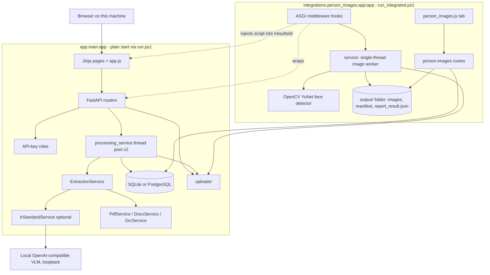
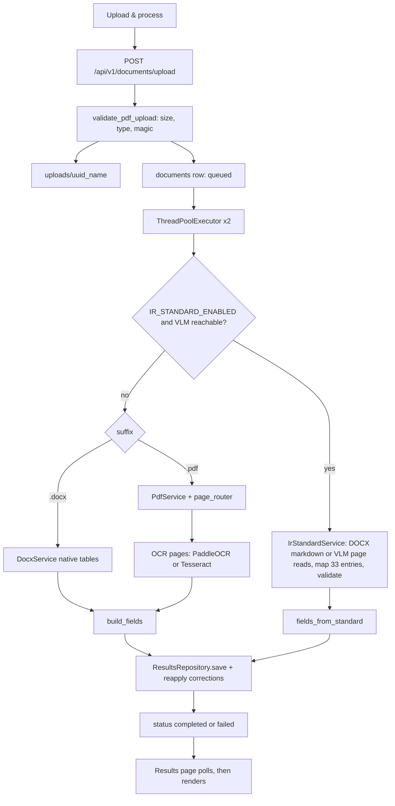
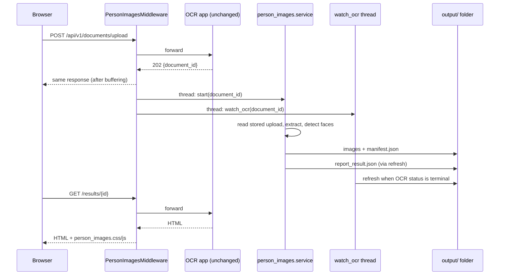
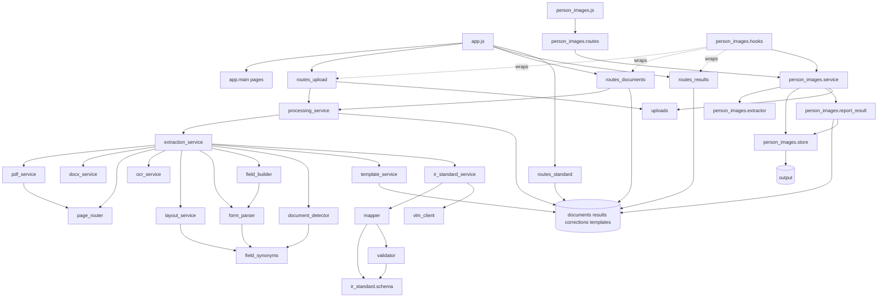

# IR_OCR Application Analysis

**Audit type:** Evidence-based functional and technical review (read-only)
**Repository:** `IR_OCR` (branch `IR_OCR`, HEAD `5bf3b05`)
**Runtime name:** Interrogation Report Extraction Service (`app/config.py` `APP_NAME`)
**Package version:** `1.0.0` (`app/__init__.py`); person-image integration `1.0.0` (`integrations/person_images/__init__.py`)
**Result schema written by the pipeline:** `2.0.0` (`app/schemas/charge_sheet.py` `SCHEMA_VERSION`)
**Standard-template schema:** `ir-standard-1.0` (`app/ir_standard/schema.py`)
**Combined-export schema:** `report_result` `1.0.0` (`integrations/person_images/report_result.schema.json`)
**Date of audit:** 15 October 2026
**Supersedes:** the 14 October 2026 version of this file (still in git history). That version predates the `integrations/` package. This one re-checks its claims against the current code, adds the integration, and adds runtime evidence (see "Method").

## Method

| Activity | Done | Result |
| --- | --- | --- |
| Read routes, services, models, repositories, templates, browser script, config, security code | Yes | Basis for every status below |
| Read the whole `integrations/person_images/` package, its README, and `run_integrated.ps1` | Yes | New in this version |
| Ran the project test suite with the project venv (`pytest -q`, cache disabled) | Yes | **323 passed, 1 failed, 7 skipped** in 42.6 s. The `tests/person_images` subset: 56 passed, 1 skipped |
| Read the on-disk output of an earlier integrated run (`output/…/report_result.json`, `person_images/manifest.json`) | Yes, structure and counts only | Runtime evidence that the standard-template path and the image extractor ran live on a DOCX |
| Read-only aggregate counts on `data/ir_reports.db` | Yes, counts only | 19 documents, all `completed`, none verified, 0 corrections |
| Started the server, clicked through the browser UI, ran OCR engines, or called the VLM myself | **No** | Anything that depends on those is marked **Unverified** |
| Modified application code | **No** | The only file written is this report. The test run wrote nothing into the repository (cache disabled; fixtures use temp dirs per `tests/conftest.py`) |

Status words used throughout:

| Status | Meaning |
| --- | --- |
| **Implemented** | Functionality is implemented and evidence confirms its operation (code path connected end to end, plus tests or run artifacts) |
| **Partially Implemented** | Some parts exist but the complete workflow is missing or incomplete |
| **Unverified** | Code suggests the behavior and available evidence is insufficient to confirm it |
| **Unused** | Exists, and no active caller was found |
| **Broken** | Implementation exists and contains an identifiable failure |
| **Placeholder** | Stub, mock, or future implementation |

Naming, comments, and READMEs were checked against the code and are not treated as proof by themselves.

---

## Executive Summary

**What it is.** IR_OCR is a local web application for confidential police **interrogation reports (IRs)**. A person uploads a Word (`.docx`) or PDF report, the service reads it on the same machine, stores the extraction in a local database, and shows it for human review, correction and sign-off. Started through its second entry point, it also pulls photographs of people out of the same file and adds them, with a combined JSON export, to the review screen.

**Who uses it.** Operators who upload and correct reports; reviewers who sign them off; administrators who delete them. With the shipped default (`ENABLE_AUTH=false`) there is exactly one interactive user: an unauthenticated loopback "operator" who can upload, reprocess and correct, but cannot verify or delete.

**Problem it solves.** IR forms (CCTNS / MO Criminal Database Part-II style) vary between units. The default pipeline does not force them into one field list; it shows the labels and values that are printed, in reading order. An optional second mode maps the report onto a fixed template of **33 entries (a narrative plus 32 numbered sections)** with a local vision-language model, refusing values it cannot ground in the source.

**Major capabilities.**
- Upload, queue and poll; PDF and DOCX; size, type and magic-byte checks.
- Field extraction from Word tables, PDF text layers, and local OCR on scanned pages.
- Review screen: filter, edit, save corrections with the original kept, correction history, mark verified (reviewer key).
- Raw-line view and, in template mode, a template-shaped JSON view.
- History list, reprocess, startup retention purge, offline network guard, role-based API.
- Optional standard-template mapping (local VLM) with API-level JSON and DOCX exports.
- Optional person-image extraction (face detection) with a **Person Images** tab and `report_result.json`.

**Key integrations (all local).** PyMuPDF, pdfplumber, python-docx/OOXML, PaddleOCR with a Tesseract fallback, an OpenAI-compatible VLM server on loopback (Nanonets-OCR2-3B via llama.cpp, per `scripts/run_vlm_server.ps1`), OpenCV YuNet face detector, SQLite (PostgreSQL supported by configuration).

**Implementation maturity.** The default capture-and-review loop is implemented and covered by 323 passing automated tests. Evidence from earlier runs shows the standard-template path and the image extractor working on real DOCX reports. Authentication, roles, upload hardening and retention are implemented. Several finished back-end features have no screen, three optional layout engines record that they ran without improving the fields, and the review/sign-off part of the workflow has never been exercised on real data (0 corrections and 0 verifications in the local database).

**Major gaps and risks.**
1. **Privacy:** deleting a document or the retention purge does **not** remove `output/` (person images and a full copy of the OCR payload in `report_result.json`). Real report files are present in `uploads/`, and a code comment quotes a real record value.
2. **One automated test fails** (`test_no_ground_truth_values_in_runtime_code`) because of that comment.
3. The standard Word download, delete, and template list have no UI. **Mark verified** is shown to users who cannot use it by default.
4. Jobs are in-process and non-durable; retention runs only at process start.
5. PP-Structure tables, Docling markdown and PaddleOCR-VL text never reach the field list.
6. The Person Images tab has not been clicked through in a browser by anyone on record, including this audit.

---

## 1. Application Overview

### Purpose

Extract structured text from interrogation reports and hold it for human review on one computer. `app/main.py` states the boundary: uploads stay on the host, and external AI services are disabled unless an operator deliberately points the model URL elsewhere.

### Problem it solves

An IR contains many labelled rows (identity, identifiers, physical features, family, associates, offences, cases, drugs, SIM cards, finances, legal support). Layouts differ. Two modes exist:

| Mode | Switch | What the user gets |
| --- | --- | --- |
| **Labels as printed** (default) | `IR_STANDARD_ENABLED=false` | One list of fields whose label and value are the detected text, in reading order (`field_builder.py`, `form_parser.py`) |
| **Standard template** | `IR_STANDARD_ENABLED=true` plus `LLM_*` pointing at a local VLM | The same report mapped onto the fixed template (`app/ir_standard/schema.py`, 33 entries `s00`–`s32`); ungrounded values are dropped and flagged; absent sections stay empty |
| **Plus person images** | Start with `integrations.person_images.app:app` (`run_integrated.ps1`) | Either mode, plus extracted photographs and `report_result.json` |

If the standard mode is on and the VLM is unreachable, the code records `STANDARD_IR_FALLBACK` and runs the default pipeline (`extraction_service.py:390-394`).

### Likely users

| Actor | Evidence | What they can do in the default setup |
| --- | --- | --- |
| Local operator (unauthenticated) | `get_principal` returns role `operator` for loopback clients when `ENABLE_AUTH=false` (`app/security/auth.py:67-76`) | Upload, open results, correct, reprocess, history, person images |
| Reviewer | `API_KEYS=name:key:reviewer` | Everything an operator can, plus mark verified |
| Administrator | `API_KEY` (user `default`) or role `admin` | Everything above, plus permanent delete (API only) |
| Viewer | role `viewer` | Read-only API and screens |
| Developer / evaluator | `scripts/`, `evaluation/`, `tests/` | Offline measurement; not a product screen |

There is no login form and no user table. Identity is an API key in the `X-API-Key` header, kept in the browser tab's `sessionStorage` under one key (`app.js` `API_KEY_STORAGE`).

### Major workflows

1. Upload a DOCX/PDF, wait on the results page, read the fields.
2. Correct values, optionally mark verified.
3. Reprocess after a failure or a pipeline change.
4. (Optional) standard-template mapping and template JSON.
5. (Integrated start only) person images appear in a third tab; `report_result.json` is rebuilt as things change.
6. On process start, documents older than `RETENTION_DAYS` are purged.

---

## 2. Architecture / Technology Overview



| Layer | Technology | Where |
| --- | --- | --- |
| HTTP API and HTML | FastAPI, Jinja2, Uvicorn | `app/main.py`, `app/templates/`, `app/api/` |
| Browser UI | One vanilla script (`window.ChargeSheetApp`), no build step | `app/static/js/app.js`, `app/static/css/styles.css` |
| Settings / validation | pydantic v2, pydantic-settings; `.env` | `app/config.py`, `app/schemas/` |
| Database | SQLAlchemy 2; SQLite default (`data/ir_reports.db`), PostgreSQL if `DATABASE_URL` says so | `app/db.py`, `app/models.py` |
| PDF | PyMuPDF text and render; pdfplumber tables | `app/services/pdf_service.py` |
| DOCX | OOXML via zipfile + ElementTree for the default path; python-docx for template output | `docx_service.py`, `app/ir_standard/docx_writer.py` |
| OCR | PaddleOCR if installed, else Tesseract if on PATH | `ocr_service.py` |
| Optional assist engines | PP-Structure (on by default), Docling and PaddleOCR-VL (off) | `structure_service.py`, `docling_service.py`, `vl_service.py` |
| Standard template | HTTP chat-completions client; sectioning, evidence index, validator | `app/ir_standard/*` |
| Person images | OpenCV `FaceDetectorYN` + YuNet ONNX model; PyMuPDF/zipfile for image extraction | `integrations/person_images/*` |
| Jobs | `ThreadPoolExecutor(max_workers=2)` in the web process; integration has its own single-worker pool | `processing_service.py`, `person_images/service.py` |
| Privacy controls | `socket.connect` patch in offline mode; loopback-only auth-off mode; PII-redacting log filter; security headers and CSP | `network_guard.py`, `auth.py`, `logging_utils.py`, `main.py` |

**Two entry points.** `run.ps1` starts `app.main:app` (no image features). `run_integrated.ps1` starts `integrations.person_images.app:app`, which imports the unchanged `app.main:app` and attaches routes, static files and middleware (`integrations/person_images/wiring.py`). No tracked file under `app/` was modified by the integration (git history shows it added only new files; memory note of the same).

**Not present:** a separate worker process, a message queue, Celery, an in-app scheduler, a user database, cloud OCR, or a frontend build.

**Schema note.** `Settings.schema_version` (`"1.0.0"`, `app/config.py:105`) is never read. Stored results use `"2.0.0"`. Alembic is in `requirements.txt` with no migration directory; `db.py` adds missing nullable columns with `ALTER TABLE`.

**Startup (`create_app`, `app/main.py:47-64`).** Logging, network guard, `init_db`, retention purge, recovery of interrupted jobs, then router registration. `attach()` additionally calls the integration's own `recover_interrupted()` for image runs.

---

## 3. Module Inventory

### 3.1 Screens

| Screen | Route | Template | Script entry | Purpose |
| --- | --- | --- | --- | --- |
| Upload | `GET /` | `index.html` | `initUploadPage` | Choose a DOCX/PDF and send it |
| Results | `GET /results/{id}` | `results.html` | `initResultsPage` | Poll, show fields, correct, verify, raw/template JSON; **Person Images** tab when integrated |
| History | `GET /history` | `history.html` | `initHistoryPage` | List up to 100 documents, reprocess |
| API docs | `/docs`, `/redoc` | FastAPI | n/a | Only when `API_DOCS_ENABLED` is true; loads assets from cdn.jsdelivr.net |
| Shared header | all pages | `base.html` | `bindApiKeyForm` | Navigation, API key box (hidden when auth is off), health line |

A non-UUID `document_id` returns 404 before rendering (`app/main.py:133`).

### 3.2 API modules

| Module | Routes |
| --- | --- |
| `routes_health.py` | `GET /health` |
| `routes_upload.py` | `POST /api/v1/documents/upload` |
| `routes_documents.py` | list, get, `source`, `reprocess`, `DELETE`, `GET /api/v1/templates` |
| `routes_results.py` | `results`, `raw`, `corrections`, `PATCH fields`, `POST verify` |
| `routes_standard.py` | `standard`, `template.json`, `standard.docx`, `standard-ir/template.docx` |
| `integrations/person_images/routes.py` | `person-images`, `person-images/files/{run}/{name}`, `person-images/run`, `report_result` |

### 3.3 Processing and extraction (`app/services/`)

| Module | Purpose |
| --- | --- |
| `processing_service.py` | Queue, in-memory progress, persist results, recover interrupted jobs |
| `extraction_service.py` | Pick standard or default path; build `ChargeSheetData` (schema 2.0.0) |
| `pdf_service.py`, `docx_service.py` | Text, tables and page model for PDF / DOCX |
| `page_router.py` | Per-page decision: native / OCR / both; OCR acceptance gate |
| `ocr_service.py`, `layout_service.py` | PaddleOCR/Tesseract; boxes to rows, header pairs, reading order |
| `form_parser.py`, `field_builder.py`, `field_synonyms.py`, `field_mapping_service.py` | Decide what is a label; emit `fields[]`; the printed label is never renamed |
| `document_detector.py`, `template_service.py` | Classify as `interrogation_report` / unknown; hash a label fingerprint |
| `text_normalize.py`, `value_parsers.py` | Spacing, dates, digits |
| `retention_service.py` | Delete file/results/corrections, keep a tombstone row |
| `structure_service.py`, `docling_service.py`, `vl_service.py` | Optional assist engines |
| `ir_standard_service.py` | Glue for the VLM path: DOCX/page images in, `standard_ir` + `fields[]` out |

### 3.4 Standard-template package (`app/ir_standard/`)

| Module | Purpose |
| --- | --- |
| `schema.py` | The 33 entries (`s00_narrative`, `s01_individual_particulars` … `s32_dopams_links`): fields, options, tables. Single source for prompts, validation, DOCX |
| `docx_markdown.py` | DOCX to markdown keeping ticks, bold, bullets |
| `sectioner.py` | Split markdown into sections by title similarity |
| `mapper.py` | One model request per section; narrative parsed in Python; retry on unparsable JSON |
| `evidence.py`, `validator.py` | Index what is actually marked in the source; drop ungrounded selections; produce `review_flags` |
| `paths.py` | Flatten the JSON to the field list; apply reviewer overrides |
| `template_json.py` | Template-shaped JSON including empty fields |
| `docx_writer.py` | Blank or filled DOCX; draft banner until verified |
| `vlm_client.py` | Local-only HTTP client (`is_up`, `transcribe_png`, `complete`) |

### 3.5 Persistence (`app/models.py`)

| Table | Contents | Local DB state (counts only) |
| --- | --- | --- |
| `documents` | File metadata, status, page count, verification | 19 rows: all `completed`, none verified; 18 `.docx`, 1 `.pdf` |
| `results` | `payload_json` (extraction), `raw_json` (every line read) | 19 rows; 6 contain the `standard_template_mapping` stage |
| `corrections` | Field id, original, corrected value, reviewer, notes, `_verification` notes | **0 rows** |
| `templates` | Fingerprint, label, `mapping_json` (never written), document count | 8 rows covering 13 documents |

### 3.6 Security (`app/security/`, `logging_utils.py`)

| Module | Behavior confirmed in code |
| --- | --- |
| `auth.py` | Roles viewer < operator < reviewer < admin. Keys under 16 characters and placeholder values refused. Auth off means loopback-only operator. Constant-time key comparison |
| `files.py` | Size cap in 1 MB chunks, extension plus content-type allowlist, `%PDF` or `PK` magic, server-chosen filename `uuid_sanitized`, path confined to `UPLOAD_DIR` |
| `network_guard.py` | Patches `socket.connect/connect_ex` to refuse public addresses while `OFFLINE_MODE=true`. Private-range addresses are allowed. In-process only |
| `logging_utils.py` | Redacts e-mail, 12-digit and 10-digit numbers when `LOG_PII=false` |
| `main.py` | `X-Frame-Options: DENY`, `nosniff`, no-referrer, `script-src 'self'` CSP for pages, `no-store` on `/api/` and `/results/`, CORS without credentials |

### 3.7 Person-image integration (`integrations/person_images/`)

| Module | Purpose |
| --- | --- |
| `app.py`, `wiring.py` | ASGI entry; `attach()` is idempotent and adds router, static mount, middleware |
| `hooks.py` | Pure ASGI middleware: classifies upload, reprocess, PATCH fields, POST verify, and `GET /results/{id}`; triggers follow-up work in background threads; injects the tab script/CSS into the results HTML |
| `service.py` | Single-worker queue; reads the stored upload read-only; runs the extractor under a lock; records the run in a manifest |
| `extractor.py` | Copy of an external extractor: PDF images by xref, DOCX/XLSX from `word|xl/media/`, face detection with rotation fallbacks, saves only images with a face; never deletes or overwrites |
| `store.py` | Output folder naming, `.person_images_index.json`, manifest, strict id and filename validation, atomic writes |
| `report_result.py` | Builds the combined export from the database (read-only) and the manifest; `watch_ocr` thread refreshes it when OCR is final |
| `routes.py` | Four new routes using the app's own `require_api_key` / `require_role` |
| `static/person_images.js/.css` | The Person Images tab |
| `models/face_detection_yunet_2023mar.onnx` | Face model (untracked at the time of the git snapshot; now committed per HEAD `5bf3b05`) |

### 3.8 Tooling and tests

| Item | Purpose |
| --- | --- |
| `scripts/run_vlm_server.ps1`, `vlm_smoke_test.py` | Start and probe the local VLM |
| `scripts/run_ir_evaluation.py`, `evaluation/ir_standard_eval.py` | Score the standard pipeline on labelled reports (accuracy only when a person marked the ground truth `verified`) |
| `scripts/evaluate.py`, `evaluate_variants.py`, `validation_report.py`, `evaluation/*` | CER/WER/field metrics against ground truth |
| `scripts/verify_offline.py` | Configuration check for local-only operation |
| `scripts/generate_sample_pdfs.py`, `build_blank_template.py` | Fixture and blank-template generators |
| `tests/` | 331 collected tests: API, extraction, field builder/mapping, layout, page router, OCR (opt-in), security, IR standard/evidence/DOCX/template JSON, no-hardcoding guards, and `tests/person_images/` |

---

## 4. Feature Inventory

Each item answers: **What → Who → Why → How → User action → Technical path → Outcome → Status.**

### 4.1 Upload and queue
- **What/Who/Why.** Accept one PDF or DOCX so it can be read; operator or higher.
- **How.** Multipart field `file`. The server validates, writes `uuid_name` to `UPLOAD_DIR`, creates a `documents` row (`uploaded`→`queued`), and submits to a two-thread pool.
- **User action.** Choose or drop a file, click **Upload & process**.
- **Path.** `initUploadPage` → `POST /api/v1/documents/upload` → `validate_pdf_upload` → `DocumentRepository.create` → `enqueue_processing` → HTTP 202 `{document_id, poll_url}`.
- **Outcome.** Browser opens `/results/{id}`.
- **Status.** **Implemented** (`tests/test_api.py`, `test_security.py`).

### 4.2 Default extraction: labels as printed
- **How.** DOCX: `DocxService` reads native tables and headings (no OCR). PDF: `PdfService` plus `page_router.decide_route`; weak pages are rendered and OCR'd. `build_fields` opens a field at each recognised label and follows text until the next. Page "furniture" (scanner marks, repeated header/footer) is dropped.
- **Path.** `process_document` → `ExtractionService.process` → `build_fields` → `ResultsRepository.save` → `completed` / `failed`.
- **Outcome.** Fields plus raw lines, stage and page diagnostics. `requires_human_review` is always true.
- **Status.** **Implemented** (tests). Real-scan quality: **Unverified** (no OCR run in this audit; the DB holds one PDF).

### 4.3 Scanned-page OCR
- **How.** Page rendered at `OCR_DPI` (200); `OcrService.recognize_png` tries PaddleOCR then Tesseract. Acceptance uses character count, mean confidence and label hits. A time budget (`PROCESSING_TIMEOUT_SECONDS`, 900) skips later OCR pages and marks the result partial.
- **Outcome.** Fields from OCR lines; confidence shown as "OCR confidence (not accuracy)". No engine means pages fail with `OCR_REQUIRED` and `/health` reports it.
- **Status.** **Implemented** when an engine imports; engine output **Unverified** here. OCR tests are opt-in (`RUN_OCR_TESTS`, `conftest.py`).

### 4.4 Review, correction and verification
- **How.** Only inputs that differ from `data-initial` are sent. The API checks every `field_id`, appends `corrections` rows, sets `corrected_value` without touching `value`, and reopens a verified document. Verification needs a non-empty note and role `reviewer`.
- **Status.** Correction: **Implemented** (tests; never used in the local DB). Verification: **Implemented** at the API; **unusable by the default UI role** (see 12.2).

### 4.5 History and reprocess
- **How.** `GET /api/v1/documents?limit=100`. Reprocess sets `queued`, clears verification, re-enqueues the stored file. Earlier corrections are replayed only when the field id still exists and the new extracted value equals the corrected-from value (`reapply_corrections`).
- **Status.** **Implemented**; history is **Partially Implemented** (first 100 rows, no filters, no paging, no delete).

### 4.6 Raw line view
- **How.** `results.raw_json` holds every line as read. The JSON tab loads `GET .../raw` once, supports per-page filtering, copy and a browser-built download.
- **Status.** **Implemented.**

### 4.7 Standard 33-entry template (optional)
- **How.** `ExtractionService._process_standard`: `IrStandardService.ready()` checks the VLM; DOCX goes to markdown locally; PDF pages are rendered at `VLM_DPI` and transcribed by the VLM; each section is mapped with one text request; Python validates against an evidence index. `fields_from_standard` feeds the existing field list grouped by `section_title`. Any `VlmError` or exception falls back to the default pipeline.
- **Outcome.** `results.standard_ir`, sectioned fields, a **JSON** tab with a "Template JSON" view.
- **Status.** **Implemented** for DOCX with **live evidence**: the earlier integrated run recorded stages `docx_native_read` (ok) and `standard_template_mapping` (ok), 303 fields in 33 section titles, 41 flagged `needs_review`, and the warning `1 section(s) not found: s16_arrest_particulars`; 6 of 19 stored results carry the mapping stage. The **PDF-through-VLM** branch (`vlm_page_read`) has tests with a fake client only: **Unverified** live.

### 4.8 Standard DOCX and blank template
- **What.** A Word report in the standard layout: selected options in bold with ☒, draft banner and NEEDS REVIEW marks until verified.
- **Path.** `GET .../standard.docx`, `GET /api/v1/standard-ir/template.docx` → `render_docx`.
- **Status.** API **Implemented** (`tests/test_ir_docx.py`, `test_ir_review_docx.py`); UI **Unused** (no `fetch` in `app.js`).

### 4.9 Document type and template memory
- **What.** `DocumentDetector` scores keywords ("interrogation report", "cctns", "aadhaar", …) and hashes normalised labels; `TemplateService.remember` upserts `templates`.
- **Status.** Classification and fingerprint: **Implemented**. Reuse of a stored mapping: **Unused** (`mapping_json` is never written; the fuzzy branch of `match()` needs `min_similarity < 1.0` and no production caller passes it).

### 4.10 Health, offline mode, retention
- **What.** A status line on every page; blocked outbound sockets; deletion of documents older than `RETENTION_DAYS` (90).
- **Status.** Health and guard **Implemented**. Retention **Implemented at process start only** and deletes verified documents too (`purge_expired` filters on age and `status != deleted`). `/health` does not report `IR_STANDARD_ENABLED` or VLM reachability.

### 4.11 Optional assist engines
| Engine | Default | What the code does with the output | Status |
| --- | --- | --- | --- |
| PP-Structure | On | Tables stored in `_structure_tables` (lines 79, 183, 381); no reader exists | **Partially Implemented** |
| Docling | Off | Sets `docling_used` and a note; `dl.markdown` is not copied into page text (lines 111-123) | **Partially Implemented** |
| PaddleOCR-VL | Off; GPU required unless `VL_REQUIRE_GPU=false` | Appends unresolved-item text only; runs only when `unresolved.needs_review`, which only a `critical` item (a `failed` page) sets; `vl_pages` never incremented | **Partially Implemented** |

### 4.12 Person-image extraction (integrated start only)
- **What/Who/Why.** Find photographs of people in the uploaded report (PDF or DOCX) and keep them with the OCR result; operators reviewing a case file.
- **How.** `PersonImagesMiddleware` sees the app's own 202 on upload (and 2xx on reprocess), reads `document_id` from the response body, and after the response is sent starts a background run: read the stored upload, extract embedded images (PDF xrefs; DOCX `word/media/`), reject images under 40 px, downscale to 1600 px, run YuNet at score ≥ 0.7 (≥ 0.8 for rotated attempts, order 0°, 90°, 270°, 180°, EXIF honoured), save only images with a face to `output/<uploaded name>_<ext>/person_images/<name> image[ (n)].<ext>`, and write a manifest. A reprocess creates `rerun_<n>/`; nothing is deleted.
- **User action.** None to start; open the **Person Images** tab; optional **Run image extraction again**, **Download report_result.json**.
- **Outcome.** Run statuses `queued | processing | succeeded | partial | no_person_images | failed | unsupported`. OCR and image failures are independent.
- **Status.** Back end **Implemented** with evidence: 56 passing tests; the on-disk run shows two successful runs on a real DOCX, each finding 1 of 1 embedded image as a person. The UI tab: **Unverified** (script checked by tests and syntax only; no browser run recorded anywhere).

### 4.13 Combined export `report_result.json`
- **What.** One file per document: envelope + the OCR payload exactly as `GET .../results` serialises it + the person-image section; each pipeline's status stands alone.
- **How.** `report_result.build` reads the database through the app's repositories; `refresh` writes it atomically; hooks refresh it after PATCH fields and POST verify; `watch_ocr` refreshes it when OCR reaches a final state. `GET .../report_result[?download=true]` rebuilds on demand.
- **Status.** **Implemented.** Observed output: schema `1.0.0`, `ocr_status: succeeded`, 303 fields, `person_images.status: succeeded`.

---

## 5. Important Button and Action Audit

| Module | User action | What the user expects | What actually happens | Technical flow | Outcome | Status |
| --- | --- | --- | --- | --- | --- | --- |
| Header | **Upload** / **History** | Open that screen | Plain navigation | `base.html` links | Page loads, `init*` runs | **Implemented** |
| Header | **API Docs** | Open the API explorer | New tab to `/docs` if enabled | FastAPI; relaxed CSP only on doc paths | Swagger loads assets from a public CDN | **Implemented** (conflicts with an air-gapped deployment; disable with `API_DOCS_ENABLED=false`) |
| Header | **Use key** | Key is used for later calls | Trimmed into `sessionStorage`; no server check | `bindApiKeyForm` | "Key saved for this browser tab"; box hidden when `/health` says auth is off | **Implemented** |
| Header | Status line | See what is active | `GET /health` text: auth, OCR engine, PP-Structure, Docling, VL, offline | `app.js:98-114` | Auth-off text says "authentication off (local only, verification disabled)" | **Implemented** (omits standard-template readiness) |
| Upload | Drop zone click / Enter / Space / drag-drop | Pick a file | Shows name and size, enables the button | Local only | File held in memory | **Implemented** |
| Upload | **Upload & process** | Start extraction | Rejects non-`.pdf`/`.docx` names client-side, XHR POST with progress, on 202 redirect to `/results/{id}` | `routes_upload.upload_document` → disk → DB row → pool | Processing starts | **Implemented** |
| Results | Auto refresh | See progress | Every 2.5 s while `uploaded/queued/processing`; shows step and elapsed seconds | `GET /api/v1/documents/{id}` + in-memory `_progress` | Fields or failure card | **Implemented** |
| Results | **Open PDF** | See the source | Fetch with key, open a blob in a tab | `GET .../source` | PDF shows; for DOCX the button text is still "Open PDF" and the browser typically downloads | **Implemented**, label inaccurate for DOCX |
| Results | Failure **Reprocess** | Try again | POST reprocess, reload | `reprocess_document` | Queued | **Implemented** |
| Results | **Fields** / **JSON** (or **raw_json**) tabs | Switch views | Toggle panels; raw or template JSON fetched on open | `GET .../raw`, `GET .../template.json` | Lines or template JSON | **Implemented** (JSON tab label depends on `standard_ir`) |
| Results | View selector, **Page** select | Choose Template/Raw, one page | Client-side re-render | Local | Redraw | **Implemented** |
| Results | **Copy**, **Download JSON** | Take the JSON away | Clipboard, or a Blob download; API `?download=true` not used | Local | `*_raw.json` / `*_template.json` | **Implemented** (the raw filename strips only `.pdf`, so a DOCX downloads as `name.docx_raw.json`; cosmetic) |
| Results | **Filter by label or value** | Hide non-matching rows | Compares to each row's `data-search` | Local | Rows hidden | **Implemented** |
| Results | **Save changed fields** | Keep edits | PATCH only dirty inputs with `review_status: corrected` | `patch_fields` → `corrections` + `corrected_value` | Page reloads; original `value` kept | **Implemented** |
| Results | **Mark verified** (+ notes) | Approve the extraction | Notes required client-side; POST `{verified: true, notes}` | `verify_document` requires reviewer | Verified badge, or HTTP 403 for the default local operator | **Implemented** at API; **fails by design under default config** |
| Results | **Reprocess** (review card) | Re-run | Same POST | clears `verified` | New extraction; matching corrections replayed | **Implemented** |
| Results | **Correction history** | Who changed what | On open, `GET .../corrections` | `correction_history` | Table | **Implemented** |
| Results | **Person Images** tab (integrated) | See photographs | Tab added by injected script; loads `GET .../person-images`, fetches each image with the key header and shows a blob URL; polls every 3 s while queued/processing | `person_images.js` → `routes.get_person_images` → `store` | Grid with file name, page or source member, size, face count | **Unverified in a browser**; back end **Implemented** |
| Results | **Run image extraction again** | Re-detect | POST `.../person-images/run` (operator); 409 if active | `routes.run_person_images` → `service.start` | New `rerun_<n>` folder | **Implemented** (API tests) / UI **Unverified** |
| Results | **Download report_result.json** | Get the combined export | GET `.../report_result`, Blob download | `report_result.refresh` | File | **Implemented** / UI **Unverified** |
| History | Filename link | Open that result | Navigate | Page route | Results screen | **Implemented** |
| History | **Reprocess** | Queue again | POST then reload | Same as above | Row becomes queued | **Implemented** |
| History | Filters, paging, delete | A full archive | None offered; request is `limit=100` only | API supports `status`, `verified`, `offset`, `DELETE` | Rows beyond 100 invisible | **Partially Implemented** |

Actions with an API but no control are in section 7.

---

## 6. Major Application Workflows

### 6.1 Upload a report and read its fields

**Business terms.** An operator has a Word or PDF interrogation report and wants every printed label and value on screen without the system inventing fields.

**Technical terms.**



1. Upload rejects empty files, files over `MAX_UPLOAD_SIZE_MB` (25), and anything that is not PDF/DOCX by magic bytes.
2. Stored name is `{uuid}_{sanitised original}` (`safe_store_filename`); the original path is never used.
3. Status moves `uploaded` → `queued` → `processing`; progress phrases live only in memory.
4. PDF pages over `MAX_PAGES` (200) or encrypted PDFs raise and the document becomes `failed`. DOCX does not consult `MAX_PAGES`.
5. Usable text under 40 characters yields `failed` with no field values (`_failed_result`; `GET /results` answers 422 with diagnostics only).
6. `extraction_status` is `complete` only when every page and stage succeeded and nothing critical is unresolved; otherwise `partial`.

**Final outcome.** Stored `payload_json` + `raw_json`, an editable field table, or a failure card with stage and page tables.

### 6.2 Correct a value
Dirty inputs → `PATCH .../fields` → unknown ids return 400 → each correction stores `canonical_name`=field id, `original_value`, `corrected_value`, reviewer → `corrected_value` set on the field → a verified document returns to `completed`. The UI prefers `corrected_value` and shows the original on expand.

### 6.3 Verify
`POST .../verify` with notes → role `reviewer` required → a `_verification` correction row stores the note → `status=verified`, `verified_by`=key's user name, `requires_review=false`. The standard DOCX then drops the draft banner (`_review_state`). Default deployment outcome: HTTP 403 "requires an authenticated 'reviewer'".

### 6.4 Reprocess
409 if the id is in `_inflight`; else `queued`, `verified=false`, re-enqueue, replay still-valid corrections, warn about skipped ones. In the integrated start, the same 2xx also queues a new image run.

### 6.5 Standard-template mapping
`VlmClient` requires `LLM_ENABLED`, base URL, model name and a loopback URL (`http://127.0.0.1…` or `http://localhost…`) unless `LLM_ALLOW_EXTERNAL`. Section chunks (≤ 14 000 characters) go to `complete()` at temperature 0 with fixed rules ("never invent; leave out anything not written; ticked ☑ wins over bold/'Yes'"). The validator removes selections the evidence index cannot find in the source, and records `review_flags`. Missing sections are listed, not guessed. Evidence from a VLM transcription is weaker than from native DOCX (`evidence_source="vlm_transcription"`).

### 6.6 Person images alongside OCR (integrated start)

**Business terms.** The report contains passport-style photographs of the accused or others; the reviewer wants them next to the extracted text and in one export.

**Technical terms.**



Contained failure: exceptions in hooks are swallowed (`hooks._in_thread`), exceptions in a run become a `failed` manifest entry with filesystem paths scrubbed from the message (`service._scrub`), and `report_result` marks `ocr.payload: null` when OCR produced nothing. Interrupted runs are marked failed at attach time.

### 6.7 Delete and retention
`DELETE` (admin, not in flight) unlinks the upload and `purge_content` deletes the result and corrections, sets `original_filename="[purged]"`, status `deleted`. `purge_expired` does the same for rows older than `RETENTION_DAYS`, once, in `create_app`. **Neither touches `output/`.**

### 6.8 Restart while a job runs
`recover_interrupted` marks `queued`/`processing` rows not in the new process's `_inflight` as `failed` ("Use Reprocess"). The integration does the same for image runs.

---

## 7. Backend / API / Service Mapping

| Method and path | Role | Handler | Storage / service | Used by UI |
| --- | --- | --- | --- | --- |
| `GET /health` | none | `routes_health.health` | import checks only | Yes |
| `GET /`, `/history`, `/results/{id}` | none (HTML) | `main.py` | Jinja | Yes |
| `POST /api/v1/documents/upload` | operator | `upload_document` | disk, `documents`, pool | Yes |
| `GET /api/v1/documents` | viewer | `list_documents` | `documents` | Yes (`limit=100` only) |
| `GET /api/v1/documents/{id}` | viewer | `get_document` | `documents` + progress | Yes |
| `GET .../source` | viewer | `get_source_pdf` | `uploads/` | Yes |
| `POST .../reprocess` | operator | `reprocess_document` | pool | Yes |
| `DELETE /api/v1/documents/{id}` | admin | `delete_document` | file unlink, tombstone | **No** |
| `GET /api/v1/templates` | viewer | `list_templates` | `templates` | **No** |
| `GET .../results` | viewer | `get_results` | `results`, `corrections` | Yes |
| `GET .../raw` | viewer | `get_raw` | `results.raw_json` | Yes (`download=true` unused) |
| `GET .../corrections` | viewer | `correction_history` | `corrections` | Yes |
| `PATCH .../fields` | operator | `patch_fields` | `results` + `corrections` | Yes |
| `POST .../verify` | reviewer | `verify_document` | `documents`, `corrections` | Yes (only `verified: true`) |
| `GET .../standard` | viewer | `get_standard` | `standard_ir` + overrides | **No** |
| `GET .../template.json` | viewer | `get_template_json` | `build_template_json` | Yes, when `standard_ir` exists |
| `GET .../standard.docx` | viewer | `get_standard_docx` | `render_docx` | **No** |
| `GET /api/v1/standard-ir/template.docx` | viewer | `get_blank_template` | `render_docx(None)` | **No** |
| `GET .../person-images` | viewer | `get_person_images` | manifest | Yes (Person Images tab) |
| `GET .../person-images/files/{run}/{name}` | viewer | `get_person_image_file` | only manifest-listed files | Yes |
| `POST .../person-images/run` | operator | `run_person_images` | `service.start` | Yes |
| `GET .../report_result[?download]` | viewer | `get_report_result` | DB + manifest → file | Yes (button) |

`require_api_key` equals `require_role("viewer")`; higher roles include lower ones (`ROLE_ORDER`). Auth failures: 401 (bad key), 403 (role, or non-loopback with auth off), 503 (auth enabled with no usable key).

### Component to feature

| Component | Features | Active in default config |
| --- | --- | --- |
| SQLite `data/ir_reports.db` | All documents, results, corrections, templates | Yes |
| `uploads/` | Source download, processing, delete, image extraction (read-only) | Yes |
| PyMuPDF | PDF text, render for OCR/VLM, PDF image extraction | Yes |
| PaddleOCR / Tesseract | Scanned pages | If installed; health shows it |
| PP-Structure | OCR pages (tables then discarded) | Attempted when Paddle is present |
| Docling, PaddleOCR-VL | Hard/native pages | No (flags off), output unused even if on |
| Local VLM (llama.cpp) | Standard template | Only if `IR_STANDARD_ENABLED` + `LLM_*` set (the local `.env` has these keys) |
| Thread pool (2) | Upload, reprocess | Yes |
| Network guard | All sockets | Yes (`OFFLINE_MODE=true`) |
| OpenCV YuNet, `output/` | Person images, export | Only when started through the integrated entry point |

### Exists but not reached

| Finding | Evidence | Status |
| --- | --- | --- |
| Delete, template list, standard JSON, standard DOCX, blank DOCX have no caller in the UI | `app/static/js/app.js` fetches only `health`, `documents`, `results`, `source`, `reprocess`, `template.json`, `raw`, `fields`, `verify`, `corrections`, `upload` | **Unused** by UI |
| `DocumentFilter` schema | `app/schemas/document.py`; list route reads query parameters directly | **Unused** |
| `accused_numbering_gaps` | `page_router.py:212`; referenced only by `tests/test_page_router.py` | **Unused** |
| `Settings.schema_version` | `config.py:105`; never read | **Unused** configuration |
| Alembic | `requirements.txt` only | **Unused** |
| `templates.mapping_json`; fuzzy `match()` | See 4.9 | **Unused** |
| `ReviewStatus.REJECTED` | Accepted by PATCH; UI sends only `corrected` | **Unused** by UI |
| `vl_pages` counter | Initialised and read, never incremented | **Unused** |
| `verified: false` | `VerifyRequest.verified` defaults true; UI posts true only | UI **Unused** |
| XLSX image extraction | `extractor.extract_xlsx`; upload validation accepts PDF/DOCX only | **Unreachable** |
| `GET .../raw?download=true`, `GET .../standard?download=true` | UI builds its own files | **Unused** |

No UI control calls a route that does not exist.

---

## 8. User Roles

Roles are inclusive: viewer < operator < reviewer < admin (`app/security/auth.py`).

| Role | How assigned | Can access | Can do | Cannot do | Workflows |
| --- | --- | --- | --- | --- | --- |
| Local unauthenticated operator | `ENABLE_AUTH=false` and client host in `127.0.0.1`, `::1`, `localhost`, `testclient` | All screens; read APIs | Upload, reprocess, correct, run image extraction again | Verify, delete; any non-loopback client receives 403 | Upload, review, correct, reprocess |
| viewer | `API_KEYS=name:secret:viewer` | Read APIs incl. source file and exports | List, open, download | Any write | Read-only review |
| operator | role `operator` | + write | Upload, reprocess, correct, re-run images | Verify, delete | Daily capture and correction |
| reviewer | role `reviewer` | + verify | `POST .../verify` | Delete | Sign-off; makes the standard DOCX "final" |
| admin | `API_KEY` (user `default`) or role `admin` | everything | `DELETE .../documents/{id}` | n/a | Disposal |

The HTML pages are not role-gated (any browser that reaches the port loads them); every data call is. There is no per-document ownership: any key of sufficient role sees every document and every image. Person-image files and `report_result` follow the same checks (`routes.py`), but the static script/CSS mount `/integrations/person-images/static` is public by design (code only, no data).

---

## 9. Functional Use Cases

```text
UC-1 Read a native IR Word form
Actor: Operator | Trigger: a .docx report is available
User actions: open /, drop file, Upload & process, wait on /results/{id}
Processing: magic-byte check, store, DocxService tables/headings, build_fields, classify, save
Systems: FastAPI, uploads/, SQLite, OOXML parser
Outcome: one field per detected label (one synthetic "page" for DOCX). Images in the DOCX are not OCR'd
Status: Implemented (18 of 19 local documents are DOCX and completed)
```

```text
UC-2 Read a digital PDF
Actor: Operator | Trigger: PDF upload
Processing: PyMuPDF text + tables, decide_route mostly native, build_fields
Outcome: fields in reading order + raw lines
Status: Implemented
```

```text
UC-3 Read a scanned PDF
Actor: Operator | Trigger: pages fail the native-text gates
Processing: render PNG, PaddleOCR/Tesseract, layout boxes, build_fields; time budget -> partial
Outcome: fields with OCR confidence, or a failed document if no engine/no text
Status: Implemented in code; engine output Unverified here
```

```text
UC-4 Correct and record a change
Actor: Operator | Trigger: a field is wrong
User actions: edit, Save changed fields, optionally open Correction history
Processing: PATCH fields -> corrections rows -> corrected_value (original kept)
Outcome: screen shows the correction; extracted value remains behind the disclosure
Status: Implemented (tests). Never used in the local DB (0 corrections)
```

```text
UC-5 Supervisory verification
Actor: Reviewer with a key | Trigger: corrections acceptable
User actions: enter notes, Mark verified
Processing: POST verify -> status verified, note stored as _verification
Outcome: history shows Verified; standard DOCX (if requested by API) drops the draft banner
Default config: the same click returns 403
Status: Implemented for reviewer keys; not exercised on real data
```

```text
UC-6 Normalise the report to the standard template
Actor: Operator after enabling the local VLM | Trigger: IR_STANDARD_ENABLED + reachable loopback model
User actions: upload as usual; open JSON tab, choose Template JSON
Processing: DOCX markdown (or VLM page reads), map 33 entries, validate against evidence, flatten to fields
Outcome: sectioned review screen + template JSON. The Word download needs a direct API call
Status: Implemented; live evidence for DOCX; PDF-via-VLM Unverified
```

```text
UC-7 Re-run after a failure or a pipeline change
Actor: Operator | Trigger: failure card, legacy REPROCESS_REQUIRED warning, new engine
User actions: Reprocess (results or history)
Processing: queued, verification cleared, full process_document, selective correction replay
Outcome: new extraction; corrections whose source value changed are skipped and warned
Status: Implemented
```

```text
UC-8 Dispose of content
Actor: process start (automatic) or admin (API) | Trigger: age > RETENTION_DAYS, or DELETE
Processing: unlink upload, delete result+corrections, tombstone row
Outcome: later reads 404; id remains with "[purged]"
Gap: person images and report_result.json in output/ remain
Status: Partially Implemented
```

```text
UC-9 Keep the accused's photographs with the extraction
Actor: Operator (integrated start) | Trigger: upload or reprocess of a report that embeds photographs
User actions: upload; open Person Images tab; optionally Run image extraction again / Download report_result.json
Processing: middleware hook -> background face detection on embedded images -> manifest + report_result.json
Systems: OpenCV YuNet, PyMuPDF/zipfile, output/ folder, SQLite (read-only)
Outcome: only images with a detected face are saved, with page/source member, size, face count, sha256
Status: Back end Implemented (tests + earlier run). Tab Unverified in a browser. Detector finds faces, not identities
```

```text
UC-10 Confirm the service is local and which engines loaded
Actor: any visitor | Trigger: page load | Processing: GET /health (import checks only)
Outcome: status line: auth state, OCR engine or "OCR unavailable", PP-Structure, Docling, VL, offline mode
```

---

## 10. Module Dependencies



**Direct.** The browser talks only to FastAPI. Processing is the only writer of extraction results. The standard package is entered from `ExtractionService._process_standard` (write) and `routes_standard` (read).

**Integration boundary.** The integration imports from `app` (`db`, repositories, `ResultsResponse`, `require_role`, `resolve_under`, settings) and the OCR code imports nothing from `integrations/`. It couples to the OCR app by URL shape (`/api/v1/documents/upload`, `/reprocess`, `/fields`, `/verify`, `/results/{id}`) and by the 202 response body containing `document_id`. If those shapes change, the hooks stop firing silently.

**Shared state.** `documents.id` ties results, corrections, template id, and the output folder (via `.person_images_index.json` and each manifest). Field ids in corrections must match `PdfField.id`. `_inflight` and `_progress` (OCR) and `_futures` and `_watching` (integration) are process-local.

**Shared services.** `field_synonyms` serves label recognition, layout and type detection. `SECTIONS` in `ir_standard/schema.py` serves prompt, validator, template JSON and DOCX.

**Cross-module workflow.** Corrections saved by `routes_results` are replayed by `processing_service` on the next extraction, applied as overrides by `routes_standard`, and included in the next `report_result.json` refresh. Verification state set by `routes_results` changes the DOCX banner and `report_result.processing`.

---

## 11. Implementation Status

### Feature-to-implementation mapping

| Feature | UI location | API / route | Backend service | Data / storage | External integration | Status |
| --- | --- | --- | --- | --- | --- | --- |
| Upload PDF/DOCX | Upload drop zone | `POST /api/v1/documents/upload` | `routes_upload`, `processing_service` | `uploads/`, `documents` | none | **Implemented** |
| Progress polling | Results | `GET /api/v1/documents/{id}` | `get_progress` | memory, then `documents.status` | none | **Implemented** |
| DOCX native extraction | Results fields | upload | `DocxService`, `FieldBuilder` | `results.payload_json` | none | **Implemented**; embedded images skipped |
| Digital PDF extraction | Results fields | upload | `PdfService`, `FieldBuilder` | `results` | PyMuPDF, pdfplumber | **Implemented** |
| Scanned OCR | Results, health line | upload | `OcrService` | `results` | PaddleOCR / Tesseract | **Implemented**; runtime **Unverified** here |
| Page routing | Pipeline-stages disclosure | in results JSON | `page_router.decide_route` | `page_summaries` | none | **Implemented**; label vocabulary is charge-sheet (12.9) |
| Label/value fields | Fields tab | `GET .../results` | `field_builder` | `payload_json.fields` | none | **Implemented** |
| Document classification | "Document type" | in results | `DocumentDetector` | `documents`, `templates` | none | **Implemented** (a label, not a mapping) |
| Template catalogue | none | `GET /api/v1/templates` | `TemplateService` | `templates` | none | API **Implemented**, UI **Unused**, reuse **Unused** |
| Raw lines | JSON / raw_json tab | `GET .../raw` | `_raw_document` | `results.raw_json` | none | **Implemented** |
| Field filter | Search box | none | none | DOM | none | **Implemented** (client-side) |
| Save corrections | **Save changed fields** | `PATCH .../fields` | `ResultsRepository.apply_corrections` | `corrections` | none | **Implemented** |
| Correction history | Disclosure | `GET .../corrections` | `DocumentRepository` | `corrections` | none | **Implemented** |
| Verify | **Mark verified** | `POST .../verify` | `verify_document` | `documents.verified*` | none | **Implemented**; default UI role gets 403 |
| Reprocess | Results/History buttons | `POST .../reprocess` | `enqueue_processing` | same file, new `results` | none | **Implemented** |
| History list | History | `GET /api/v1/documents` | `DocumentRepository.list` | `documents` | none | **Partially Implemented** |
| Open source | **Open PDF** | `GET .../source` | `FileResponse` | `uploads/` | none | **Implemented** |
| Delete one document | none | `DELETE .../{id}` | `retention_service` | tombstone | none | API **Implemented**, UI **Unused**, leaves `output/` |
| Retention purge | none | startup only | `purge_expired` | files + rows | none | **Implemented** at startup; leaves `output/` |
| Standard-template extraction | Sectioned fields | in processing | `IrStandardService`, `mapper`, `validator` | `results.standard_ir` | Local VLM | **Implemented** (DOCX live evidence); PDF-via-VLM **Unverified** |
| Template JSON | JSON tab | `GET .../template.json` | `build_template_json` | derived | none | **Implemented** when `standard_ir` exists |
| Standard DOCX / blank template | none | `GET .../standard.docx`, `.../template.docx` | `render_docx` | derived | none | API **Implemented**, UI **Unused** |
| PP-Structure | health line | in OCR pages | `StructureService` | note only | Paddle | **Partially Implemented** |
| Docling assist | health line | in native pages | `DoclingService` | flag only | Docling | **Partially Implemented** |
| PaddleOCR-VL assist | unresolved list | `_maybe_vl_escalate` | `VlService` | unresolved item only | Paddle | **Partially Implemented** |
| API key prompt | header | all `/api/v1` | `get_principal` | `sessionStorage` | none | **Implemented** |
| Offline network block | health line | process-wide | `install_network_guard` | none | blocks sockets | **Implemented** (in-process, not a firewall) |
| Legacy 1.x result handling | warning banner | `ChargeSheetData` loader | drops old fixed fields | existing rows | none | **Implemented** |
| Person-image extraction | Person Images tab | hooks + `GET/POST …/person-images…` | `person_images.service/extractor/store` | `output/…/person_images`, manifest | OpenCV YuNet | Back end **Implemented**; UI **Unverified**; not in plain start |
| Combined export | **Download report_result.json** | `GET …/report_result` | `report_result` | `output/…/report_result.json` | none | **Implemented**; retention gap |
| Evaluation tooling | none | none | `evaluation/`, `scripts/` | fixture JSON | optional local VLM | **Implemented** (offline tools) |

### Test evidence (this audit)

| Result | Detail |
| --- | --- |
| 323 passed, 7 skipped | Full suite, 42.6 s |
| 1 failed | `tests/test_no_sample_hardcoding.py::test_no_ground_truth_values_in_runtime_code` — token `goud` found in `app/services/field_builder.py:166`, a **comment** quoting a real caste value. No runtime effect; the guard works as designed. **Broken** (test fails at HEAD) |
| Skips | `conftest.py` documents opt-in OCR tests; `README` documents an optional face-photo control. Individual skip reasons were not inspected |
| UI | No browser test exists in the repository |

**Broken:** only the failing guard test above. No user-facing flow was shown to fail unconditionally by a coding error. **Verify** fails under default configuration by an explicit authorization rule.
**Placeholder:** none of the screens or buttons are stubs.

---

## 12. Gaps / Issues / Unused Functionality

### 12.1 Privacy and data handling (highest priority)

1. **Retention and delete do not cover `output/`.** `delete_document_content` and `purge_expired` know nothing about `output/<folder>/`. Person images and `report_result.json` (observed size for one document: about 290 KB, the full OCR payload including every field value) remain until removed by hand. The integration README lists this as a known limitation. **Status: Partially Implemented** retention.
2. **Identifying names on disk.** `output/` folders and image files are named after the uploaded file; the local `uploads/` filenames embed the accused's name. `output/` is ignored by an inner `.gitignore`; `uploads/`, `data/`, `.env` and `tmp_*.txt` are ignored by the root one.
3. **Real data in tracked/ignored files.** The local `uploads/` folder holds 19 real-looking IR files (many are duplicates of the same size, i.e. repeated test uploads). `tmp_debug_fir83.txt` and `tmp_debug_uploads.txt` at the repo root are page-text dumps (ignored by git). `README.md` uses a person-like name as its JSON example value. `field_builder.py:166` quotes a real caste value in a comment, which fails the guard test. None of this was altered.
4. **Network guard scope.** `network_guard.py` allows private (RFC 1918) and link-local addresses, not only loopback, and does not intercept native-code sockets; the VLM client separately insists on `127.0.0.1`/`localhost` (so `::1` is refused).
5. **`/docs` loads assets from a public CDN** when enabled (default true), at odds with an air-gapped intent; documented in `config.py`.

### 12.2 Product gaps

6. **Standard Word output is invisible.** `standard.docx` and the blank template are complete and tested; `app.js` never requests them.
7. **Verification is offered and then refused by default.** `renderResults` always draws **Mark verified**; the default principal is `operator`. The header status line does say "verification disabled" when auth is off, which softens but does not remove the problem.
8. **Delete has no screen.** Disposal is the startup purge (which also deletes verified documents) or a direct admin API call.
9. **History stops at 100 rows**; `total`, `offset`, `status` and `verified` are unused by the UI.
10. **DOCX images skipped.** `docx_service.py:127-158` counts `word/media/*` and warns "image OCR is not applied". Ironically the integration extracts those very images for faces, but their text is never read.
11. **`MAX_PAGES` is not applied to DOCX.**
12. **Review workflow untested on real data.** 0 corrections and 0 verifications in the local DB across 19 documents.

### 12.3 Pipeline gaps

13. **PP-Structure tables, Docling markdown and PaddleOCR-VL text never become fields** (4.11).
14. **VL escalation seldom starts.** It needs `unresolved.needs_review`, which only a `critical` item (`page_failed`) sets (`extraction_service.py:657`). Partial pages alone do not trigger it.
15. **Template memory does not influence extraction** (4.9).
16. **Charge-sheet vocabulary in the router.** `page_router._LABEL_PATTERNS` (lines 14-28) look for district, police station, FIR, charge sheet, acts/sections, accused, witness, investigat, court, BNSS/CrPC. This affects PDFs only (DOCX bypasses the router). An IR PDF page whose text lacks these words and is under 80 characters can be routed to OCR despite having a text layer. `field_synonyms.py` and `DocumentDetector` contain IR phrases; the router does not use them.
17. **Stale naming.** `app/__init__.py` docstring says "Charge Sheet PDF Extraction and Data Mapping Service"; the JS global is `ChargeSheetApp`; schema classes are `ChargeSheetData`; `docs/AUDIT_REPORT.md` and `docs/SECURITY.md` are titled for the Charge Sheet service; `CHARGE_SHEET_OCR-application-analysis.md` is a leftover report in the repo root; `scripts/generate_sample_pdfs.py` produces charge-sheet fixtures; `README.md` does not mention standard mode or the integration.
18. **Health omits readiness of the standard mode** (`IR_STANDARD_ENABLED`, VLM reachability).

### 12.4 Operations

19. **Jobs are not durable.** Two threads, in-memory progress; a restart marks in-flight work failed. A second server process would not share `_inflight`, so the 409 guard is per-process. The integration has the same limits plus one `watch_ocr` polling thread per document (1 s for 2 minutes, then 3 s, up to 3 hours).
20. **Retention is not scheduled.** A process that stays up past `RETENTION_DAYS` does not purge until the next start.
21. **Reprocess multiplies images.** Every reprocess or manual re-run creates a new `rerun_<n>/` with a fresh copy of the same images (observed: two runs, one image each). Disk use grows by design.
22. **Hooks depend on response shapes.** The middleware fires on exact paths and a 202 JSON body; a change to those silently disables image extraction and the combined export refresh (errors are swallowed).
23. **Integration start is opt-in.** `run.ps1` / `app.main:app` run the plain app; the Person Images tab, routes and export exist only via `run_integrated.ps1`.
24. **Person Images tab never browser-tested** (integration README says so; no browser test exists). The face detector finds faces, not identities, and can miss unusual photos or accept face-like drawings.
25. **Machine-specific scripts.** `run.ps1` and `run_integrated.ps1` hard-code `%LOCALAPPDATA%\Programs\Python\Python312\python.exe` for first-time venv creation.
26. **`processed_at` is overwritten on verification** (`update_status` sets it for `COMPLETED/FAILED/VERIFIED`), so the standard DOCX's "verified at" time is really the verification time, but the same column is also the extraction time elsewhere.
27. **README of the integration is partly stale:** the "What happens on an upload" diagram still shows `output/<id>/person_images/runs/<run>/person_001.jpeg`, while the Storage section (and `store.py`) use `<uploaded name>_<ext>/person_images/<name> image.<ext>`.

### 12.5 Inconsistent behavior

| Topic | What the user sees | What the code does |
| --- | --- | --- |
| Source link | "Open PDF" | Serves the DOCX when the original name ends in `.docx` |
| OCR confidence | "not accuracy" | Mean of OCR line confidences; native pages show "—" |
| "Scanned (OCR)" | yes/no | True when any page `text_source` is not `native`, including VLM-read pages |
| Complete vs partial | Badge | `complete` also needs no critical unresolved items and no failed/degraded stage |
| Legacy results | Banner to reprocess | 1.x JSON loads with an empty `fields` list and `REPROCESS_REQUIRED` |
| Standard fallback | Ordinary field list | VLM errors do not fail the document; warning prefixed `STANDARD_IR_FALLBACK` |
| Document type in standard mode | "interrogation_report" | Hard-coded in `_process_standard`; no detection runs, `classification_confidence` is left unset |

### 12.6 TODO / FIXME

A search of `app/`, `integrations/`, `scripts/`, `evaluation/` for TODO, FIXME, XXX, HACK and `NotImplemented` found **none**. The gaps above are unfinished wiring, not commented stubs.

### 12.7 Corrections to the 14 October audit

| Earlier statement | Now |
| --- | --- |
| Standard path "Unverified live" | A live DOCX run is evidenced in `output/` and the DB (6 of 19 results). PDF-via-VLM still Unverified |
| Verify button "does not hide or explain" | Header line states "verification disabled" when auth is off; the button is still shown |
| No integration | `integrations/person_images/` added, committed in `5bf3b05` |
| Test status not recorded | 323 pass / 1 fail / 7 skip |

---

## 13. Evidence and Code References

Paths relative to the repository root.

| Finding | Evidence |
| --- | --- |
| Three screens, UUID check, security headers, startup order | `app/main.py` (lines 28-64, 127-139) |
| Upload accepts PDF/DOCX, 202, queues | `app/api/routes_upload.py`; `app/security/files.py` `validate_pdf_upload`, `_detect_kind` |
| Client behavior | `app/static/js/app.js` `initUploadPage`, `initResultsPage`, `renderResults` (lines 466-604), `initHistoryPage` |
| No UI call to delete / templates / standard / DOCX | `app.js` fetch list (lines 33-36, 98, 164, 199-633) |
| Default vs standard pipeline; fallback | `app/services/extraction_service.py` `process` (390-394), `_process_standard` (520-612) |
| Labels not renamed | `field_builder.py` docstring; `form_parser.py` `recognise` |
| DOCX images skipped | `app/services/docx_service.py:127-158` |
| Router vocabulary | `app/services/page_router.py:14-28`, `decide_route`, `count_label_hits` |
| PP-Structure unread | `extraction_service.py:79, 183, 381` (no other reference) |
| Docling flag only | `extraction_service.py:111-123` |
| VL escalation | `extraction_service.py:273-310`, `_build_unresolved` 645-657 |
| 33 entries | `app/ir_standard/schema.py` `SECTIONS` (printed by importing it: `s00_narrative` … `s32_dopams_links`) |
| Local-only VLM | `app/ir_standard/vlm_client.py` `VlmClient.__init__`; `config.py` `llm_is_local_only` |
| Narrative handling, prompt rules | `app/ir_standard/mapper.py` `RULES`, `PAGE_PROMPT` |
| Draft vs final DOCX | `app/api/routes_standard.py` `_review_state`; `docx_writer.ReviewState` |
| Roles | `app/security/auth.py` |
| Tables | `app/models.py` |
| Correction replay | `app/repositories/document_repository.py` `reapply_corrections` |
| Retention and tombstone | `app/services/retention_service.py`; `document_repository.purge_content` |
| Restart recovery | `app/services/processing_service.py` `recover_interrupted` |
| Network guard | `app/security/network_guard.py` |
| Integration entry and attach | `integrations/person_images/app.py`, `wiring.py` |
| Hooks and tab injection | `integrations/person_images/hooks.py` `classify`, `after_response`, `PersonImagesMiddleware` |
| Image runs and manifest | `service.py` `start`, `_work`; `store.py` `add_run`, `resolve_image` |
| Detection rules | `extractor.py` constants and `detect_faces` |
| Combined export | `report_result.py` `build`, `refresh`, `watch_ocr`; `report_result.schema.json` |
| Person Images UI | `integrations/person_images/static/person_images.js` `mount`, `render`, `refresh` |
| Runtime evidence (earlier integrated run) | `output/<folder>/report_result.json`, `output/<folder>/person_images/manifest.json` (structure and counts read; values not reproduced here) |
| DB counts | `data/ir_reports.db` read-only aggregate query |
| Tests | `tests/test_api.py`, `test_extraction.py`, `test_ir_standard.py`, `test_ir_evidence.py`, `test_ir_docx.py`, `test_ir_review_docx.py`, `test_ir_template_json.py`, `test_security.py`, `test_no_sample_hardcoding.py`, `tests/person_images/*` |

**Evidence insufficient to verify.** This audit did not start the server, upload a sample, click the UI (including the Person Images tab), run PaddleOCR, Tesseract, Docling, PaddleOCR-VL, PostgreSQL, or a live llama.cpp server. The standard-template and image-extractor results above come from artifacts of an earlier run, not from an execution by this audit. Quality of recognition on any given report remains outside what source alone can confirm.

---

## 14. Overall Application Summary

### What the Application Does

IR_OCR is a local interrogation-report extraction and review desk. A person uploads a DOCX or PDF. The service reads the file on that computer, shows the labels and values it finds for correction, and keeps the result in a local database. With a local vision-language model enabled it instead maps the report onto a fixed 33-entry standard template and can emit that as template JSON (screen) and Word (API). Started through the integrated entry point, it also extracts photographs containing faces from the same file, shows them in a Person Images tab, and writes one combined `report_result.json` per document.

### Primary Users

Operators who capture and correct reports, reviewers who sign them off when authentication is enabled, administrators who delete them. In the shipped default the only interactive user is a loopback operator who cannot verify or delete.

### Major Capabilities

Upload with validation; native Word extraction; digital-PDF extraction; local OCR for scans; human correction with an audit trail; verification for reviewer keys; reprocess; history; raw-line inspection; optional standard-template mapping with evidence checks; optional person-image extraction and combined export; startup retention; offline network guard; role-based API.

### Major Business Use Cases

Read a Word IR; read a digital or scanned PDF; correct a value while keeping the original; have a named reviewer verify; normalise a report to the 32-section standard; keep the accused's photographs with the extraction; re-run after a failure; purge aged content.

### Key Technical Components

FastAPI and one browser script; SQLAlchemy on SQLite (or PostgreSQL); `uploads/`; PyMuPDF and an OOXML reader; PaddleOCR or Tesseract; an in-process thread pool; a loopback OpenAI-compatible VLM; the `app/ir_standard` package; the `integrations/person_images` package (ASGI middleware, OpenCV YuNet, `output/` store).

### Implementation Status

The default capture-and-review loop is implemented end to end and backed by 323 passing tests. The standard-template path is implemented and has live evidence on a DOCX; its PDF-via-VLM branch is tested with a fake client only. The person-image back end is implemented and tested; its browser tab is unverified. Standard Word download, document delete and the template list are APIs with no screen. PP-Structure, Docling and PaddleOCR-VL run far enough to record that they ran, and their output does not change the fields. One guard test fails because of a comment that quotes a real record value.

### Major Gaps / Risks

- Delete and retention leave person images and a full OCR copy in `output/`; real reports and name-bearing filenames sit in local folders.
- **Mark verified** is shown to users who cannot use it by default; the review and sign-off workflow has never been used on the local data (0 corrections, 0 verified).
- No screen for delete, Word export, history paging or filters.
- Jobs are non-durable; retention runs only at startup and spares nothing.
- The page router still looks for charge-sheet phrases on PDFs.
- Hook-based integration relies on response shapes and swallows errors, and is active only when started through the integrated entry point.
- DOCX images are never read for text.
- This audit did not execute OCR, the VLM, or a browser.

### Overall Assessment

IR_OCR is a working single-machine review tool: a person can upload an interrogation report, read what was extracted, correct it, and re-run it, with an optional second mode that normalises the report to a police template and an additive module that keeps photographs with the text. The evidence supports "implemented and tested" for the core path and the back ends of both optional modes. It does not yet support "finished case system": sign-off, disposal, Word output and the photo tab are either hidden, role-gated away from the default user, or unproven in a browser, and personal data written outside the database is not covered by the deletion rules. Treat it as a confidential single-user review desk until those privacy and wiring gaps are closed.

---

*End of audit. No application source files were modified to produce this document.*
