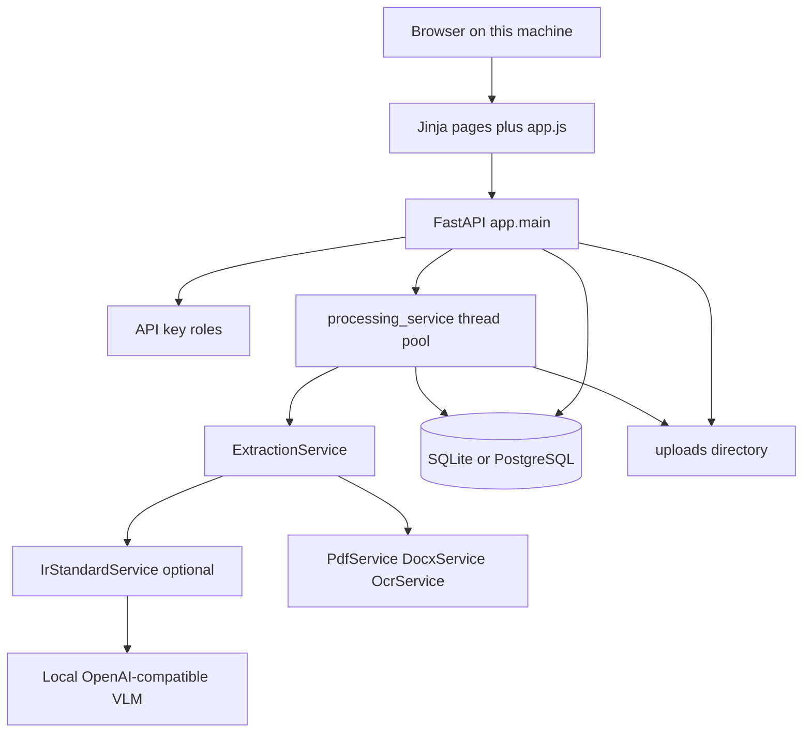
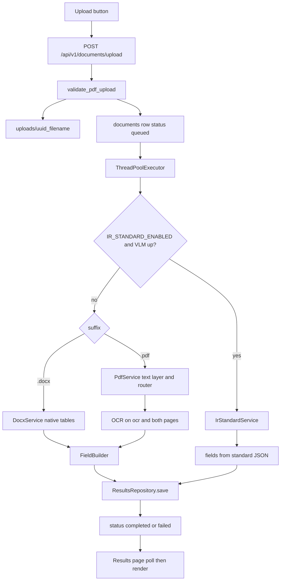
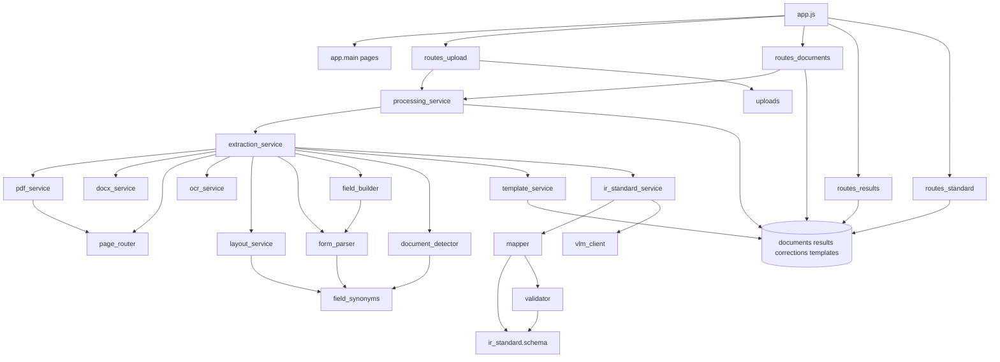

# IR_OCR Application Analysis

**Audit type:** Evidence-based functional and technical review (read-only)  
**Repository:** `IR_OCR`  
**Application name (runtime):** Interrogation Report Extraction Service (`app/config.py`, `APP_NAME`)  
**Package version:** `1.0.0` (`app/__init__.py`)  
**Result schema written by the pipeline:** `2.0.0` (`app/schemas/charge_sheet.py`, `SCHEMA_VERSION`)  
**Standard-template schema:** `ir-standard-1.0` (`app/ir_standard/schema.py`)  
**Date of audit:** 14 October 2026  
**Method:** Static review of routes, services, models, templates, and the browser script. Optional OCR and vision-language engines were not executed in this audit.

Status words used below mean:

| Status | Meaning |
| --- | --- |
| **Implemented** | The code path is present and connected from the caller through storage or the response. |
| **Partially Implemented** | Some of the path exists, but the complete workflow does not finish. |
| **Unverified** | The code suggests the behavior, and this audit did not execute that engine or deployment. |
| **Unused** | The code or endpoint exists, and no active caller in the application was found. |
| **Broken** | An implementation exists and contains an identifiable failure. None of the traced user flows were classified Broken from static evidence alone. |
| **Placeholder** | The UI or code is a stub. None of the main screens are empty stubs. |

Where a live engine was not run, the report says so. Naming, comments, and the README were checked against the code and are not treated as proof by themselves.

---

## Executive Summary

**What it is.** IR_OCR is a local web application that accepts an interrogation-report Word file (`.docx`) or PDF, reads the labels and values printed in that file, stores the result on the same machine, and lets a person correct and later verify the extraction.

**Who uses it.** The intended operators are people handling confidential police interrogation reports on a private workstation: an operator who uploads and corrects, a reviewer who marks a result verified, and an administrator who deletes a document. With the default configuration (`ENABLE_AUTH=false`), only loopback clients are accepted and they act as an unauthenticated operator. That operator can upload, reprocess, and save corrections. Verification and deletion stay closed until named API keys and higher roles are configured.

**Problem it solves.** Interrogation reports (CCTNS / MO Criminal Database Part-II style forms) vary in layout. The default pipeline does not force every document into one fixed field list. It detects the labels and values that are actually printed and keeps them in reading order so a person can review them against the source file. A second, optional mode maps the same upload onto a fixed 32-section standard template and can emit that template as JSON and as a Word document.

**Major capabilities.**

- Upload a PDF or DOCX from a browser, then poll until processing finishes.
- Extract fields from native Word tables, from a PDF text layer, or from local OCR on scanned pages.
- Review, filter, correct, and (with a reviewer key) verify results.
- Download the raw lines that were read, and, when the standard-template mode ran, view a template-shaped JSON.
- List recent documents and reprocess them.
- Keep files, results, and corrections in SQLite (PostgreSQL is supported by configuration) and purge them after a retention period at process start.

**Major workflows.** Upload and process; review and correct; verify; reprocess; optional standard-template mapping; retention purge on startup.

**Key integrations.** All of them are local. PyMuPDF and pdfplumber read PDFs. python-docx and direct OOXML parsing read Word files. PaddleOCR, with a Tesseract fallback, reads scans. An optional local OpenAI-compatible vision-language server (the supplied script targets Nanonets-OCR via llama.cpp on `127.0.0.1`) maps reports onto the standard template. Docling and PaddleOCR-VL are optional and, in the current code, do not feed their text back into the field list.

**Implementation maturity.** The default upload, extraction, review, correction, history, and reprocess path is implemented and covered by tests in `tests/`. Authentication, loopback restriction, upload checks, and retention are implemented. The standard-template path is implemented in code and covered by tests that substitute a fake model client; it is off by default (`IR_STANDARD_ENABLED=false`) and was not run against a live model in this audit.

**Major gaps and risks.**

- The results screen never offers the standard Word download, the blank template download, document delete, or the template catalogue, even though those APIs exist.
- With authentication off, the visible **Mark verified** button always fails, because verification requires an authenticated reviewer.
- PP-Structure table rows and Docling markdown are collected and then not used to build fields. PaddleOCR-VL text is recorded as a review note and is not parsed into fields.
- Template fingerprints are stored, but the stored mapping is never applied to a later document.
- Processing runs in an in-process thread pool. A restart marks in-flight jobs failed. There is no durable queue and no scheduled worker; retention runs only when the process starts.
- The page router’s “form label” patterns are still charge-sheet phrases (FIR, charge sheet, accused, court). Interrogation-report pages that do not contain those words can be routed to OCR even when they have a text layer.
- Images embedded in a DOCX are counted and then skipped. Text that exists only inside those images is not extracted.

---

## 1. Application Overview

### Purpose

The service extracts structured text from interrogation reports and holds that text for human review on the same computer. The FastAPI description in `app/main.py` states the same boundary the code enforces: uploads stay on the host, and external AI APIs are disabled unless an operator deliberately points a local model URL at loopback (or explicitly allows an external URL).

### Problem it solves

A printed or Word interrogation report contains many labelled rows (name, address, identifiers, physical features, family, cases, drugs, SIM cards, and so on). Layouts differ between units. The default extractor (`ExtractionService.process` when `IR_STANDARD_ENABLED` is false) builds one list of fields whose labels and values are the text it detected, in reading order (`app/services/field_builder.py`, `app/schemas/charge_sheet.py`). It does not fill a universal charge-sheet schema.

When `IR_STANDARD_ENABLED` is true and a local vision-language server answers, `IrStandardService` maps the report onto the 32 numbered sections defined in `app/ir_standard/schema.py`. Python validation (`app/ir_standard/validator.py`) drops values the evidence index cannot ground in the source text. Sections the report does not contain stay empty and are flagged.

### Likely users

| Actor | Evidence | What they can do in the default local setup |
| --- | --- | --- |
| Local operator | `Principal` role `operator` when `ENABLE_AUTH` is false (`app/security/auth.py`) | Upload, open results, correct fields, reprocess, open history |
| Authenticated reviewer | Role `reviewer` via `API_KEYS` | Everything an operator can do, plus mark a document verified |
| Administrator | Role `admin` via `API_KEY` (user `default`) or `API_KEYS` | Everything a reviewer can do, plus permanent delete |
| Viewer | Role `viewer` | Read documents and results only |
| Developer / evaluator | `scripts/`, `evaluation/`, `tests/` | Measure extraction offline; not a product screen |

There is no login form and no user table. Identity is an API key in the `X-API-Key` header, stored for the browser tab in `sessionStorage` (`app/static/js/app.js`).

### Major workflows

1. Select a DOCX or PDF, upload it, wait on the results page, read the detected fields.
2. Edit values, save corrections, optionally mark the document verified.
3. Reprocess a document after a pipeline change or a failure.
4. Optionally, with a local model enabled, map the report onto the standard 32-section template and export JSON (UI) or DOCX (API only).
5. On the next process start, delete documents older than `RETENTION_DAYS`.

---

## 2. Architecture / Technology Overview



| Layer | Technology | Where |
| --- | --- | --- |
| HTTP API and HTML | FastAPI, Jinja2, Uvicorn | `app/main.py`, `app/templates/`, `app/api/` |
| Browser UI | One script, no framework | `app/static/js/app.js`, `app/static/css/styles.css` |
| Validation / settings | Pydantic v2, pydantic-settings | `app/config.py`, `app/schemas/` |
| Database | SQLAlchemy 2, SQLite by default, PostgreSQL if `DATABASE_URL` is `postgresql://` | `app/db.py`, `app/models.py` |
| PDF | PyMuPDF (`fitz`), pdfplumber tables | `app/services/pdf_service.py` |
| DOCX | OOXML via `zipfile` + ElementTree; python-docx for standard-template output | `app/services/docx_service.py`, `app/ir_standard/docx_writer.py` |
| OCR | PaddleOCR if installed, else Tesseract if `tesseract` is on PATH | `app/services/ocr_service.py` |
| Optional layout assist | PP-Structure, Docling, PaddleOCR-VL | `structure_service.py`, `docling_service.py`, `vl_service.py` |
| Optional standard IR | Local HTTP chat-completions client | `app/ir_standard/vlm_client.py` |
| Jobs | `ThreadPoolExecutor(max_workers=2)` inside the web process | `app/services/processing_service.py` |
| Privacy control | Socket `connect` / `connect_ex` patch blocking non-local hosts when `OFFLINE_MODE` is true | `app/security/network_guard.py` |

**Not present:** a separate worker process, a message queue, Celery, cron inside the app, a user database, cloud OCR, or a frontend build step.

**Schema note.** `Settings.schema_version` defaults to `"1.0.0"` in `app/config.py` and is never read. The value stored on a document is `ChargeSheetData`’s `"2.0.0"`. Alembic is listed in `requirements.txt` and there is no Alembic directory. Schema changes for existing databases are additive `ALTER TABLE` statements for new nullable columns in `app/db.py` (`_add_missing_columns`).

**Startup (`create_app`).** Logging, network guard, `create_all`, retention purge, and recovery of interrupted jobs all run before the server accepts traffic (`app/main.py`).

---

## 3. Module Inventory

### Screens

| Screen | Route | Template | Script entry | Purpose |
| --- | --- | --- | --- | --- |
| Upload | `GET /` | `app/templates/index.html` | `initUploadPage` | Choose a DOCX or PDF and send it |
| Results | `GET /results/{document_id}` | `app/templates/results.html` | `initResultsPage` | Poll status, show fields, correct, verify |
| History | `GET /history` | `app/templates/history.html` | `initHistoryPage` | List up to 100 documents and reprocess |
| API docs | `GET /docs`, `GET /redoc` | FastAPI | — | Present only when `API_DOCS_ENABLED` is true |
| Shared chrome | all pages | `app/templates/base.html` | `bindApiKeyForm` | Navigation, API key box, health line |

The results route rejects a non-UUID `document_id` with HTTP 404 before rendering (`app/main.py`, `_UUID`).

### API modules

| Module | Prefix | Role |
| --- | --- | --- |
| `app/api/routes_health.py` | `/health` | Process health and which local engines import |
| `app/api/routes_upload.py` | `POST /api/v1/documents/upload` | Accept a file and queue processing |
| `app/api/routes_documents.py` | `/api/v1/documents`, `/api/v1/templates` | List, status, source file, reprocess, delete, template list |
| `app/api/routes_results.py` | `/api/v1/documents/{id}/...` | Results, raw lines, corrections, verify |
| `app/api/routes_standard.py` | `/api/v1/documents/{id}/standard...`, `/api/v1/standard-ir/template.docx` | Standard JSON, template JSON, filled DOCX, blank DOCX |

### Processing and extraction

| Module | Purpose |
| --- | --- |
| `processing_service.py` | Queue, in-memory progress, persist results, recover jobs after restart |
| `extraction_service.py` | Choose standard-template mode or the hybrid OCR pipeline; build `ChargeSheetData` |
| `pdf_service.py` | Text layer, tables, images, route each page native / OCR / both |
| `docx_service.py` | Word tables and headings into the same page model; images are not OCR’d |
| `page_router.py` | Gate 1 routing and Gate 3 OCR acceptance |
| `ocr_service.py` | PaddleOCR then Tesseract |
| `layout_service.py` | OCR boxes to rows, header pairs, reading order |
| `form_parser.py` | Decide which text is a label; strip repeated headers and scanner marks |
| `field_builder.py` | Emit `fields[]` in reading order |
| `field_synonyms.py` / `field_mapping_service.py` | Recognise that a phrase is a label. The printed label is not renamed |
| `document_detector.py` | Classify text as `interrogation_report` or `unknown` and hash a fingerprint |
| `template_service.py` | Remember that fingerprint. It does not reuse a mapping |
| `text_normalize.py`, `value_parsers.py` | Spacing, dates, digits |
| `retention_service.py` | Delete file, results, and corrections; leave a tombstone row |

### Standard-template package (`app/ir_standard/`)

| Module | Purpose |
| --- | --- |
| `schema.py` | The 32 sections, fields, options, and tables. Single source for prompts, validation, and DOCX |
| `sectioner.py` | Split markdown into those sections by title similarity |
| `docx_markdown.py` | DOCX to markdown, keeping bold, ticks, and bullets for the model |
| `mapper.py` | One model call per section; narrative is parsed in Python |
| `evidence.py` | Index ticks, bold, and written answers so the validator can reject ungrounded values |
| `validator.py` | Build the canonical JSON and review flags |
| `paths.py` | Flatten the JSON into the field list the UI already edits |
| `template_json.py` | Same sections and labels as the screen, including empty template fields |
| `docx_writer.py` | Blank or filled DOCX; draft banner until a reviewer verifies |
| `vlm_client.py` | HTTP client that refuses a non-local model URL unless `LLM_ALLOW_EXTERNAL` is true |
| `ir_standard_service.py` | Glue: DOCX or page images in, `standard_ir` plus `fields[]` out |

### Persistence

| Table | Model | Contents |
| --- | --- | --- |
| `documents` | `DocumentRecord` | File metadata, status, page count, scanned flag, template id, verification |
| `results` | `ResultRecord` | `payload_json` (the extraction) and `raw_json` (every line read) |
| `corrections` | `CorrectionRecord` | Field id, original value, corrected value, reviewer, notes |
| `templates` | `TemplateRecord` | Fingerprint, label, unused `mapping_json`, document count |

### Security

| Module | Behavior confirmed in code |
| --- | --- |
| `security/auth.py` | Four roles. Placeholder keys and keys shorter than 16 characters are refused. Auth off means loopback-only operator. |
| `security/files.py` | Size cap, PDF `%PDF` or DOCX `PK` magic, server-side stored name, path confined to `UPLOAD_DIR` |
| `security/network_guard.py` | Blocks outbound sockets to public hosts while offline mode is on |
| `logging_utils.py` | Redacts email, 12-digit id-like numbers, and 10-digit phone-like numbers when `LOG_PII` is false |

### Evaluation and scripts (not product UI)

`evaluation/` and `scripts/evaluate.py`, `evaluate_variants.py`, `run_ir_evaluation.py`, `validation_report.py` score extractions against fixtures. `scripts/run_vlm_server.ps1` starts a loopback llama.cpp server. `scripts/verify_offline.py` checks that the LLM URL stays local. `scripts/generate_sample_pdfs.py` and `scripts/build_blank_template.py` are authoring tools. `run.ps1` creates a venv if needed and starts Uvicorn on `127.0.0.1:8000`.

---

## 4. Feature Inventory

For each feature: **What is it? → Who uses it? → Why is it needed? → How does it work? → What does the user do? → What happens technically? → What is the final outcome?**

### 4.1 Upload and queue

**What.** Accept one interrogation-report PDF or DOCX and start extraction.  
**Who.** Operator (and any higher role).  
**Why.** The report has to enter the machine before anything can be read.  
**How.** The browser posts multipart form field `file`. The server checks type and size, writes a new filename under `UPLOAD_DIR`, inserts a `documents` row, and submits work to a two-thread pool.  
**User action.** Drop or choose a file, then **Upload & process**.  
**Technical path.** `initUploadPage` → `POST /api/v1/documents/upload` → `validate_pdf_upload` → `DocumentRepository.create` → `enqueue_processing` → HTTP 202 with `document_id`.  
**Outcome.** The browser opens `/results/{id}`. Status is `queued` then `processing`.  
**Status.** **Implemented.**

### 4.2 Default field extraction (labels as printed)

**What.** A list of label/value fields in reading order, plus page and stage diagnostics.  
**Who.** Operator reviewing the upload.  
**Why.** The form’s own labels are what the reviewer compares to the paper.  
**How.** DOCX uses native tables (`DocxService`). PDF uses PyMuPDF. Pages with little or suspicious text are rendered and OCR’d. `FieldBuilder` opens a new field when it sees a label and keeps following text until the next label. Synonyms only decide “this phrase is a label”; the stored `label` is the printed text (`form_parser.py` module comment, `field_builder.py`).  
**User action.** Wait on the results page.  
**Technical path.** `process_document` → `ExtractionService.process` → `build_fields` → `ResultsRepository.save` → status `completed` or `failed`.  
**Outcome.** Fields on the results page, or a failure card with stage and page tables.  
**Status.** **Implemented** in code and tests (`tests/test_extraction.py`, `tests/test_field_builder.py`, `tests/test_ir_docx.py`). OCR quality on a given scan is **Unverified** in this audit.

### 4.3 Scanned-page OCR

**What.** Local recognition of pages routed to `ocr` or `both`.  
**Who.** Operator, indirectly, when the PDF has no usable text layer.  
**Why.** Photocopies and scans have no text layer.  
**How.** `PdfService` renders a PNG (`OCR_DPI`, default 200). `OcrService.recognize_png` uses PaddleOCR if importable, otherwise Tesseract. Acceptance uses character count, mean confidence, and label hits (`ocr_accept`). A time budget (`PROCESSING_TIMEOUT_SECONDS`, default 900) skips remaining OCR pages and marks the extraction partial.  
**Outcome.** Fields from OCR lines, with a confidence that the UI labels “OCR confidence (not accuracy)”. If no engine is installed, those pages fail and `/health` reports OCR unavailable.  
**Status.** **Implemented** when an engine is installed. **Unverified** here because this audit did not run Paddle or Tesseract.

### 4.4 Human review, correction, and verification

**What.** Edit detected values, keep the original, and optionally lock the document as verified.  
**Who.** Operator for edits. Reviewer for verification.  
**Why.** Extraction is not treated as final. `requires_human_review` is set true on every successful run (`processing_service.py`).  
**How.** The UI sends only inputs whose value differs from `data-initial`. The API checks each `field_id`, appends `corrections` rows, and sets `corrected_value` without replacing `value`. Verification requires non-empty notes and role `reviewer`. Editing a verified document clears `verified` and returns status to `completed`.  
**Outcome.** Corrected values show in the inputs. A verified document shows the reviewer’s name.  
**Status.** Corrections: **Implemented**. Verification: **Implemented** only when auth is on and the caller has role `reviewer` or `admin`. With the default config the button is visible and the API returns 403. That is the designed rule in `auth.py`, and it is a product gap because the screen does not hide or explain the control before the click.

### 4.5 History and reprocess

**What.** A table of recent uploads and a way to run extraction again.  
**Who.** Operator.  
**Why.** A failed job, an engine install, or a pipeline change needs another run.  
**How.** `GET /api/v1/documents?limit=100`. Reprocess sets status `queued`, clears verification, and enqueues the same stored file. Earlier corrections are reapplied only when the field id still exists and the newly extracted value equals the value that was corrected (`DocumentRepository.reapply_corrections`).  
**Outcome.** A new result. Skipped corrections are mentioned in `extraction_warnings`.  
**Status.** **Implemented** for the first 100 rows. Filters and further pages exist on the API and are **Unused** by the UI.

### 4.6 Raw line view

**What.** Every text line read from the file, in reading order, with OCR confidence when the line came from OCR.  
**Who.** Operator checking what the engine actually saw.  
**Why.** Field detection can drop or join lines. The raw view is the evidence.  
**How.** Stored in `results.raw_json` during processing. The UI loads `GET .../raw` the first time the JSON tab is opened and can copy or download that JSON in the browser.  
**Status.** **Implemented.**

### 4.7 Standard 32-section template (optional)

**What.** Map one report onto a fixed interrogation-report template: narrative plus sections 1–32 (individual particulars through DOPAMS links). See the section list in `app/ir_standard/schema.py` (`SECTIONS`).  
**Who.** Operator who turns on `IR_STANDARD_ENABLED`, `LLM_ENABLED`, `LLM_BASE_URL`, and `LLM_MODEL`.  
**Why.** Downstream consumers want one layout regardless of how the source form was printed.  
**How.** If the model server is up, DOCX is converted to markdown locally and each section is mapped with a text completion. PDF pages are rendered (`VLM_DPI`, default 150) and transcribed by the vision model, then mapped the same way. `build_standard` validates. `fields_from_standard` feeds the existing results table, grouped by `section_title`. If the server is down, the code appends `STANDARD_IR_FALLBACK` and runs the default OCR pipeline instead (`ExtractionService._process_standard`).  
**User action.** Same upload. On the results page, sections replace page groups, and the second tab can show template JSON.  
**Outcome.** `results.standard_ir` plus a field per template value. Empty sections are flagged, not invented.  
**Status.** **Implemented** in code; tests use a fake client (`tests/test_ir_standard.py`, `tests/test_ir_evidence.py`, `tests/test_ir_template_json.py`). Live model behavior is **Unverified** in this audit. The mode is off by default.

### 4.8 Standard DOCX and blank template

**What.** A Word file in the standard layout. Selected options are bold with ☒; others are ☐. Until verification, the file is a draft with “NEEDS REVIEW” marks (`docx_writer.py`, `routes_standard.py`).  
**Who.** An API client. The browser never calls these routes.  
**Why.** A reviewer needs a printable report in one format.  
**How.** `GET /api/v1/documents/{id}/standard.docx` and `GET /api/v1/standard-ir/template.docx`.  
**Status.** Backend **Implemented** (see `tests/test_ir_review_docx.py`). UI **Unused**.

### 4.9 Document type and template memory

**What.** A confidence that the text looks like an interrogation report, plus a hash of normalized labels.  
**Who.** Nobody in the UI. The type appears as “Document type” on the results summary.  
**How.** `DocumentDetector.detect` scores keywords such as “interrogation report”, “cctns”, and “aadhaar” (`document_detector.py`). `TemplateService.remember` upserts `templates`. `mapping_json` is never passed by the pipeline. `match()` is called only to set `previously_seen`. The fuzzy-match branch requires `min_similarity < 1.0` and no production caller passes that.  
**Status.** Classification and fingerprint storage: **Implemented**. Reuse of a verified mapping: **Unused**.

### 4.10 Health, offline mode, and retention

**What.** A status line on every page, a block on outbound network, and deletion of old documents.  
**Who.** The operator sees the status line. Retention is automatic.  
**How.** `GET /health` reports database kind, OCR, PP-Structure, Docling, VL, auth, and whether the LLM flag is both enabled and local. It does not report `IR_STANDARD_ENABLED`. Retention deletes rows older than `RETENTION_DAYS` (default 90; `0` keeps everything) at startup only.  
**Status.** Health and network guard: **Implemented**. Retention: **Implemented** at startup, not on a clock.

### 4.11 Optional assist engines that do not change fields

| Engine | Default | What the code does with the output | Status |
| --- | --- | --- | --- |
| PP-Structure | On (`PPSTRUCTURE_ENABLED=true`) | Tables are stored in `ExtractionService._structure_tables` and never read again. Layout still comes from OCR boxes. | **Partially Implemented** |
| Docling | Off | On native pages, markdown is detected and a note is stored. The comment says native tables may be replaced; the assignments do not copy `dl.markdown` into `page.text`. | **Partially Implemented** |
| PaddleOCR-VL | Off, and GPU required unless `VL_REQUIRE_GPU` is false | For up to five hard pages, text length is appended as an unresolved item. The comment says re-parse is “too heavy”. Fields are unchanged. `vl_pages` is never incremented. | **Partially Implemented** |

---

## 5. Important Button and Action Audit

| Module | User action | What the user expects | What actually happens | Technical flow | Outcome | Status |
| --- | --- | --- | --- | --- | --- | --- |
| Chrome | **Upload** / **History** nav | Open that screen | Browser navigates to `/` or `/history` | Jinja links in `base.html` | The matching page loads and its `init*` runs | **Implemented** |
| Chrome | **API Docs** | Open OpenAPI UI | New tab to `/docs` when `docs_enabled` | FastAPI; CSP allows jsDelivr only on doc paths | Swagger UI, which loads remote assets | **Implemented** when docs are enabled |
| Chrome | **Use key** | Later API calls send the key | Value is trimmed into `sessionStorage` key `ir_api_key`. No server check on save | `bindApiKeyForm` | Message “Key saved for this browser tab.” Health still loads without the key | **Implemented** |
| Upload | Drop zone click, Enter, Space, file input | Choose a file | `showFile` displays name and size and enables the button | Local only | File held in memory until upload | **Implemented** |
| Upload | Drag and drop | Same | `drop` uses the first file | Local only | Same | **Implemented** |
| Upload | **Upload & process** | Extract the report | Client rejects names that are not `.pdf` or `.docx`. XHR posts `file` to `/api/v1/documents/upload` with progress. HTTP 202 redirects to `/results/{id}` | `routes_upload.upload_document` → disk → `documents` row → `enqueue_processing` | Processing starts. Other errors re-enable the button | **Implemented** |
| Results | Automatic refresh | See progress, then fields | Every 2.5 s while status is `uploaded`, `queued`, or `processing`, `GET /api/v1/documents/{id}` | `get_document` attaches in-memory `progress` | Status text, then results or failure | **Implemented** |
| Results | **Open PDF** | See the source | Fetch `GET .../source` with the API key and `window.open` the blob | `get_source_pdf` returns the stored PDF or DOCX inline | PDF opens in a tab. A DOCX is still labelled “Open PDF”; the browser typically downloads it | **Implemented**, label is inaccurate for DOCX |
| Results | Failure **Reprocess** | Try again | `POST .../reprocess`, then `load()` | `reprocess_document` | Status returns to queued | **Implemented** |
| Results | **Fields** / **JSON** or **raw_json** tabs | Switch views | Toggles `tab-fields` and `tab-raw`. Raw or template JSON loads on first open | `GET .../raw` or `GET .../template.json` | Lines or template JSON on screen | **Implemented**. Template option exists only when `results.standard_ir` is present |
| Results | Raw **Page** select | One page of raw lines | Filters the already loaded JSON | Client only | Redraw | **Implemented** |
| Results | **Copy** / **Download JSON** | Take the JSON away | Clipboard, or a Blob download built in the browser. The API’s `?download=true` is not called | Client only | File named `*_raw.json` or `*_template.json` | **Implemented** |
| Results | **Filter by label or value** | Hide non-matching rows | Compares the query to `data-search` on each row | Client only | Rows hidden. No server search | **Implemented** |
| Results | **Save changed fields** | Keep edits | PATCH body `{corrections:[{field_id, corrected_value, review_status:"corrected"}]}` for dirty inputs only | `patch_fields` → `corrections` table and `corrected_value` | Page reloads. Original `value` remains | **Implemented** |
| Results | **Mark verified** | Approve the extraction | POST `{verified:true, notes}` | `verify_document` requires reviewer and non-empty notes | Verified metadata, or 403 for a local unauthenticated operator | **Implemented** on the API; **unusable in the default UI role** |
| Results | **Reprocess** (review card) | Run extraction again | Same POST as history | Clears `verified` | New extraction; matching corrections reapplied | **Implemented** |
| Results | **Correction history** disclosure | See who changed what | On open, `GET .../corrections` | `correction_history` | Table of time, field id, original, corrected value, reviewer | **Implemented** |
| History | Filename link | Open that result | Navigates to `/results/{id}` | Page route | Results screen | **Implemented** |
| History | **Reprocess** | Queue again | POST reprocess, then reload the table | Same as above | Row status becomes queued | **Implemented** |
| History | Filters, next page, delete | A full archive | The table requests `limit=100` and `offset` 0 only. There is no delete control | API supports `status`, `verified`, `limit`, `offset`, and `DELETE` | Documents after the first 100 are not shown. Delete is not offered | **Partially Implemented** |

Actions that exist only as APIs are audited in section 7.

---

## 6. Major Application Workflows

### 6.1 Upload a report and read its fields

**Business terms.** An operator has an interrogation report as Word or PDF and wants every printed label and value on screen, without the system inventing fields the form does not contain.

**Technical terms.**



1. `upload_document` reads the body, rejects empty files, files over `MAX_UPLOAD_SIZE_MB` (default 25), and files that are neither PDF nor DOCX magic.
2. The stored name is `{uuid}_{sanitized original}` (`safe_store_filename`). The client path is not used as a filesystem path.
3. Status moves `uploaded` → `queued` → `processing`.
4. If standard mode is on and `VlmClient.is_up()` fails, a warning is recorded and the default pipeline runs.
5. DOCX: `DocxService.extract` reads `word/document.xml`. Embedded images increment a warning and are not OCR’d.
6. PDF: each page is measured. `decide_route` returns `native`, `ocr`, or `both`. Password-protected PDFs and PDFs over `MAX_PAGES` (default 200) raise and the document becomes `failed`.
7. OCR pages render through PyMuPDF and `OcrService`. Layout becomes `DocItem`s. `drop_page_furniture` removes scanner watermarks and short lines repeated on page edges.
8. `build_fields` produces `PdfField` rows. `DocumentDetector` sets `document_type`. A fingerprint row is upserted.
9. `extraction_status` is `failed` when usable text is under 40 characters, `complete` when every page and stage succeeded and nothing is critically unresolved, otherwise `partial`.
10. The results page stops polling and draws one table per page, or per standard section when `section_title` is set.

**Systems.** Browser, FastAPI, local disk, SQLite, and optionally PaddleOCR/Tesseract or the local VLM.  
**Final outcome.** A stored JSON result and an editable field table, or a failure explanation with no field values (failed results return HTTP 422 and omit extracted values; `routes_results.get_results`).

### 6.2 Correct a value

**Business terms.** The operator sees a wrong value and wants the correction kept, with the machine’s original still available.

**Technical terms.** Dirty inputs become a PATCH to `/api/v1/documents/{id}/fields`. Unknown field ids return 400. Each correction stores `canonical_name` = field id, `original_value` = current `value`, and `corrected_value`. `ResultsRepository.apply_corrections` sets `corrected_value` and `review_status`. If the document was `verified`, status returns to `completed` and `verified` becomes false. The UI prefers `corrected_value` in `shownValue` and can expand the extracted original.

**Final outcome.** The new text is what reviewers see. The extracted string remains in the result JSON and in the correction row.

### 6.3 Verify

**Business terms.** A named reviewer confirms the extraction and records why.

**Technical terms.** `POST .../verify` with `verified: true` and notes. Role must be at least `reviewer`. A correction row with `canonical_name` `_verification` stores the note. Document status becomes `verified`, `verified_by` is the key’s user name, `requires_review` becomes false. The standard DOCX renderer treats that state as final (`ReviewState.final`). The UI never sends `verified: false`, which the API would accept as “back to completed”.

**Final outcome.** The history “Verified” column shows the badge. A later edit or reprocess clears it.

**Default deployment outcome.** HTTP 403, detail that an authenticated reviewer is required (`auth.py`).

### 6.4 Reprocess

**Business terms.** Run the current pipeline on the file already stored.

**Technical terms.** Refuses with 409 if that id is in `_inflight`. Otherwise status `queued`, `verified` false, `requires_review` true, then `process_document` again. Corrections reapply only on an unchanged extracted value for the same field id. Standard mode is attempted again if it is enabled.

**Final outcome.** A new `payload_json` and `raw_json`. The source file is unchanged.

### 6.5 Standard-template mapping

**Business terms.** Produce one canonical interrogation-report shape: the same sections, options, and tables, with blanks where the source is silent, and a draft Word file until a person verifies it.

**Technical terms.**

1. `VlmClient` requires `LLM_ENABLED`, a base URL, a model name, and a loopback URL unless external URLs are explicitly allowed.
2. DOCX: `docx_to_markdown`. PDF: one `transcribe_png` per page using `PAGE_PROMPT` (ticks as ☑, bold as `**`).
3. `split_sections` assigns chunks to section keys. Missing sections are listed, not guessed.
4. Section 0 narrative is parsed by `parse_narrative` (no model regeneration). Other sections call `complete` up to twice if JSON cannot be parsed.
5. `EvidenceIndex` plus `validate_section` remove selections that are not marked in the source and record `review_flags`.
6. `fields_from_standard` creates one `PdfField` per flattened value. Flagged fields get `review_status` `needs_review`.
7. Later, `GET .../template.json` rebuilds a full template document via `build_template_json`, including empty fields. `GET .../standard.docx` calls `render_docx` with reviewer overrides from `corrected_value`.

**Final outcome.** Sectioned fields in the UI, template JSON on the second tab, and a draft or final DOCX only if something calls the DOCX route.

### 6.6 Delete and retention

**Business terms.** Remove a report’s content after review, or automatically after the retention window.

**Technical terms.** `DELETE /api/v1/documents/{id}` requires role `admin` and a document that is not in flight. `delete_document_content` unlinks the file and `purge_content` deletes the result and corrections, sets the filename to `[purged]`, and sets status `deleted`. List and get skip `deleted`. The same function runs for every non-deleted row older than `RETENTION_DAYS` inside `purge_expired`, which `create_app` calls once.

**Final outcome.** The id remains as a tombstone without personal data. The UI has no delete button, so day-to-day deletion is the startup purge or a direct API call.

### 6.7 Restart while a job is running

**Business terms.** The operator expects a crashed run not to sit on “processing” forever.

**Technical terms.** `recover_interrupted` selects `queued` and `processing` rows that are not in the new process’s `_inflight` set and sets them `failed` with the message that the service restarted. Progress lives only in `_progress` and disappears with the process.

**Final outcome.** The results page shows the failure card and **Reprocess**.

---

## 7. Backend / API / Service Mapping

| Method and path | Auth | Handler | Service / storage | Used by UI |
| --- | --- | --- | --- | --- |
| `GET /health` | None | `health` | OCR, structure, Docling, VL import checks | Yes, status line |
| `GET /` `/history` `/results/{id}` | None (HTML only) | `index`, `history_page`, `results_page` | Jinja | Yes |
| `POST /api/v1/documents/upload` | operator | `upload_document` | disk, `documents`, thread pool | Yes |
| `GET /api/v1/documents` | viewer | `list_documents` | `documents` | Yes, `limit=100` only |
| `GET /api/v1/documents/{id}` | viewer | `get_document` | `documents` + in-memory progress | Yes |
| `GET /api/v1/documents/{id}/source` | viewer | `get_source_pdf` | `uploads/` | Yes |
| `POST /api/v1/documents/{id}/reprocess` | operator | `reprocess_document` | thread pool | Yes |
| `DELETE /api/v1/documents/{id}` | admin | `delete_document` | file unlink, tombstone | **No** |
| `GET /api/v1/templates` | viewer | `list_templates` | `templates` | **No** |
| `GET /api/v1/documents/{id}/results` | viewer | `get_results` | `results.payload_json`, corrections | Yes |
| `GET /api/v1/documents/{id}/raw` | viewer | `get_raw` | `results.raw_json` | Yes. `download=true` **Unused** (UI builds the file itself) |
| `GET /api/v1/documents/{id}/corrections` | viewer | `correction_history` | `corrections` | Yes |
| `PATCH /api/v1/documents/{id}/fields` | operator | `patch_fields` | results + corrections | Yes |
| `POST /api/v1/documents/{id}/verify` | reviewer | `verify_document` | `documents`, corrections | Yes, only `verified: true` |
| `GET /api/v1/documents/{id}/standard` | viewer | `get_standard` | `standard_ir` plus correction overrides | **No** |
| `GET /api/v1/documents/{id}/template.json` | viewer | `get_template_json` | `build_template_json` | Yes, when standard mode produced `standard_ir` |
| `GET /api/v1/documents/{id}/standard.docx` | viewer | `get_standard_docx` | `render_docx` | **No** |
| `GET /api/v1/standard-ir/template.docx` | viewer | `get_blank_template` | `render_docx(None)` | **No** |

`require_api_key` is `require_role("viewer")`. Higher roles include lower ones (`ROLE_ORDER` in `auth.py`).

### Component to feature

| Component | Features that call it | Called in the default configuration |
| --- | --- | --- |
| SQLite `data/ir_reports.db` | Every document, result, correction, template | Yes |
| `uploads/` | Source download, processing, delete | Yes |
| PyMuPDF | PDF text, render for OCR and for VLM | Yes for PDF |
| PaddleOCR / Tesseract | Scanned and suspicious pages | Only if installed. Health reports availability |
| PP-Structure | OCR pages, tables discarded | Attempts when Paddle is installed |
| Docling | Native form-like pages | No (`DOCLING_ENABLED=false`), and output is unused even if enabled |
| PaddleOCR-VL | Hard pages | No (`VL_ENABLED=false`), and output is not merged |
| Local VLM | Standard template | No until `IR_STANDARD_ENABLED` and `LLM_*` are set |
| Thread pool | Upload and reprocess | Yes |
| Network guard | All sockets while offline | Yes (`OFFLINE_MODE=true`) |

### Frontend without a matching screen, and backend without a screen

| Finding | Evidence | Status |
| --- | --- | --- |
| Delete, template list, standard JSON, standard DOCX, blank DOCX | Routes in `routes_documents.py` and `routes_standard.py`; no matching `fetch` in `app/static/js/app.js` | **Unused** by the UI |
| `DocumentFilter` model | `app/schemas/document.py`; list route uses query parameters directly | **Unused** |
| `accused_numbering_gaps` | `page_router.py`; referenced only from `tests/test_page_router.py` | **Unused** in the pipeline |
| `Settings.schema_version` | Defined, never read | **Unused** configuration |
| Alembic | `requirements.txt` only | **Unused** |
| `templates.mapping_json` | Column and repository parameter; `ExtractionService._remember_template` never passes a mapping | **Unused** |
| `TemplateService.match` fuzzy branch | Requires `min_similarity < 1`; the only caller uses the default `1.0` | **Unused** |
| `ReviewStatus.REJECTED` | Enum and PATCH accept it; the UI only sends `corrected` | **Unused** by the UI |
| `vl_pages` | Increment never happens; the “VL on N” stage detail cannot appear from this counter | **Unused** |
| Verify with `verified: false` | `VerifyRequest.verified` defaults true; UI always posts true | API **Implemented**, UI **Unused** |

No product button was found that calls a route that does not exist. The gap is the other way: several finished routes have no button.

---

## 8. User Roles

Roles are inclusive: viewer < operator < reviewer < admin (`app/security/auth.py`).

| Role | How it is assigned | Can access | Can do | Cannot do | Workflows |
| --- | --- | --- | --- | --- | --- |
| Unauthenticated local operator | `ENABLE_AUTH=false` and client host in `127.0.0.1`, `::1`, `localhost`, `testclient` | Upload, history, results, source, raw, template JSON if present | Upload, reprocess, save corrections | Verify, delete. Non-loopback clients receive 403 | Upload, review, correct, reprocess |
| viewer | `API_KEYS=name:secret:viewer` | Read APIs including source file and standard downloads | List, open, download JSON/DOCX via API | Upload, correct, reprocess, verify, delete | Read-only review |
| operator | `API_KEYS` role `operator` | Viewer access plus write | Upload, reprocess, corrections | Verify, delete | Daily capture and correction |
| reviewer | `API_KEYS` role `reviewer` | Operator access | `POST .../verify` | Delete | Sign-off. This is what makes a standard DOCX “final” |
| admin | `API_KEY` as user `default`, or `API_KEYS` role `admin` | All of the above | `DELETE .../documents/{id}` | — | Disposal of a single report |

The HTML pages themselves are not role-gated. Any browser that can open `127.0.0.1:8000` can load the screens. Data calls enforce the role. The **Mark verified** and (absent) delete controls are not hidden per role.

There is no per-document ownership. Any key of sufficient role sees every document in the database.

---

## 9. Functional Use Cases

### UC-1 Capture an interrogation report from Word

```text
Use case: Read a native IR Word form
Actor: Operator
Trigger: A .docx interrogation report is available
User actions: Open /, drop the file, Upload & process, wait on /results/{id}
Application processing: Magic-byte check, store file, DocxService tables and headings,
  FieldBuilder labels as printed, classify, save JSON
Systems: FastAPI, uploads/, SQLite, python OOXML parse
Final outcome: One field per detected label, grouped by the synthetic DOCX "page"
  (DocxService builds a single native page model). Images inside the DOCX are not read.
```

### UC-2 Capture a digital PDF

```text
Use case: Read a text-layer PDF
Actor: Operator
Trigger: PDF upload
User actions: Same as UC-1
Application processing: PyMuPDF text and tables, decide_route mostly native,
  FieldBuilder, save
Systems: PyMuPDF, pdfplumber, SQLite
Final outcome: Fields in reading order plus a raw line list
```

### UC-3 Capture a scanned PDF

```text
Use case: Read a photocopy
Actor: Operator
Trigger: PDF whose pages fail the native-text gates
User actions: Upload and wait. The UI text says scanned pages take roughly 30–40 seconds each on the development machine
Application processing: Render PNG, PaddleOCR or Tesseract, layout boxes, FieldBuilder.
  Budget expiry marks remaining pages partial
Systems: PyMuPDF, local OCR, SQLite
Final outcome: Fields with OCR confidence, or a failed document if no engine is installed or no text is found
Status: Implemented; engine output Unverified in this audit
```

### UC-4 Correct and record the change

```text
Use case: Fix a wrong value without losing the extraction
Actor: Operator
Trigger: A field on the results page is wrong
User actions: Edit the input, Save changed fields, optionally open Correction history
Application processing: PATCH fields, insert corrections, set corrected_value
Systems: results JSON, corrections table
Final outcome: Screen shows the correction; extracted value remains under the disclosure
```

### UC-5 Supervisory verification

```text
Use case: Attribute a reviewed result to a person
Actor: Reviewer with an API key
Trigger: Corrections are acceptable
User actions: Enter notes, Mark verified
Application processing: POST verify, status verified, note stored as _verification
Systems: documents.verified, documents.verified_by, corrections
Final outcome: History shows verified. Standard DOCX, if requested by API, omits the draft banner
Default config: the same click returns 403
```

### UC-6 Produce the standard 32-section pack

```text
Use case: One canonical IR regardless of the source layout
Actor: Operator, after enabling the local VLM
Trigger: IR_STANDARD_ENABLED and a reachable loopback model
User actions: Upload as usual; open the JSON tab and choose Template JSON
Application processing: Transcribe pages or read DOCX markdown, map each section,
  validate against evidence, flatten to fields
Systems: Local VLM HTTP API, ir_standard package, SQLite
Final outcome: Sectioned review screen and template JSON.
  Word download is available only by calling GET .../standard.docx
Status: Code Implemented; live model Unverified here
```

### UC-7 Recover a failed or outdated extraction

```text
Use case: Run the pipeline again on the same file
Actor: Operator
Trigger: Failure card, legacy REPROCESS_REQUIRED warning, or a new engine install
User actions: Reprocess on the results page or history row
Application processing: Status queued, previous verification cleared, full process_document,
  selective correction replay
Systems: stored file, thread pool, results row replaced
Final outcome: New extraction. Corrections whose source value changed are skipped and warned
```

### UC-8 Dispose of content

```text
Use case: Remove report content after the retention period, or on demand
Actor: Process startup (automatic) or admin (API)
Trigger: created_at older than RETENTION_DAYS, or DELETE
User actions: None in the UI
Application processing: Unlink file, delete result and corrections, tombstone the document row
Systems: uploads/, documents, results, corrections
Final outcome: Later reads return 404. The id remains with filename [purged]
```

### UC-9 Check that the service is local and which engines loaded

```text
Use case: See whether OCR and auth are actually on
Actor: Any visitor of the HTML pages
Trigger: Page load
User actions: Read the line under the title
Application processing: GET /health
Systems: import checks only; no document is read
Final outcome: Text such as authentication state, OCR engine or "OCR unavailable",
  PP-Structure, Docling, VL, offline mode
```

---

## 10. Module Dependencies



**Direct.** The UI talks only to FastAPI. Processing is the only writer of extraction results. The standard package is entered only from `ExtractionService._process_standard` and from `routes_standard` (read side).

**Shared state.** `documents.id` links results, corrections, and the template id. Field ids in corrections must match `PdfField.id`. In-memory `_inflight` and `_progress` are process-local and are not in the database.

**Shared services.** `field_synonyms` is shared by label recognition, layout, and document type detection. It does not define the JSON the UI saves. `SECTIONS` in `ir_standard/schema.py` is shared by the prompt, the validator, the template JSON, and the DOCX writer.

**Cross-module workflow.** A correction saved by `routes_results` is replayed by `processing_service` on the next extraction, and is applied as an override by `routes_standard.apply_overrides` when building standard JSON or DOCX. Verification state written by `routes_results` changes the DOCX banner in `routes_standard._review_state`.

---

## 11. Implementation Status

| Feature | UI location | API / route | Backend | Data / storage | External integration | Status |
| --- | --- | --- | --- | --- | --- | --- |
| Upload PDF/DOCX | `index.html` drop zone, **Upload & process** | `POST /api/v1/documents/upload` | `routes_upload`, `processing_service` | `uploads/`, `documents` | None | **Implemented** |
| Progress polling | `results.html` | `GET /api/v1/documents/{id}` | `get_progress` | In-memory, then `documents.status` | None | **Implemented** |
| DOCX native extraction | Results field tables | Same upload | `DocxService`, `FieldBuilder` | `results.payload_json` | None | **Implemented**. Embedded images skipped |
| Digital PDF extraction | Results field tables | Same | `PdfService`, `FieldBuilder` | `results` | PyMuPDF, pdfplumber | **Implemented** |
| Scanned OCR | Results, health line | Same | `OcrService` | `results`, optional page text if `STORE_PAGE_TEXT` | PaddleOCR or Tesseract, local | **Implemented** if an engine imports; **Unverified** at runtime in this audit |
| Page routing | Pipeline stages disclosure | Inside results JSON | `page_router.decide_route` | `page_summaries` | None | **Implemented**. Label list is still charge-sheet vocabulary |
| Label/value fields | Fields tab | `GET .../results` | `field_builder` | `results.payload_json` `fields` | None | **Implemented** |
| Document classification | Summary “Document type” | Inside results | `DocumentDetector` | `documents.classification_confidence`, `templates` | None | **Implemented** as a label, not as a mapping |
| Template catalogue | None | `GET /api/v1/templates` | `TemplateService.list_profiles` | `templates` | None | API **Implemented**, UI **Unused**. Mapping reuse **Unused** |
| Raw lines | JSON / raw_json tab | `GET .../raw` | `ExtractionService._raw_document` | `results.raw_json` | None | **Implemented** |
| Field filter | Search box on results | None | None | Browser DOM | None | **Implemented** client-side |
| Save corrections | **Save changed fields** | `PATCH .../fields` | `ResultsRepository.apply_corrections` | `corrections`, `fields[].corrected_value` | None | **Implemented** |
| Correction history | Disclosure on results | `GET .../corrections` | `DocumentRepository.correction_history` | `corrections` | None | **Implemented** |
| Verify | **Mark verified** | `POST .../verify` | `verify_document` | `documents.verified`, `verified_by` | None | **Implemented** for reviewer keys. Default UI role receives 403 |
| Reprocess | Results and history buttons | `POST .../reprocess` | `enqueue_processing` | Same file, replaced `results` | None | **Implemented** |
| History list | `history.html` | `GET /api/v1/documents` | `DocumentRepository.list` | `documents` | None | **Partially Implemented** (first 100, no filters) |
| Open source | **Open PDF** | `GET .../source` | `FileResponse` | `uploads/` | None | **Implemented** |
| Delete one document | None | `DELETE .../documents/{id}` | `retention_service.delete_document_content` | Tombstone | None | API **Implemented**, UI **Unused** |
| Retention purge | None | Startup only | `purge_expired` | Files and rows older than `RETENTION_DAYS` | None | **Implemented** at startup |
| Standard template extraction | Section groups on results | Inside processing | `IrStandardService`, `mapper`, `validator` | `results.standard_ir` and `fields` | Local VLM | **Implemented** in code, off by default, live model **Unverified** |
| Template JSON | JSON tab when `standard_ir` is set | `GET .../template.json` | `build_template_json` | Derived from `standard_ir` | None | **Implemented** when standard mode ran |
| Standard DOCX | None | `GET .../standard.docx` | `render_docx` | Derived; draft vs final from `verified` | None | API **Implemented**, UI **Unused** |
| Blank template DOCX | None | `GET /api/v1/standard-ir/template.docx` | `render_docx(None)` | Generated, not the file under `ir_standard/templates/` as the HTTP body | None | API **Implemented**, UI **Unused** |
| PP-Structure | Mentioned on the health line and page summary | Inside OCR pages | `StructureService.analyze_png` | Note / engine name only | Paddle, local | **Partially Implemented** |
| Docling assist | Health line | Inside native pages when enabled | `DoclingService.analyze_pdf_page` | `docling_used` flag | Docling, local, off by default | **Partially Implemented** |
| PaddleOCR-VL assist | Unresolved list text | `_maybe_vl_escalate` | `VlService.analyze_png` | Unresolved item only | Local GPU pipeline, off by default | **Partially Implemented** |
| API key prompt | Header card | All `/api/v1` routes | `get_principal` | `sessionStorage` only | None | **Implemented**. Hidden when `/health` says auth is off |
| Offline network block | Health “offline mode” | Process-wide | `install_network_guard` | None | Blocks non-local sockets | **Implemented** as an in-process patch, not a firewall |
| Legacy 1.x results | Warning banner | `ChargeSheetData._load_legacy` | Drops old fixed fields | Existing `payload_json` | None | **Implemented** as a reprocess prompt |
| Evaluation scripts | None | None | `evaluation/`, `scripts/evaluate*.py` | Fixture JSON | Optional local VLM for IR eval | **Implemented** as offline tools, not a user workflow |

**Broken:** no user-facing flow was shown to fail unconditionally by a coding error in the static trace. The verification button fails under the default configuration by an explicit authorization check.

**Placeholder:** the API key box is a real control, not a stub. Empty LLM settings are rejected by `VlmClient` rather than simulated.

---

## 12. Gaps / Issues / Unused Functionality

### Product gaps

1. **Standard Word output is invisible.** `get_standard_docx` and `get_blank_template` are complete and tested. `app.js` never requests them. An operator who enables the VLM still cannot download the canonical DOCX from the results page.

2. **Verification is offered and then refused in the default deployment.** `base.html` always renders the results script path that draws **Mark verified**. `get_principal` with `ENABLE_AUTH=false` returns role `operator`. `require_role("reviewer")` returns 403. The failure appears only after the click.

3. **Delete is admin-only and has no screen.** Operators cannot dispose of a single report from History. Disposal is the startup retention job, which deletes every document older than 90 days, verified or not (`purge_expired` filters on `created_at` and status not `deleted` only).

4. **History is a single page of 100.** `list_documents` supports `status`, `verified`, `limit` (max 200), and `offset`. The script requests `limit=100` and does not read `total`.

5. **DOCX images are skipped.** `DocxService.extract` warns and does not render or OCR `word/media/*`. A Word file whose content is a scanned picture yields little or no text.

6. **`MAX_PAGES` applies when PyMuPDF opens a PDF.** `DocxService.extract` does not consult `max_pages`. A large DOCX is limited by upload size, not by page count.

### Pipeline gaps

7. **PP-Structure tables are discarded.** Assignment to `self._structure_tables` in `_run_page_pipeline` has no reader. Field building uses OCR boxes and PDF tables.

8. **Docling markdown is discarded.** After `analyze_pdf_page`, the code sets `summary.docling_used` and a note. It does not assign the markdown to the page text. The nearby comment (“Prefer Docling markdown when native tables look weak”) describes a step the function does not perform.

9. **VL escalation does not repair fields.** `_maybe_vl_escalate` appends `vl_assist` / `vl_error` unresolved items. It does not call `FieldBuilder` again. It also runs only when `unresolved.needs_review` is already true, which `_build_unresolved` sets only for `severity == "critical"` (`page_failed`). Partial pages alone do not set `needs_review`, so the VL branch often does not start.

10. **`vl_pages` is dead.** It is initialized to 0 and checked when building the stage detail. Nothing increments it. VL usage is recorded on the page summary inside `_maybe_vl_escalate`, which runs after that stage result is already appended.

11. **Template memory does not affect extraction.** Fingerprints are stored and `previously_seen` is set. `mapping_json` stays null. A second document with the same fingerprint is extracted from scratch.

12. **Charge-sheet routing vocabulary remains in the IR router.** `_LABEL_PATTERNS` in `page_router.py` matches district, police station, FIR, charge sheet, acts, accused, witness, court, BNSS, CrPC. `count_label_hits` uses that list for OCR acceptance. IR-only pages can score zero label hits and be sent to OCR (`decide_route`: char count under 80 and `label_hits == 0`). `field_synonyms.py` and `DocumentDetector` do contain interrogation-report phrases; the router does not use them.

13. **`accused_numbering_gaps` is test-only.** It is not called from extraction, so missing accused numbers are not reported as unresolved items.

### Configuration and leftovers

14. **`Settings.schema_version` (`"1.0.0"`) is unused.** Stored results use `"2.0.0"`. The package docstring in `app/__init__.py` still says “Charge Sheet PDF Extraction and Data Mapping Service.” The browser global is `window.ChargeSheetApp` (`app.js`). Behavior follows the interrogation-report pipeline, not that name.

15. **Alembic is an unused dependency.** Migrations that do exist are nullable-column alters in `db.py`. A new non-nullable column would not be added to an existing table.

16. **Health omits standard-template readiness.** `llm_enabled` is reported only as “enabled and local”. `IR_STANDARD_ENABLED` and `VlmClient.is_up()` are not on `/health`, so the status line cannot tell the operator that uploads will use the VLM.

17. **Jobs are not durable.** Two threads, in-memory progress, and fail-on-restart. A second Uvicorn process would not share `_inflight`, so the 409 “already processing” guard is per process.

18. **Retention is not scheduled.** A process that stays up longer than `RETENTION_DAYS` does not purge until the next start.

19. **`STORE_PAGE_TEXT` defaults false.** Page summaries then omit native and OCR text. The separate `raw_json` still stores every line. That is intentional in config comments and is easy to miss because both stores hold page text.

20. **No TODO/FIXME markers** were found in application Python or JavaScript. The gaps above are unfinished wiring, not commented stubs.

### Inconsistent behavior

| Topic | What the user sees | What the code does |
| --- | --- | --- |
| Source link | “Open PDF” | Serves DOCX when the original name ends with `.docx` |
| OCR confidence | Labelled “not accuracy” | Mean of OCR line confidences only; native PDFs show “—” |
| “Scanned (OCR)” | yes / no | True when any page `text_source` is not `native`, including `both` and VLM `vlm` |
| Complete vs partial | Badge | `complete` also requires no critical unresolved items and no failed or degraded stages |
| Legacy results | Banner asking for reprocess | 1.x JSON loads with an empty `fields` list and `REPROCESS_REQUIRED` (`charge_sheet.py`) |
| Standard fallback | Ordinary field list, plus a warning if the client reads `extraction_warnings` | VLM errors do not fail the document; the OCR pipeline runs and prefixes `STANDARD_IR_FALLBACK` |

---

## 13. Evidence and Code References

Paths are relative to the repository root.

| Finding | Evidence |
| --- | --- |
| Three screens and UUID check | `app/main.py` routes `/`, `/results/{document_id}`, `/history` |
| Upload accepts PDF and DOCX, returns 202, queues work | `app/api/routes_upload.py` `upload_document`; `app/security/files.py` `validate_pdf_upload` |
| Client upload, poll, correct, verify, history | `app/static/js/app.js` `initUploadPage`, `initResultsPage`, `initHistoryPage` |
| No UI calls to delete, templates, standard DOCX, or `/standard` | Search of `app/static/js/app.js` finds `template.json`, `/raw`, `/fields`, `/verify`, `/reprocess`, `/source` only |
| Default pipeline vs standard pipeline | `app/services/extraction_service.py` `process`, `_process_standard` |
| Labels are not renamed | `app/services/field_builder.py` module docstring; `app/services/form_parser.py` `recognise` |
| DOCX images skipped | `app/services/docx_service.py` `extract` warning when `word/media/` images exist |
| OCR engines | `app/services/ocr_service.py` `OcrService.recognize_png` |
| Router label list | `app/services/page_router.py` `_LABEL_PATTERNS`, `decide_route`, `count_label_hits` |
| PP-Structure stored and not read | `extraction_service.py` `_structure_tables` assignment; no other read in `app/` |
| Docling flag without text merge | `extraction_service.py` inside `_run_page_pipeline` native branch |
| VL does not rebuild fields | `extraction_service.py` `_maybe_vl_escalate` |
| 32 sections | `app/ir_standard/schema.py` `SECTIONS` |
| Model refused unless local | `app/ir_standard/vlm_client.py` `VlmClient.__init__` |
| Narrative not rewritten by the model | `app/ir_standard/mapper.py` `parse_narrative` |
| Evidence gate | `app/ir_standard/validator.py` `build_standard`; `app/ir_standard/evidence.py` `EvidenceIndex` |
| Draft vs final DOCX | `app/api/routes_standard.py` `_review_state`; `app/ir_standard/docx_writer.py` `ReviewState` |
| Roles and loopback operator | `app/security/auth.py` `get_principal`, `require_role` |
| Tables | `app/models.py` `DocumentRecord`, `ResultRecord`, `CorrectionRecord`, `TemplateRecord` |
| Corrections replay | `app/repositories/document_repository.py` `reapply_corrections` |
| Retention and tombstone | `app/services/retention_service.py`; `purge_content` |
| Restart recovery | `app/services/processing_service.py` `recover_interrupted` |
| Offline sockets | `app/security/network_guard.py` `install_network_guard` |
| Unused schema version setting | `app/config.py` `schema_version`; no other read |
| Result schema 2.0.0 and legacy loader | `app/schemas/charge_sheet.py` |
| Health engines | `app/api/routes_health.py` |
| Tests that lock the main behaviors | `tests/test_api.py`, `tests/test_extraction.py`, `tests/test_ir_docx.py`, `tests/test_ir_standard.py`, `tests/test_ir_review_docx.py`, `tests/test_security.py`, `tests/test_field_builder.py` |

**Evidence insufficient to verify.** This audit did not start the server, did not upload a sample report, and did not call PaddleOCR, Tesseract, Docling, PaddleOCR-VL, PostgreSQL, or a live llama.cpp server. Whether those engines succeed on a given interrogation report is outside what the source alone can confirm. The code paths above are what will run if those engines are present and the corresponding flags are on.

---

## 14. Overall Application Summary

### What the Application Does

IR_OCR is a local interrogation-report extraction and review application. A person uploads a DOCX or PDF. The service reads the file on that computer, detects the labels and values printed in it, and shows them for correction. If a local vision-language model is enabled, it instead maps the report onto a fixed 32-section standard template and can emit that template as JSON and, through the API, as Word. Results stay in a local database until a retention purge or an administrator delete removes them.

### Primary Users

Operators who capture and correct reports, reviewers who sign them off when authentication is enabled, and administrators who delete them. In the shipped default, the only interactive user is a loopback operator who cannot verify or delete.

### Major Capabilities

Upload, native Word extraction, digital PDF extraction, local OCR for scans, human correction with an audit trail, verification for reviewer keys, reprocess, history, raw line inspection, optional standard-template mapping, and startup retention. Health and an offline network guard support private deployment.

### Major Business Use Cases

Read a Word interrogation form; read a digital or scanned PDF; correct values while keeping the original; have a named reviewer verify; optionally normalize the report to the 32-section standard; reprocess after a failure; purge aged content.

### Key Technical Components

FastAPI and a single browser script; SQLAlchemy on SQLite or PostgreSQL; files under `uploads/`; PyMuPDF and an OOXML reader; PaddleOCR or Tesseract; an in-process thread pool; an optional loopback OpenAI-compatible vision model; the `app/ir_standard` package for schema, evidence checks, and DOCX rendering.

### Implementation Status

The default capture and review loop is implemented end to end in code: upload, queue, extract, store, poll, display, filter, correct, list, and reprocess. Authorization matches the role table. The standard-template path is implemented and tested with a fake model, and it is off unless configured. Word download of that template, document delete, and the template list are implemented as APIs and unused by the screens. PP-Structure, Docling, and PaddleOCR-VL run far enough to record that they ran, and their text is not turned into fields.

### Major Gaps / Risks

The results page cannot download the standard DOCX. Verification is shown to users who are not allowed to verify. History stops at 100 rows. Assist engines do not improve the field list. Template fingerprints are not reused. The page router still looks for charge-sheet phrases. Embedded images in Word files are ignored. Jobs vanish on restart except for a failed status. Retention runs only at startup and does not spare verified documents. This audit did not execute OCR or the vision model, so recognition quality on real reports remains unverified.

### Overall Assessment

IR_OCR is a working local tool for turning an interrogation-report DOCX or PDF into a reviewable list of printed fields, with a serious optional second mode that normalizes the same file onto a 32-section police template. The core workflow a local operator can complete without extra services is upload, wait, read, correct, and reprocess. Sign-off, disposal from the screen, printable standard output, and the optional layout engines are either role-gated away from the default user or only partly connected. Treat the application as a confidential single-machine review desk, not as a finished multi-user case system.

---

*End of audit. No application source files were modified to produce this document.*
